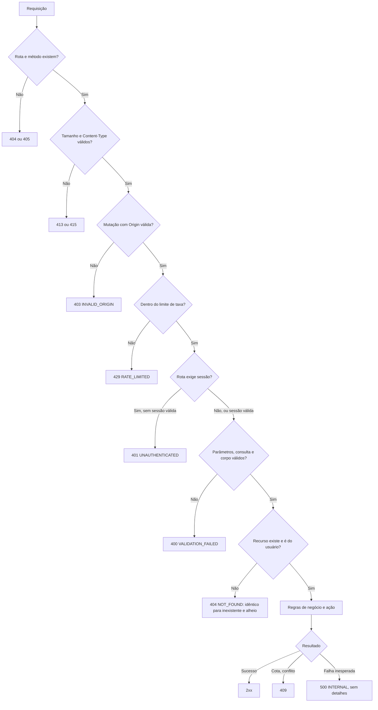
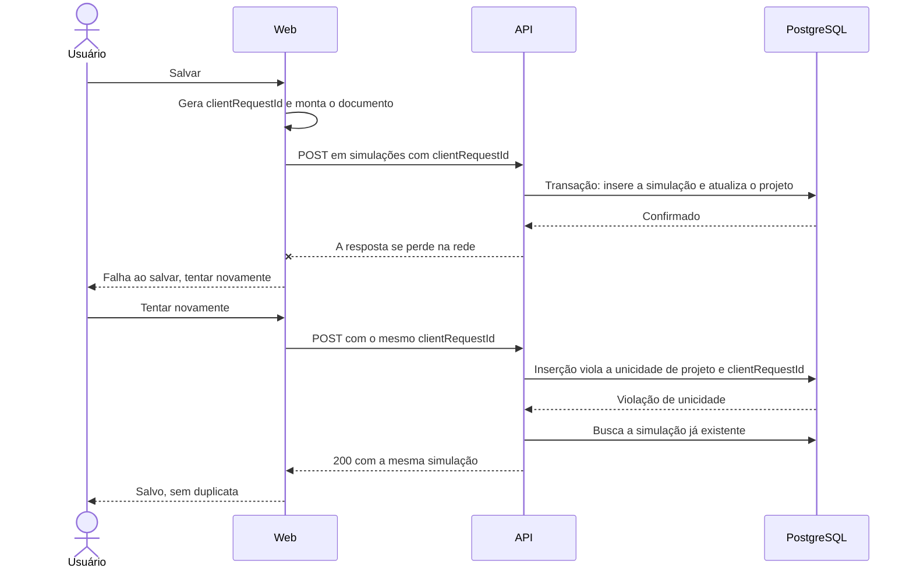

# DataStructure Studio — Contratos da API REST (MVP)

> **Versão:** 0.1 (rascunho para validação)
> **Data:** 14/11/2026
> **Base:** `REQUIREMENTS.md`, `USE_CASES.md`, `USER_FLOWS.md`, `ARCHITECTURE.md` (seções 9, 10.6, 13 e 14) e ADR-0006 a ADR-0009
> **Documento complementar:** [`DATABASE.md`](DATABASE.md) (modelo de dados e decisões pendentes Q44 a Q64)
> **Escopo:** define **o contrato HTTP** do MVP. **Não** implementa endpoints, não contém código nem migrations. Os exemplos em JSON são **ilustrações do contrato**.

---

## 1. Como ler este documento

- ✅ **Confirmado:** vem de requisito, de ADR aceito ou de decisão do autor.
- 💡 **Proposta:** recomendação deste documento, aguardando aprovação.
- ❓ **Pendente:** decisão necessária antes de implementar (seção 10; numeração continua a dos documentos anteriores, **Q44 a Q64**).
- Valores numéricos (limites, taxas, tamanhos) são 💡 sugestões, salvo indicação contrária.
- **Terminologia:** o contêiner de simulações é o **Projeto** (`project`), conforme os requisitos. A "Workspace" do pedido é tratada como o mesmo conceito (❓ Q44, ver `DATABASE.md` seção 4.1). Se o nome mudar, só mudam as rotas e os nomes dos campos.
- **Identificadores de endpoint:** E-01 a E-13.

---

## 2. Convenções gerais

### 2.1 Formato e transporte

| Tema | Convenção |
|---|---|
| Prefixo | Todas as rotas começam com `/api`. Rota inexistente sob `/api` devolve **JSON `404 NOT_FOUND`**, nunca a página do SPA (a API serve o SPA em produção, ADR-0012) |
| Formato | JSON em UTF-8. Corpos exigem `Content-Type: application/json`; caso contrário, **415** |
| Versionamento | Sem prefixo de versão no MVP; o que se versiona é o **formato do documento de simulação** (ADR-0006) |
| Origem | **Mesma origem**; não há CORS e nenhum cabeçalho `Access-Control-*` é enviado |
| Datas | ISO 8601 em UTC (ex.: `2026-11-14T08:30:00.000Z`) |
| Identificadores | UUID em texto. Identificador malformado em rota ou consulta → **400** `VALIDATION_FAILED` (❓ Q61) |
| Cache | Respostas que contêm dados do usuário levam `Cache-Control: no-store` |
| Rastreio | Toda resposta inclui o cabeçalho `X-Request-Id` (o mesmo valor vai no envelope de erro) |
| Métodos | Apenas os listados; outros métodos devolvem `405` com o envelope padrão |

### 2.2 Autenticação

- **Sessão por cookie** `httpOnly`, `Secure` (produção), `SameSite=Lax` (ADR-0009). O cliente **nunca** vê o token.
- Cada endpoint indica se é **Pública** ou **Autenticada**. Sem sessão válida, um endpoint autenticado devolve **401** `UNAUTHENTICATED` (que aciona o diálogo D-05 no Front-end).

### 2.3 Proteção de mutações (CSRF)

Para `POST`, `PATCH` e `DELETE` (💡):

1. `Content-Type: application/json` quando há corpo;
2. cabeçalho `Origin` **presente e igual** à origem da aplicação; ausente ou diferente → **403** `INVALID_ORIGIN` (❓ Q62; os testes de integração precisam enviar a origem).

Métodos de leitura (`GET`) não alteram estado e dispensam a verificação.

### 2.4 Normalização e validação de entrada

| Regra | Descrição |
|---|---|
| **Validação no servidor sempre** | Mesmo que o cliente já tenha validado (RNF-003) |
| **Esquemas estritos** | Campos desconhecidos são **rejeitados** (`NOT_ALLOWED`); nunca se repassa o corpo ao banco (proteção contra *mass assignment*) |
| **Texto** | Espaços nas pontas removidos; 💡 normalização Unicode NFC; caracteres de controle rejeitados |
| **E-mail** | Minúsculas e sem espaços nas pontas |
| **Texto vazio opcional** | `description` vazia é tratada como ausente (`null`) |
| **Fonte única dos limites** | Limites de produto vêm da Engine (RN-002) via `contracts`; a API não os repete à mão |
| **Corpo limitado** | 💡 16 KB por padrão; 48 KB em `POST` de simulações → **413** `PAYLOAD_TOO_LARGE` |

### 2.5 Ordem de verificação de uma requisição



**Por que validar o formato antes de checar o dono:** a validação **não depende do recurso**; portanto uma requisição malformada recebe 400 tanto para recurso próprio quanto alheio e o resultado não revela existência. Quando o formato é válido, recurso inexistente e recurso alheio recebem **a mesma** resposta 404 (RN-020).

### 2.6 Paginação (💡 ❓ Q57)

- Parâmetros de consulta: `page` (inteiro ≥ 1, padrão 1) e `pageSize` (inteiro 1 a 50, padrão 20).
- Resposta: `{ items, page, pageSize, total }`.
- Ordenação **fixa e determinística** (mais recente primeiro, desempate por identificador). Não há parâmetro de ordenação no MVP.
- Página além do fim devolve `items` vazio (**200**), não erro. Valores inválidos → **400**.

### 2.7 Idempotência de salvamento (💡 ❓ Q51)

`POST` de simulações exige `clientRequestId` (UUID gerado pelo cliente **por tentativa de salvar**). Repetir a mesma chamada, no mesmo projeto, **não duplica**: devolve **200** com a simulação já criada (o corpo da repetição não é reavaliado). Ver diagrama na seção 8.

### 2.8 Envelope de erro (ADR-0008)

Todo erro devolve:

| Campo | Tipo | Descrição |
|---|---|---|
| `error.code` | texto | Código estável do catálogo (seção 2.9). A interface usa **o código** para escolher a mensagem final |
| `error.message` | texto | Mensagem curta para diagnóstico (não é a mensagem exibida ao usuário) |
| `error.fields` | lista, opcional | Em validação: itens `{ field, code, meta? }`. `field` usa caminho (`document.operations[3].value`); `meta` leva parâmetros úteis à mensagem (ex.: faixa permitida) |
| `error.requestId` | texto | O mesmo valor de `X-Request-Id` |

Erro inesperado (500) **nunca** inclui detalhes internos, pilha ou texto de exceção (RNF-034).

### 2.9 Catálogo de códigos de erro

| Código | HTTP | Quando | Casos de erro relacionados |
|---|---|---|---|
| `VALIDATION_FAILED` | 400 | Corpo, parâmetro ou consulta inválidos | ERR-008, ERR-009, ERR-020 |
| `UNAUTHENTICATED` | 401 | Sem sessão, sessão inválida ou expirada | ERR-013 |
| `INVALID_CREDENTIALS` | 401 | E-mail ou senha incorretos (mensagem genérica) | ERR-011 |
| `INVALID_ORIGIN` | 403 | Mutação sem `Origin` válida (💡 novo) | — |
| `NOT_FOUND` | 404 | Recurso inexistente **ou** de outro usuário; rota inexistente | ERR-014, ERR-019 |
| `METHOD_NOT_ALLOWED` | 405 | Método não suportado (💡 novo) | — |
| `REGISTRATION_FAILED` | 409 | Cadastro não concluído (e-mail já existe), com mensagem neutra | ERR-010 |
| `QUOTA_EXCEEDED` | 409 | Limite de projetos ou simulações (💡 novo, ❓ Q50) | — |
| `PAYLOAD_TOO_LARGE` | 413 | Corpo acima do limite (💡 novo) | — |
| `UNSUPPORTED_MEDIA_TYPE` | 415 | `Content-Type` não é JSON (💡 novo) | — |
| `RATE_LIMITED` | 429 | Excesso de requisições ou de tentativas de login; inclui `Retry-After` | ERR-012 |
| `INTERNAL` | 500 | Erro inesperado | ERR-018 |
| `SERVICE_UNAVAILABLE` | 503 | Banco indisponível (💡 novo) | ERR-016, ERR-015 (do ponto de vista do cliente) |

> **Falhas de rede ou *timeout*** não geram resposta da API: o cliente as classifica como ERR-015 (ao gravar) ou ERR-016 (ao carregar) e oferece "tentar novamente" (ARCHITECTURE, seção 10.6).

### 2.10 Códigos de campo (`error.fields[].code`)

| Código | Significado | Exemplo de caso de erro |
|---|---|---|
| `REQUIRED` | Campo obrigatório ausente | ERR-020 (nome vazio) |
| `INVALID_TYPE` | Tipo incorreto | — |
| `INVALID_FORMAT` | Formato inválido (ex.: e-mail, UUID) | ERR-009 |
| `TOO_SHORT` / `TOO_LONG` | Tamanho fora do intervalo (`meta`: `min`/`max`) | ERR-008, ERR-009 |
| `OUT_OF_RANGE` | Número fora da faixa (`meta`: `min`/`max`) | espelha ERR-002 |
| `NOT_ALLOWED` | Campo desconhecido, valor fora do conjunto permitido, ou campo imutável | — |
| `UNSUPPORTED_VERSION` | Versão de formato ou de Engine desconhecida | ERR-017 |
| `NOT_REPLAYABLE` | O documento não pode ser reproduzido (apenas se Q53 for adotada) | — |

---

## 3. Visão geral

### 3.1 Endpoints do MVP

| ID | Método | Rota | Acesso | Objetivo | Casos de uso |
|---|---|---|---|---|---|
| **E-01** | `POST` | `/api/auth/register` | Pública | Criar conta | UC-014 |
| **E-02** | `POST` | `/api/auth/login` | Pública | Iniciar sessão | UC-015 |
| **E-03** | `POST` | `/api/auth/logout` | Pública (efeito só com sessão) | Encerrar sessão | UC-016 |
| **E-04** | `GET` | `/api/auth/me` | Autenticada | Obter o usuário da sessão | UC-015, guardas de rota |
| **E-05** | `GET` | `/api/projects` | Autenticada | Listar projetos | UC-001, UC-018 |
| **E-06** | `POST` | `/api/projects` | Autenticada | Criar projeto | UC-017 |
| **E-07** | `GET` | `/api/projects/{projectId}` | Autenticada | Obter projeto | UC-020 |
| **E-08** | `PATCH` | `/api/projects/{projectId}` | Autenticada | Editar nome e descrição | UC-021 |
| **E-09** | `DELETE` | `/api/projects/{projectId}` | Autenticada | Excluir projeto e suas simulações | UC-022 |
| **E-10** | `GET` | `/api/projects/{projectId}/simulations` | Autenticada | Listar simulações do projeto (histórico) | UC-020 |
| **E-11** | `POST` | `/api/projects/{projectId}/simulations` | Autenticada | Salvar simulação | UC-019 |
| **E-12** | `GET` | `/api/simulations/{simulationId}` | Autenticada | Obter simulação com o documento | UC-020 |
| **E-13** | `GET` | `/api/health` | Pública | Verificar saúde do serviço | Docker, CI |

**Por que 13 e não mais:** cada endpoint corresponde a um caso de uso do MVP (UC-014 a UC-022). Os **laboratórios, a execução, os passos, o pseudocódigo, os contadores e o histórico da sessão não têm endpoint**: acontecem inteiramente no navegador (ADR-0005). Não existe endpoint para "executar operação" nem para "obter passos".

### 3.2 Objetos de resposta (DTOs)

Descrição **conceitual** (a definição formal será de `contracts`, ADR-0007). Campos internos (`user_id`, contadores de falha, *hashes*) **nunca** aparecem.

| DTO | Campos |
|---|---|
| **UserDto** | `id`, `email`, `displayName`, `createdAt` |
| **ProjectDto** | `id`, `name`, `description` (texto ou `null`), `labId`, `simulationCount` (inteiro), `createdAt`, `updatedAt` |
| **SimulationSummaryDto** | `id`, `projectId`, `name`, `itemId`, `schemaVersion`, `engineRevision`, `operationCount`, `createdAt`, `updatedAt` |
| **SimulationDto** | todos os campos de **SimulationSummaryDto** + `document` (seção 4) |
| **PageDto&lt;T&gt;** | `items` (lista de T), `page`, `pageSize`, `total` |
| **ErrorDto** | Envelope da seção 2.8 |

`simulationCount` é **calculado** na consulta (não armazenado, `DATABASE.md` seção 12).

---

## 4. Documento de simulação (contrato)

É a **receita** persistida em `simulations.document` (ADR-0006, `DATABASE.md` seção 10). **Não** contém passos, *snapshots*, destaques, mensagens, contadores nem estado final.

### 4.1 Estrutura

| Campo | Tipo | Obrigatório | Regras |
|---|---|---|---|
| `schemaVersion` | inteiro | sim | Versão conhecida pelo servidor (hoje, `1`). Senão, `UNSUPPORTED_VERSION` |
| `engineRevision` | inteiro | sim | ≥ 1 e **não maior** que a revisão da Engine do servidor |
| `itemId` | texto | sim | Deve existir no catálogo da Engine **e pertencer ao laboratório do projeto** (`NOT_ALLOWED` se não) |
| `initialData` | objeto | sim | Ver abaixo |
| `initialData.source` | `manual` \| `random` \| `example` | sim | — |
| `initialData.values` | lista de inteiros | sim | 0 a **50** itens (RN-002); cada um entre **-999 e 999**. Lista vazia é válida (estruturas que começam vazias; ordenação de entrada vazia) |
| `initialData.seed` | inteiro sem sinal de 32 bits | só se `random` | **Obrigatória** em `random`; **proibida** nas demais origens |
| `initialData.exampleId` | texto | só se `example` | **Obrigatório** em `example` e deve existir entre os exemplos do item; proibido nas demais origens |
| `operations` | lista ordenada | sim | 0 a **200** (💡 limite de produto, ❓ Q50). Cada operação segue o descritor do item (4.2) |

- **Valores aleatórios:** `values` é **sempre** persistido, mesmo com `seed`, para que mudanças futuras no gerador não alterem simulações antigas (❓ Q63, `DATABASE.md` seção 10.4).
- **Sem campos desconhecidos** em nenhum nível.
- **Tamanho máximo** do documento: 💡 32 KB (*backstop* no banco: 64 KB).

### 4.2 Operações (ilustrativo, ❓ definido pelos descritores da Engine)

Cada operação é um objeto com `type` e parâmetros. Os **tipos e parâmetros finais** serão definidos pelos descritores de item da Engine (`ARCHITECTURE.md`, seção 7.2); a tabela mostra a **forma esperada**:

| Item (exemplos) | Tipos de operação | Parâmetros |
|---|---|---|
| Pilha | `push`, `pop`, `peek` | `value` (inteiro) só em `push` |
| Fila | `enqueue`, `dequeue`, `front` | `value` só em `enqueue` |
| Lista ligada | `insertHead`, `insertTail`, `insertAt`, `removeValue`, `removeAt`, `search` | `value`, `position` (inteiro ≥ 0) ou `target`, conforme o tipo |
| Ordenação | `sort` | — |
| Busca | `search` | `target` (inteiro) |

Regras de forma (independentes do item): `value` e `target` são inteiros em **[-999, 999]**; `position` é inteiro ≥ 0 (≤ 50); parâmetros extras ou ausentes → `VALIDATION_FAILED`.

### 4.3 Quais operações entram na lista

A lista `operations` é o **histórico da sessão** que o usuário decidiu salvar. Conforme RN-003, RN-004 e RN-007:

| Desfecho original | Entra no documento? |
|---|---|
| **Concluída** | ✅ |
| **Rejeitada** (pilha vazia, posição inexistente, valor ausente), registrada no histórico (RF-013) | ✅ — é parte da simulação e deve ser reproduzida |
| **Entrada inválida** (nunca chegou a executar) | ❌ |
| **Pré-condição não atendida** (busca binária em dados desordenados) | ❌ |

### 4.4 Validação por reprodução no servidor (❓ Q37, Q53)

- **Sem reprodução:** o servidor valida **forma e limites** (Zod). **Não** garante que as operações sejam reproduzíveis nem que a estrutura respeite o limite de 50 elementos ao longo das inserções. Um documento "inconsistente" só seria detectado ao reabrir (ERR-017).
- **Com reprodução** (recomendado): a API reproduz o documento com a **mesma Engine** e recusa (`VALIDATION_FAILED` com `NOT_REPLAYABLE`) se alguma operação **seria entrada inválida ou pré-condição não atendida** (operações rejeitadas continuam válidas, por 4.3). É verificação, **não** execução do simulador para o usuário (ADR-0005).

### 4.5 Exemplo ilustrativo

```json
{
  "schemaVersion": 1,
  "engineRevision": 1,
  "itemId": "bubble-sort",
  "initialData": {
    "source": "random",
    "seed": 123456,
    "values": [5, 3, 8, 1, 9, 2]
  },
  "operations": [
    { "type": "sort" }
  ]
}
```

---

## 5. Endpoints detalhados

> **Legenda dos códigos:** o status indicado em cada linha é o **mais específico**. Em toda rota, além dos listados, valem os transversais da seção 2.5 (**413, 415, 403, 429, 500, 503**). Exceção: as rotas sem corpo não devolvem 413/415.

---

### E-01 — Cadastrar conta

| Campo | Conteúdo |
|---|---|
| **Método e rota** | `POST /api/auth/register` |
| **Acesso** | Pública |
| **Objetivo** | Criar uma conta de usuário (UC-014, RF-033) |
| **Parâmetros** | Nenhum |
| **Corpo** | `email` (texto), `displayName` (texto), `password` (texto) |
| **Resposta de sucesso** | **201** com **UserDto**. **Não** inicia sessão (❓ Q54, Q24); o cliente segue para o login. Sem cookie |
| **Status** | **201** criada · **400** `VALIDATION_FAILED` (campos em `fields`) · **409** `REGISTRATION_FAILED` (não foi possível concluir; mensagem neutra, ERR-010) · **403/413/415/429/500** transversais |

**Regras de validação**

| Campo | Regra |
|---|---|
| `email` | Obrigatório; sem espaços nas pontas; convertido para minúsculas; formato de e-mail válido; no máximo 254 caracteres |
| `displayName` | Obrigatório; 2 a 60 caracteres após remover espaços nas pontas; sem caracteres de controle |
| `password` | Obrigatório; 8 a 128 caracteres (💡 Q11, Q55); **sem regras de composição** (basta o tamanho); não pode ser só espaços |
| Geral | Campos desconhecidos rejeitados; nenhuma regra revela se o e-mail já existe |

**Notas de segurança**
- A senha é transformada em *hash* adaptativo **antes de qualquer gravação** e **nunca** é registrada em *log*, devolvida ou gravada em texto (RNF-001).
- E-mail existente devolve a **mesma** resposta neutra de qualquer falha de conclusão; o *hash* é calculado também nesse caso, para não distinguir pelo tempo de resposta.
- **Limitação aceita:** sem verificação de e-mail não é possível impedir totalmente a descoberta de contas (ADR-0009); o limite de taxa dificulta o abuso.
- Limite de taxa: ver seção 7.6.

---

### E-02 — Entrar (login)

| Campo | Conteúdo |
|---|---|
| **Método e rota** | `POST /api/auth/login` |
| **Acesso** | Pública |
| **Objetivo** | Autenticar e iniciar a sessão (UC-015, RF-034) |
| **Parâmetros** | Nenhum |
| **Corpo** | `email` (texto), `password` (texto) |
| **Resposta de sucesso** | **200** com **UserDto** e cabeçalho `Set-Cookie` da sessão (`httpOnly`, `Secure` em produção, `SameSite=Lax`) |
| **Status** | **200** sessão iniciada · **400** `VALIDATION_FAILED` (corpo malformado) · **401** `INVALID_CREDENTIALS` (mensagem genérica, ERR-011) · **429** `RATE_LIMITED` com `Retry-After` (ERR-012) · **403/413/415/500** transversais |

**Regras de validação**
- `email`: obrigatório, texto de até 254 caracteres, convertido para minúsculas. **Sem** validação rígida de formato (evita diferenciar respostas).
- `password`: obrigatório, de 1 a 128 caracteres. A **política de composição do cadastro não é aplicada** no login.
- Campos desconhecidos rejeitados.

**Comportamento**
1. Se a conta estiver **bloqueada** (`locked_until` no futuro), responde **429** (ERR-012).
2. Verifica a senha em **tempo constante**; se o e-mail não existe, executa uma verificação **fictícia** para igualar o tempo de resposta.
3. Falha → incrementa o contador de falhas (💡 5 falhas em 15 minutos → bloqueio de 15 minutos, ❓ Q49) e responde 401 genérico.
4. Sucesso → zera os contadores, **gera sempre um token novo** (evita fixação de sessão), grava o *hash* do token, define a expiração (💡 7 dias, Q11) e envia o cookie. Se os parâmetros do *hash* da senha estiverem desatualizados, regrava o *hash* com os atuais.
5. Se houver cookie de sessão anterior, ele é substituído.

**Limitação aceita:** a resposta 429 por conta bloqueada revela que a conta existe, o que o cadastro já revela (`DATABASE.md` seção 17).

---

### E-03 — Sair (logout)

| Campo | Conteúdo |
|---|---|
| **Método e rota** | `POST /api/auth/logout` |
| **Acesso** | Pública (só tem efeito se houver sessão) |
| **Objetivo** | Encerrar a sessão no servidor (UC-016, RF-035) |
| **Parâmetros** | Nenhum |
| **Corpo** | Nenhum |
| **Resposta de sucesso** | **204** sem corpo, com cookie de sessão **removido** |
| **Status** | **204** encerrada (também quando não havia sessão ou ela já expirara: mesmo resultado, sem erro, UC-016 A2) · **403** `INVALID_ORIGIN` · **500** |

**Regras:** apaga a linha da sessão no banco (o token deixa de valer imediatamente). Páginas protegidas passam a exigir novo login, inclusive pelo botão "voltar" (RN-026).

---

### E-04 — Usuário da sessão

| Campo | Conteúdo |
|---|---|
| **Método e rota** | `GET /api/auth/me` |
| **Acesso** | Autenticada |
| **Objetivo** | Informar quem está autenticado; usado na abertura do aplicativo e nas guardas de rota |
| **Parâmetros** | Nenhum |
| **Corpo** | Nenhum |
| **Resposta de sucesso** | **200** com **UserDto** |
| **Status** | **200** · **401** `UNAUTHENTICATED` (sem sessão, inválida ou expirada) · **500** |

**Regras:** o 401 aqui **não** é um erro para o visitante: é o estado normal de "não autenticado" (o cliente não o exibe como falha, RF-037). Uma sessão expirada é removida de forma oportunista.

---

### E-05 — Listar projetos

| Campo | Conteúdo |
|---|---|
| **Método e rota** | `GET /api/projects` |
| **Acesso** | Autenticada |
| **Objetivo** | Listar os projetos do usuário (T-06) e os mais recentes do dashboard (T-01) (RF-002, RF-043) |
| **Parâmetros** | Consulta: `page` (padrão 1), `pageSize` (padrão 20, máx. 50). O dashboard usa `pageSize=5` |
| **Corpo** | Nenhum |
| **Resposta de sucesso** | **200** com **PageDto&lt;ProjectDto&gt;**, ordenada por `updatedAt` decrescente (desempate por identificador) |
| **Status** | **200** · **400** `VALIDATION_FAILED` · **401** `UNAUTHENTICATED` · **500** |

**Regras de validação:** `page` inteiro ≥ 1; `pageSize` inteiro de 1 a 50; parâmetros desconhecidos rejeitados.
**Regras de negócio:** só retorna projetos do usuário da sessão. Sem projetos: `items` vazio (estado vazio, RF-002).

---

### E-06 — Criar projeto

| Campo | Conteúdo |
|---|---|
| **Método e rota** | `POST /api/projects` |
| **Acesso** | Autenticada |
| **Objetivo** | Criar um projeto (UC-017, RF-042) |
| **Parâmetros** | Nenhum |
| **Corpo** | `name` (texto), `description` (texto, opcional), `labId` (texto) |
| **Resposta de sucesso** | **201** com **ProjectDto** (`simulationCount` = 0) e `Location: /api/projects/{id}` |
| **Status** | **201** · **400** `VALIDATION_FAILED` (ERR-008) · **401** · **409** `QUOTA_EXCEEDED` (❓ Q50) · **403/413/415/429/500** transversais |

**Regras de validação**

| Campo | Regra |
|---|---|
| `name` | Obrigatório; 3 a 60 caracteres após remover espaços nas pontas (RF-042); sem caracteres de controle; **duplicados permitidos** (💡 Q12) |
| `description` | Opcional; até 500 caracteres (💡 Q55); vazio vira `null` |
| `labId` | Obrigatório; deve existir no catálogo da Engine (❓ Q45: um laboratório por projeto) |

**Regras de negócio:** o projeto pertence ao usuário da sessão (o `userId` **nunca** vem do corpo). 💡 Máximo de 50 projetos por usuário (Q50).

---

### E-07 — Obter projeto

| Campo | Conteúdo |
|---|---|
| **Método e rota** | `GET /api/projects/{projectId}` |
| **Acesso** | Autenticada |
| **Objetivo** | Obter os dados de um projeto (UC-020, RF-044) |
| **Parâmetros** | Rota: `projectId` (UUID) |
| **Corpo** | Nenhum |
| **Resposta de sucesso** | **200** com **ProjectDto** |
| **Status** | **200** · **400** (`projectId` malformado) · **401** · **404** `NOT_FOUND` (inexistente **ou** de outro usuário, ERR-014) · **500** |

---

### E-08 — Editar projeto

| Campo | Conteúdo |
|---|---|
| **Método e rota** | `PATCH /api/projects/{projectId}` |
| **Acesso** | Autenticada |
| **Objetivo** | Renomear e/ou alterar a descrição (UC-021, RF-045) |
| **Parâmetros** | Rota: `projectId` (UUID) |
| **Corpo** | `name` (texto, opcional), `description` (texto ou `null`, opcional). **Ao menos um** dos dois |
| **Resposta de sucesso** | **200** com **ProjectDto** atualizado (`updatedAt` novo) |
| **Status** | **200** · **400** `VALIDATION_FAILED` (ERR-008) · **401** · **404** · **403/413/415/429/500** transversais |

**Regras de validação:** as mesmas de E-06 para `name` e `description`. `labId`, `id`, `userId` e quaisquer outros campos são **rejeitados** com `NOT_ALLOWED` (o laboratório é **imutável**, RI-14). `description: null` apaga a descrição.
**Concorrência:** última escrita vence (❓ Q64).

---

### E-09 — Excluir projeto

| Campo | Conteúdo |
|---|---|
| **Método e rota** | `DELETE /api/projects/{projectId}` |
| **Acesso** | Autenticada |
| **Objetivo** | Excluir o projeto **e suas simulações** (UC-022, RF-046) |
| **Parâmetros** | Rota: `projectId` (UUID) |
| **Corpo** | Nenhum |
| **Resposta de sucesso** | **204** sem corpo |
| **Status** | **204** · **400** · **401** · **404** (inexistente, alheio **ou já excluído**) · **403/500** |

**Regras:** exclusão **física e irreversível**, em cascata. A **confirmação explícita** (CONF-04) é feita **no cliente**, usando `simulationCount` do projeto; a API **não** exige parâmetro de confirmação. Repetir a chamada devolve 404 (não é erro interno).

---

### E-10 — Listar simulações do projeto (histórico)

| Campo | Conteúdo |
|---|---|
| **Método e rota** | `GET /api/projects/{projectId}/simulations` |
| **Acesso** | Autenticada |
| **Objetivo** | Histórico de simulações salvas do projeto (T-07) (RF-051) |
| **Parâmetros** | Rota: `projectId`. Consulta: `page`, `pageSize` (como em E-05) |
| **Corpo** | Nenhum |
| **Resposta de sucesso** | **200** com **PageDto&lt;SimulationSummaryDto&gt;** do mais recente ao mais antigo (por `createdAt`, desempate por identificador). **Sem o `document`** |
| **Status** | **200** · **400** · **401** · **404** (projeto inexistente ou alheio) · **500** |

**Regras:** a lista **não** traz o documento (leve); o documento vem em E-12. "Retomar a última" (RN-030) é o primeiro item da primeira página.

---

### E-11 — Salvar simulação

| Campo | Conteúdo |
|---|---|
| **Método e rota** | `POST /api/projects/{projectId}/simulations` |
| **Acesso** | Autenticada |
| **Objetivo** | Salvar uma simulação (dados iniciais + operações) em um projeto (UC-019, RF-049) |
| **Parâmetros** | Rota: `projectId` (UUID) |
| **Corpo** | `clientRequestId` (UUID), `name` (texto), `document` (objeto da seção 4) |
| **Resposta de sucesso** | **201** com **SimulationSummaryDto** e `Location: /api/simulations/{id}`. **Repetição** do mesmo `clientRequestId` no mesmo projeto → **200** com a mesma simulação |
| **Status** | **201** criada · **200** já existia (idempotência) · **400** `VALIDATION_FAILED` (ERR-020 e demais) · **401** · **404** (projeto inexistente ou alheio) · **409** `QUOTA_EXCEEDED` (❓ Q50) · **413** · **415** · **429** · **500** · **503** |

**Exemplo de corpo (ilustrativo)**

```json
{
  "clientRequestId": "6f1c2a1e-1b6e-4b53-9d65-8a4a0b2c1f10",
  "name": "Bubble Sort — 14/11 08:30",
  "document": {
    "schemaVersion": 1,
    "engineRevision": 1,
    "itemId": "bubble-sort",
    "initialData": { "source": "manual", "values": [5, 3, 8, 1] },
    "operations": [ { "type": "sort" } ]
  }
}
```

**Regras de validação**

| Campo | Regra |
|---|---|
| `clientRequestId` | Obrigatório; UUID |
| `name` | Obrigatório; 1 a 80 caracteres após remover espaços nas pontas; vazio → `REQUIRED` (ERR-020) |
| `document` | Obrigatório; **todas as regras da seção 4** (versão, item do laboratório do projeto, valores, semente, operações, tamanho) |
| Resumo | **O cliente não envia** `itemId`, versões nem `operationCount` fora do documento: o servidor os **deriva do documento** (RI-06) |

**Regras de negócio**
1. O projeto precisa existir **e ser do usuário**.
2. O `itemId` precisa pertencer ao laboratório do projeto (❓ Q45).
3. Gravação **atômica**: insere a simulação **e** atualiza `updatedAt` do projeto na mesma transação (RN-017, RI-16). Falha → nada parcial; o trabalho do usuário permanece no navegador (ERR-015).
4. 💡 Máximo de 200 simulações por projeto (Q50).
5. Se Q53 for adotada, o servidor reproduz o documento antes de gravar (seção 4.4).

---

### E-12 — Obter simulação

| Campo | Conteúdo |
|---|---|
| **Método e rota** | `GET /api/simulations/{simulationId}` |
| **Acesso** | Autenticada |
| **Objetivo** | Obter a simulação **com o documento**, para reabrir e reproduzir (UC-020, RF-050) |
| **Parâmetros** | Rota: `simulationId` (UUID) |
| **Corpo** | Nenhum |
| **Resposta de sucesso** | **200** com **SimulationDto** |
| **Status** | **200** · **400** · **401** · **404** (inexistente ou de outro usuário) · **500** |

**Regras:** a verificação de dono usa o `user_id` da própria simulação (protegido pela chave estrangeira composta). O cliente **valida o documento e a versão** ao recebê-lo (única resposta revalidada no cliente, ADR-0007); se incompatível, trata como ERR-017.

---

### E-13 — Saúde do serviço

| Campo | Conteúdo |
|---|---|
| **Método e rota** | `GET /api/health` |
| **Acesso** | Pública |
| **Objetivo** | Verificar se o serviço responde e alcança o banco (Docker, CI) |
| **Parâmetros** | Nenhum |
| **Corpo** | Nenhum |
| **Resposta de sucesso** | **200** com `{ "status": "ok" }` |
| **Status** | **200** · **503** `SERVICE_UNAVAILABLE` (banco inacessível) |

**Regras:** **não** expõe versões, nomes de bibliotecas, variáveis de ambiente ou detalhes de infraestrutura.

---

## 6. Fora do MVP (sem endpoint por enquanto)

| Endpoint futuro (ilustrativo) | Origem | Prioridade |
|---|---|---|
| `PATCH` e `DELETE /api/simulations/{id}` (renomear, excluir) | RF-052 | *Should* |
| Atualizar o documento de uma simulação (sobrescrever) | RN-018, Q13, ❓ Q52 | Depende da decisão |
| `PATCH /api/auth/me` (perfil, troca de senha) | RF-040 | *Should* |
| `DELETE /api/auth/me` (excluir conta) | RF-041 | *Should* (*Must* se houver uso público) |
| Recuperação de senha (solicitar e confirmar) | RF-039 | *Should* (exige serviço de e-mail) |
| Busca, filtro e ordenação de projetos | RF-047 | *Should* |
| `POST /api/projects/{id}/duplicate` | RF-048 | *Could* |
| Exportar e importar simulação | RF-053 | *Could* |
| Compartilhar simulação por link | RF-063 | *Could* |

> **Observação:** a exclusão de conta é *Should*, mas o modelo de dados **já a suporta** por cascata. Se houver deploy público, subir a prioridade (LGPD, conflito C10).

---

## 7. Segurança

### 7.1 Autenticação e sessão (ADR-0009)

| Tema | Decisão |
|---|---|
| Mecanismo | Sessão no servidor (PostgreSQL); token opaco em cookie `httpOnly`; só o *hash* SHA-256 fica no banco |
| Expiração | Absoluta, 💡 7 dias (Q11); logout apaga a sessão |
| Fixação de sessão | Novo token a **cada** login |
| Adulteração | Token desconhecido ou expirado → 401 |
| Reautenticação | `401` → diálogo D-05 → repete a ação (ARCHITECTURE, seção 13.4) |

### 7.2 Senhas

- Armazenamento **apenas** como *hash* adaptativo auto-descritivo, com sal único (RNF-001). Algoritmo: 💡 `scrypt` nativo do Node com parâmetros mínimos da OWASP vigente (❓ Q39).
- Política: 8 a 128 caracteres, sem regras de composição (❓ Q11, Q55). O limite superior evita abuso de custo computacional.
- Verificação em tempo constante e verificação **fictícia** quando o e-mail não existe.
- Senhas **nunca** aparecem em *logs*, respostas, mensagens de erro ou métricas.
- **Não incluído no MVP:** verificação contra listas de senhas vazadas (exigiria dependência/serviço; reavaliar).

### 7.3 Autorização

| Endpoint | Quem pode | Como é aplicado |
|---|---|---|
| E-01, E-02, E-03, E-13 | Qualquer pessoa | — |
| E-04 | Qualquer usuário autenticado | Sessão |
| E-05, E-06 | Autenticado | Operam **somente** sobre o usuário da sessão |
| E-07 a E-09 | **Dono do projeto** | Repositório filtra por `user_id`; alheio = 404 |
| E-10, E-11 | **Dono do projeto** | Idem; `userId` da simulação vem **da sessão**, nunca do corpo |
| E-12 | **Dono da simulação** | Filtra por `user_id` da simulação |

- **Recurso alheio e inexistente devolvem a mesma resposta** (404 idêntico: mesmo corpo e mesmo formato), sem diferença perceptível de tempo (RN-020).
- Os identificadores aceitos em rotas são UUID, não sequenciais (não enumeráveis), mas isso **não substitui** a verificação de dono.
- Todos os endpoints de E-05 a E-12 têm **teste automatizado de acesso cruzado** (RNF-004, ADR-0013).

### 7.4 CSRF e origem

`SameSite=Lax` + `Content-Type: application/json` + verificação de `Origin` em mutações (seção 2.3). Sem CORS.

### 7.5 Validação e proteção de dados

| Tema | Decisão |
|---|---|
| Validação | Zod em `contracts`, aplicada a **toda** entrada (corpo, rota, consulta); esquemas estritos |
| *Mass assignment* | Nunca se repassa o corpo ao ORM; mapeamento campo a campo; `userId`, `id` e campos de resumo **não** são aceitos do cliente |
| Injeção | Consultas parametrizadas (Prisma); sem concatenação de SQL |
| XSS | Nenhum campo é interpretado como HTML; a interface escapa por padrão |
| Exposição excessiva | DTOs com **lista explícita de campos**; `password_hash`, `token_hash`, contadores de falha e `user_id` **nunca** saem |
| Erros | Sem pilha, SQL, nomes de tabelas ou mensagens de exceção ao cliente (RNF-034) |
| *Logs* | Estruturados, com `requestId`; **sem** senhas, tokens, corpos de requisição nem documentos inteiros |
| Cache | `Cache-Control: no-store` em respostas com dados do usuário |
| Cabeçalhos | `helmet` com política revisada (CSP restritiva a validar com Tailwind e SVG) |
| Transporte | HTTPS em produção; cookie `Secure` (RNF-002, condicionado a Q4) |
| Minimização | Apenas e-mail e nome de exibição (RNF-007) |
| Segredos | Somente por variáveis de ambiente (RNF-006) |

### 7.6 Limites de taxa (💡 ❓ Q62)

| Escopo | Limite sugerido | Resposta |
|---|---|---|
| `POST /api/auth/register` | 5 por hora, por IP | 429 + `Retry-After` |
| `POST /api/auth/login` | 10 por 15 minutos, por IP | 429 + `Retry-After` |
| Login: falhas por **conta** | 5 falhas em 15 minutos → bloqueio de 15 minutos | 429 (ERR-012) |
| Escritas autenticadas (`POST`, `PATCH`, `DELETE`) | 30 por minuto, por usuário | 429 |
| Leituras autenticadas | 120 por minuto, por usuário | 429 |
| `GET /api/health` | Sem limite específico | — |

O limitador por IP em memória não é compartilhado entre instâncias (RNF-027, *Should*); o contador **por conta** fica no banco e já funciona com várias instâncias.

### 7.7 Ameaças × mitigações (OWASP API Security Top 10)

| Risco | Tratamento |
|---|---|
| **API1** Autorização quebrada em nível de objeto | Filtro por dono em todo repositório; FK composta; 404 uniforme; testes de acesso cruzado |
| **API2** Autenticação quebrada | Sessão no servidor, *hash* adaptativo, mensagens genéricas, bloqueio por tentativas, novo token a cada login |
| **API3** Autorização quebrada em nível de propriedade | Esquemas estritos; campos imutáveis rejeitados (`labId`); DTOs com lista explícita |
| **API4** Consumo irrestrito de recursos | Limite de corpo, de taxa, de tamanho de documento, de itens por lista e cotas |
| **API5** Autorização quebrada em nível de função | Só há um papel (usuário); sem endpoints administrativos |
| **API6** Fluxos sensíveis sem proteção | Cadastro e login com limite de taxa |
| **API7** SSRF | A API não faz requisições a URLs fornecidas pelo usuário |
| **API8** Configuração incorreta | `helmet`, variáveis validadas na subida, mensagens de erro neutras, sem CORS aberto |
| **API9** Gestão inadequada de inventário | Este documento é o inventário; rotas inexistentes devolvem 404 JSON |
| **API10** Consumo inseguro de APIs | A API não consome APIs de terceiros no MVP |

---

## 8. Fluxo de salvamento com repetição (idempotência)



---

## 9. Rastreabilidade: requisitos × endpoints

| Requisito / caso de uso | Endpoint(s) |
|---|---|
| RF-033 (cadastro) · UC-014 | E-01 |
| RF-034, RF-036 (login, sessão) · UC-015 | E-02, E-04 |
| RF-035 (logout) · UC-016 | E-03 |
| RF-037 (modo visitante) | Nenhum endpoint de laboratório; E-04 devolve 401 sem ser tratado como falha |
| RF-038, RNF-004 (acesso restrito) | E-05 a E-12 (seção 7.3) |
| RF-002 (dashboard: projetos recentes) | E-05 com `pageSize=5` |
| RF-042 (criar projeto) · UC-017 | E-06 |
| RF-043 (listar projetos) · UC-018 | E-05 |
| RF-044 (abrir projeto) · UC-020 | E-07, E-10 |
| RF-045 (editar projeto) · UC-021 | E-08 |
| RF-046 (excluir projeto) · UC-022 | E-09 |
| RF-049 (salvar simulação) · UC-019 | E-11 |
| RF-050 (reabrir e reproduzir) · UC-020 | E-12 (reprodução na Engine, no navegador) |
| RF-051 (histórico de simulações) | E-10 |
| RNF-001 a RNF-007 | Seção 7 |
| RNF-003 | Seção 2.4 e validações de cada endpoint |
| RNF-026 (paginação) | Seção 2.6; E-05, E-10 |
| RNF-032 (gravação íntegra) | E-11 (transação, idempotência) |
| RNF-034 (erros padronizados) | Seções 2.8 e 2.9 |

---

## 10. Decisões pendentes antes da implementação

As decisões completas (21, Q44 a Q64) estão em [`DATABASE.md`](DATABASE.md), seção 18, com recomendação e prioridade. **As que mais afetam este contrato:**

| # | Pergunta | Recomendação | Prior. | Endpoint(s) afetado(s) |
|---|---|---|---|---|
| **Q44** | `Project` ou `Workspace`? | `Project` | **A** | Todas as rotas `/projects` |
| **Q45** | Um laboratório por projeto? | Sim | **A** | E-06, E-08, E-11 |
| **Q51** | `clientRequestId` obrigatório e 200 na repetição? | Sim | **B** | E-11 |
| **Q52** | Continuar uma simulação: sempre nova entrada ou permitir sobrescrever? | Sempre nova (sem `PUT`) | **B** | E-11 e rotas futuras |
| **Q53** | Validação por reprodução na API (Q37)? | Sim | **B** | E-11, seção 4.4 |
| **Q54** | Cadastro sem login automático (Q24)? | Sim | **B** | E-01 |
| **Q55** | Limites de texto e política de senha (Q11) | Como propostos | **B** | E-01, E-06, E-08, E-11 |
| **Q62** | Origem ausente em mutações → rejeitar? Valores dos limites de taxa? | Rejeitar; valores da seção 7.6 | **B** | Todas as mutações |
| **Q49** | Bloqueio de login (5 falhas, 15 minutos) e limitação aceita | Sim | C | E-02 |
| **Q50** | Limites e cotas (operações, tamanho, simulações por projeto, projetos por usuário) | 200 ops; 32 KB; 200; 50 | C | E-06, E-11 |
| **Q57** | Paginação por página/tamanho ou por cursor? | Página/tamanho | C | E-05, E-10 |
| **Q61** | ID malformado → 400 ou 404? | 400 | C | E-07 a E-12 |
| **Q63** | Persistir valores além da semente? | Sim | C | Documento (seção 4) |
| **Q64** | Edição simultânea: última escrita vence? | Sim | C | E-08 |

**Dependências já abertas que também afetam o contrato:** Q3 (idioma das mensagens), Q4 (HTTPS e deploy), Q11 (senha e sessão), Q13 (sobrescrever), Q24 (login automático), Q37 (reprodução no servidor), Q39 (algoritmo do *hash*), Q42 (limites).

**Ordem sugerida de decisão:** (1) Q44, Q45 e Q46–Q48/Q60 de `DATABASE.md` (bloqueiam o schema); (2) Q51 a Q55 e Q62 (bloqueiam a API); (3) as demais, durante a implementação.

---

*Fim do documento. Migrations e implementação de endpoints só serão iniciadas mediante solicitação.*
