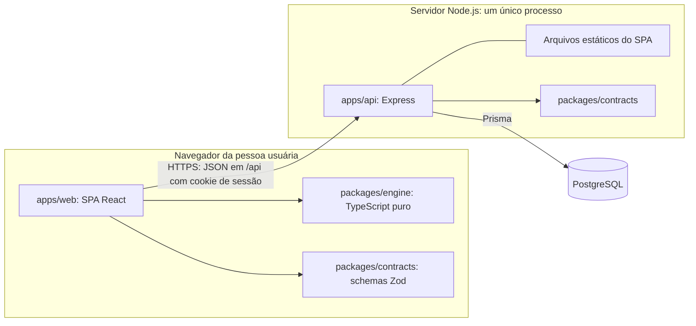
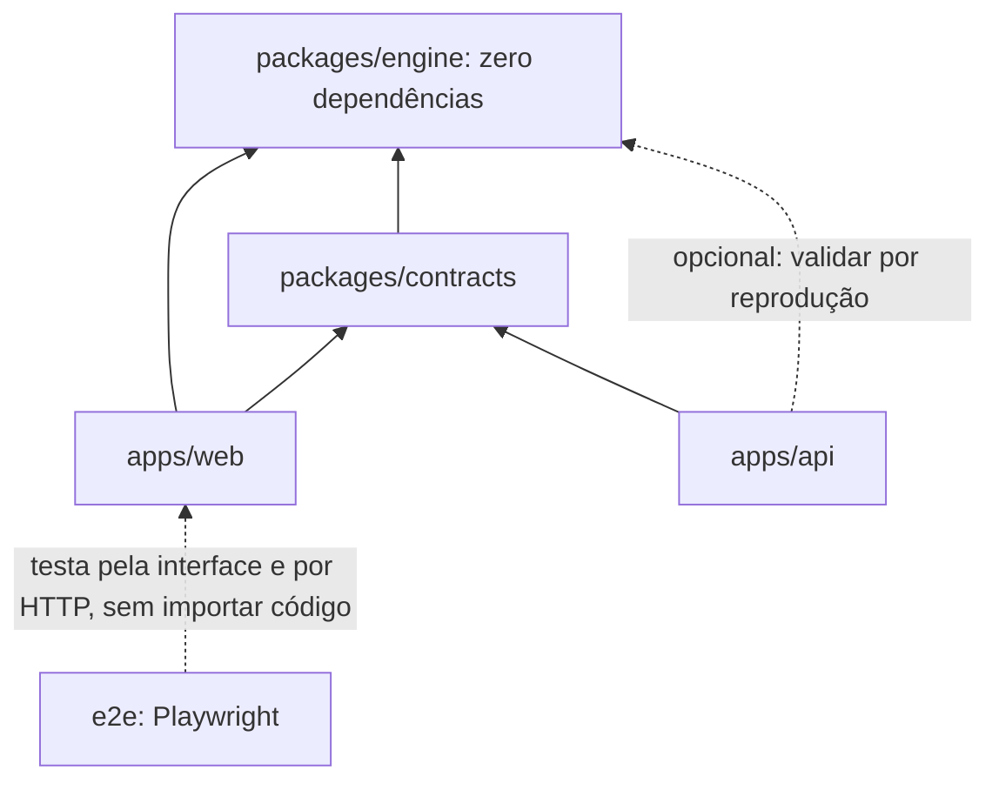
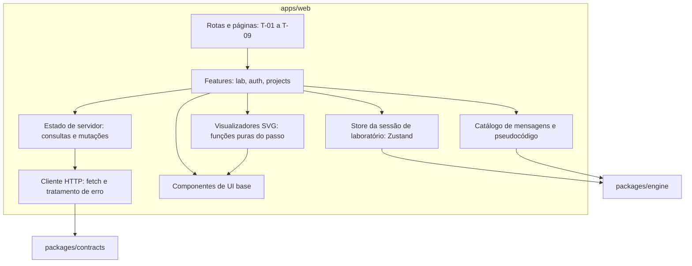
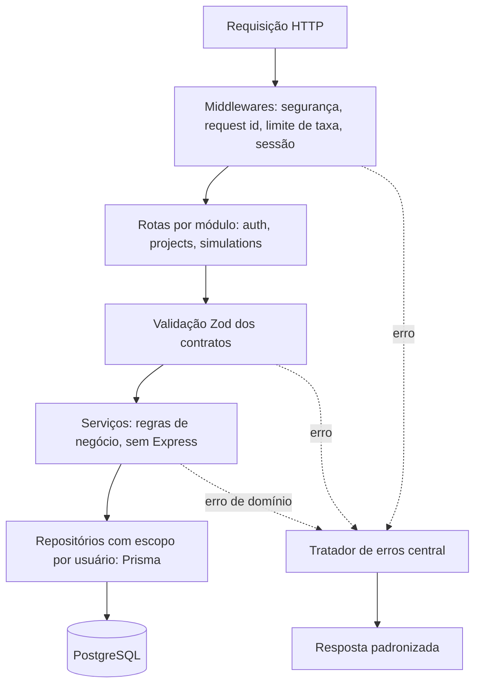
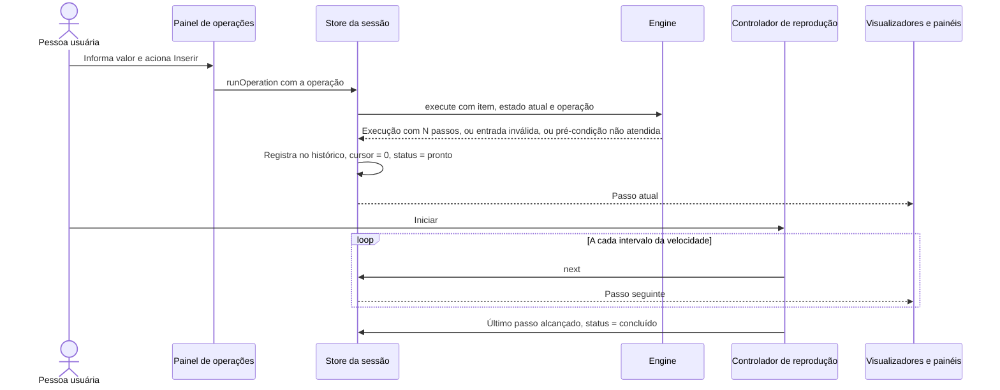
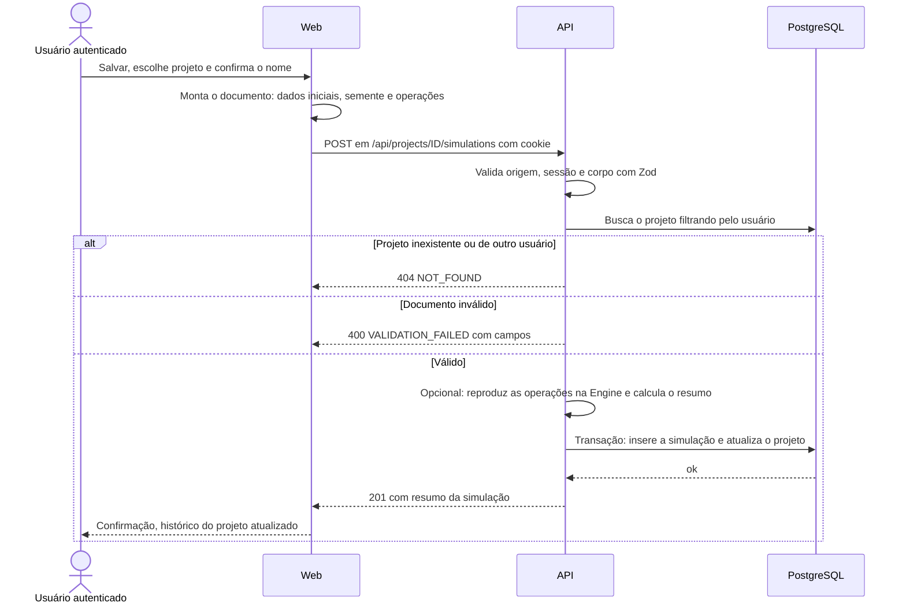
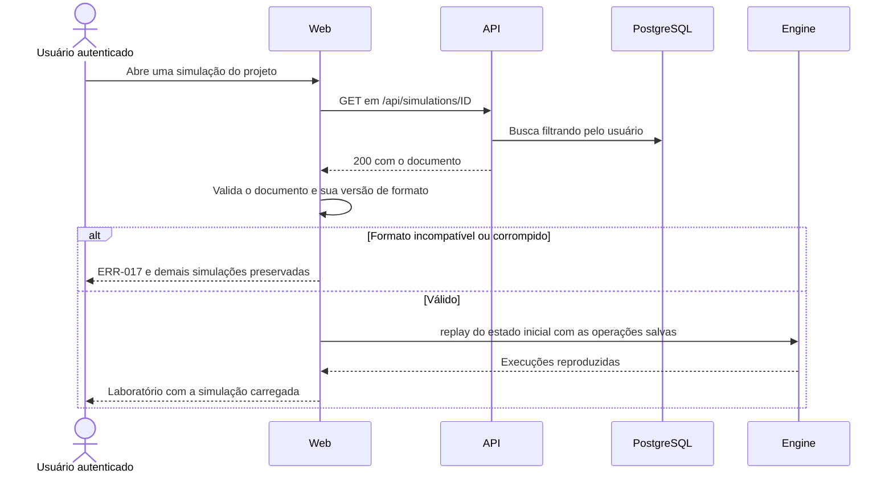
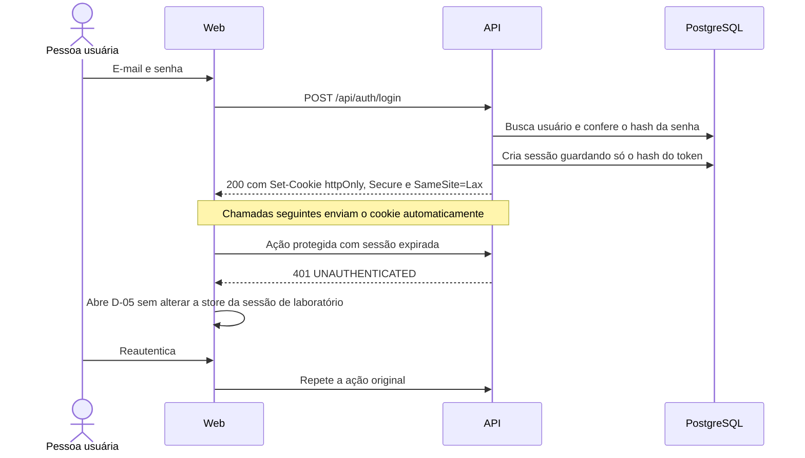
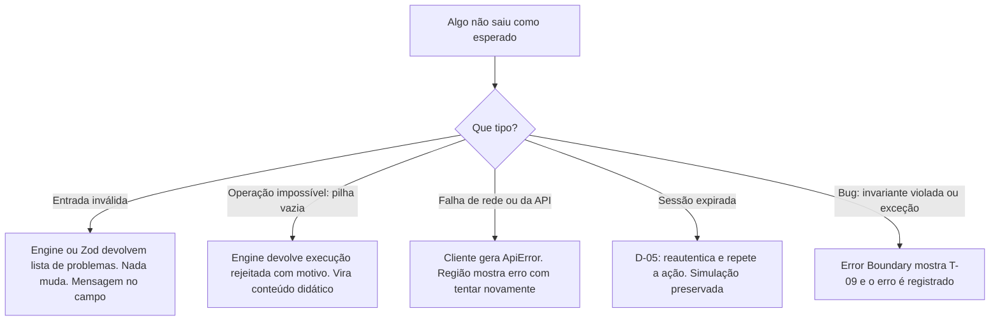
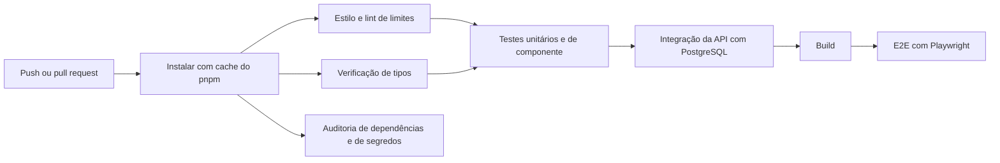

# DataStructure Studio — Arquitetura de Software

> **Versão:** 0.1 (rascunho para validação)
> **Data:** 13/11/2026
> **Base:** `PROJECT_OVERVIEW.md`, `REQUIREMENTS.md`, `USE_CASES.md` e `USER_FLOWS.md`
> **Escopo:** define *como o sistema é organizado internamente*. **Não** contém código, esquema detalhado de banco de dados (próxima etapa de modelagem), nem design visual.
> **Decisões detalhadas:** `docs/architecture/DECISIONS/` (ADR-0001 a ADR-0014).

---

## 1. Como ler este documento

- ✅ **Confirmado:** decisão explícita do autor (neste prompt ou nos anteriores).
- 💡 **Proposta:** recomendação deste documento, aguardando aprovação.
- ❓ **Em aberto:** precisa de decisão. Consolidado na seção 19.
- Os requisitos são citados como RF-nnn / RNF-nnn; casos de uso, telas e regras como UC / T / D / RN / ERR, conforme os documentos anteriores.
- Os valores numéricos citados (limites, tempos, tamanhos) são 💡 sugestões a validar em uma prova de conceito (seção 17, R-01).

---

## 2. Resumo executivo

1. **Três áreas, quatro unidades de código** (✅ três áreas; 💡 quatro unidades): `apps/web` (Front-end), `apps/api` (Back-end), `packages/engine` (Engine) e `packages/contracts` (contratos compartilhados com Zod). Um monorepo pnpm as reúne (ADR-0001).
2. **A Engine é TypeScript puro, com zero dependências** e sem acesso a DOM, Node, banco ou relógio (✅). A isolação é imposta pelo compilador e pelo gerenciador de pacotes, não só por convenção (ADR-0002).
3. **A Engine entrega a execução completa de uma operação como uma lista de passos imutáveis** (cada passo é um *snapshot* serializável: estado, destaques, mensagem, âncora de pseudocódigo e contadores). A interface apenas "toca" essa lista. Retroceder é trocar o índice (ADR-0003).
4. **A Engine não contém texto em linguagem natural.** Emite chaves e âncoras; explicações e pseudocódigo vivem em um catálogo no Front-end, com completude verificada pelo compilador (ADR-0004).
5. **As simulações executam no navegador** (✅). A API **não** executa algoritmos no fluxo normal (ADR-0005). Isso resolve a pergunta **Q2** e o conflito **C2** dos documentos anteriores.
6. **Persistimos entradas e operações, não passos** (dados iniciais + semente + operações, com versão do formato). Reabrir reproduz a execução pela Engine (ADR-0006).
7. **A API é uma aplicação em camadas, organizada por módulos** (auth, projects, simulations): rotas → validação → serviços → repositórios com escopo por usuário (ADR-0008).
8. **Autenticação por sessão guardada no PostgreSQL** e cookie `httpOnly` (ADR-0009). Logout e expiração são reais e testáveis.
9. **Estado no Front-end dividido em duas naturezas:** sessão de laboratório (Zustand) e estado de servidor (consultas e mutações) (ADR-0010).
10. **Visualização em SVG renderizado por React**, como funções puras do passo atual (ADR-0011).
11. **Um único processo em produção, mesma origem:** a API serve o SPA compilado. Sem CORS, sem segundo servidor (ADR-0012).
12. **Política de dependências:** nada entra sem justificativa registrada. Das 17 tecnologias listadas, 1 é absorvida (JavaScript), 1 tem escopo restrito (Zustand) e 1 é adiada (Playwright). Propõe-se um conjunto pequeno de adições necessárias (ADR-0014).

> **Tensão a assumir conscientemente:** o Overview exige foco *equilibrado* entre Front-end e Back-end e que o projeto *não seja um CRUD*. A decisão de executar no navegador torna o Back-end naturalmente menor. A seção 9.5 e o ADR-0006 propõem como manter o Back-end com responsabilidade real (validação por reprodução com a mesma Engine).

---

## 3. Direcionadores arquiteturais

Os requisitos que mais moldam a estrutura, e o que decidem:

| Direcionador | Requisitos | Consequência arquitetural |
|---|---|---|
| Execução em passos navegável nos dois sentidos | RF-020, RF-021, RN-010 | Execução eager de snapshots imutáveis; cursor na store (ADR-0003) |
| Núcleo independente de UI e banco | RNF-020 (✅ decisão) | Pacote sem dependências, com limites verificados (ADR-0002) |
| Extensibilidade sem mexer nos controles | RNF-023 | Itens descritos por *descritores*; visualizadores por *tipo visual*, não por item |
| Determinismo e reprodução | RNF-029, RF-050, RN-019 | PRNG com semente na Engine; proibição de relógio/aleatoriedade nativa |
| Executar no navegador, desempenho didático | RNF-009, RNF-010 | Thread principal, sem worker no MVP; teto de passos |
| Persistência com dono | RF-038, RNF-004 | Sessão no banco; repositórios com escopo por usuário; 404 uniforme |
| Falha de gravação não perde trabalho | RF-049, RNF-032, RN-017 | Estado da simulação vive na memória do cliente; gravação transacional |
| Sessão expirada sem perder simulação | RF-036, RN-025 | Estado de laboratório independente do estado de servidor |
| Entrada validada nas fronteiras | RF-012, RNF-003 | Validação na Engine (entrada de operação) e Zod nos contratos (HTTP) |
| Acessibilidade e movimento reduzido | RNF-017, RNF-018, RF-018 | Visualizadores com equivalente textual; animação por CSS que respeita preferência |
| Testabilidade ponta a ponta | RNF-028 a RNF-031 | Camadas puras testáveis sem DOM/HTTP; CI com banco real |
| Subir com um comando | RNF-024 | Imagem única e `docker compose` completo |

---

## 4. Avaliação da stack: cada tecnologia é necessária?

Critério: *"o que quebra ou fica significativamente pior sem ela, neste projeto?"* ✅ = veio da stack confirmada; a coluna **Veredito** é 💡.

### 4.1 Tecnologias da stack inicial

| Tecnologia | Papel no projeto | Veredito | Observação |
|---|---|---|---|
| React | Interface, composição dos visualizadores | **Mantida** | Declarativo combina com "UI = função do passo atual" |
| TypeScript | Todo o código | **Mantida** | Tipos compartilhados são a espinha da arquitetura |
| JavaScript | — | **Absorvida pelo TypeScript** | Não é tecnologia separada. Usar `.js` só quando uma ferramenta exigir (alguns arquivos de configuração). Regra registrada no ADR-0014 |
| HTML5 / CSS3 | Base da interface | **Mantida** (sem ação) | `<dialog>` nativo para diálogos (ADR-0011) |
| Vite | Build e servidor de dev do Web | **Mantida** | Também é o ambiente em que o Vitest roda os testes do Web |
| Tailwind CSS | Estilização | **Mantida por conveniência** | Não é indispensável. Ganho: *design tokens*, responsividade e modo escuro consistentes com pouco CSS escrito. Alternativa viável: CSS Modules |
| Zustand | Estado da sessão de laboratório | **Mantida com escopo restrito** | Justificativa: a reprodução é consumida por ~6 regiões da tela e por um temporizador fora da árvore React. Escopo: apenas sessão de laboratório e preferências (ADR-0010) |
| Node.js | Runtime da API | **Mantida** | — |
| Express | API HTTP | **Mantida** | Suficiente e conhecida. Usar a versão estável atual, fixada no setup |
| PostgreSQL | Usuários, sessões, projetos, simulações | **Mantida** | Relacional adequado; documento de simulação em coluna JSONB |
| Prisma | Acesso a dados e migrações | **Mantida** | Migrações e tipagem. Alternativas (Drizzle, Kysely) não compensam a troca |
| Zod | Validação nos limites do sistema | **Mantida, só em `contracts`** | **Fora da Engine** (ela tem zero dependências) |
| Vitest | Testes unitários, de integração e de componente | **Mantida** | Inclui `expectTypeOf` para testes de tipos |
| Playwright | E2E | **Mantida, introdução adiada** | Entra após o primeiro fluxo vertical funcionar (seção 15.4) |
| Docker | Banco local e imagem de execução | **Mantida, em duas etapas** | 1º: só o PostgreSQL; 2º: imagem do app + `compose` completo (RNF-024) |
| GitHub Actions | CI | **Mantida** | Começa mínima (tipos, estilo, testes) e cresce |
| pnpm Workspaces | Monorepo | **Mantida** | O modo estrito do pnpm ajuda a impor dependências declaradas (seção 6.4) |

### 4.2 Adições propostas (precisam de aprovação) 💡

Cada item tem justificativa vinculada a requisito. Detalhes no ADR-0014.

| Adição | Para quê | Requisito | Alternativa sem dependência |
|---|---|---|---|
| **React Router** | Rotas com URL própria, voltar/recarregar, rotas protegidas | RF-003 | Roteador próprio: descartado (reinventa a roda) |
| **TanStack Query** (opcional ❓) | Carregando/vazio/erro, nova tentativa e invalidação de cache em ~8 chamadas | RNF-013, ERR-015, ERR-016 | Hooks próprios com `fetch`. Viável, porém repete lógica de cache e nova tentativa |
| **Testing Library + jsdom** | Testar que a visualização reflete o estado em cada passo | RF-016, RNF-028 | Nenhuma razoável |
| **ESLint + typescript-eslint + Prettier** | Padrão de código e regras de limite entre pacotes | RNF-021 | Biome (uma ferramenta só) — ❓ Q41 |
| **express-rate-limit** | Limitar tentativas de login por IP | RNF-005 | Contador próprio no banco (necessário de qualquer forma por conta) |
| **helmet** | Cabeçalhos de segurança HTTP | RNF-005 | Configurar à mão: mais erro-propenso |
| **@vitest/coverage-v8** | Medir cobertura do núcleo (≥ 90%) | RNF-028 | Nenhuma |
| **tsx** (dev) e **tsup** (build) | Rodar e empacotar a API incluindo pacotes do workspace | ADR-0001 | `tsc -b` com referências de projeto — ❓ Q38 |

### 4.3 Considerados e **não** adotados

| Item | Motivo |
|---|---|
| Redux / MobX | Zustand cobre o escopo, com menos cerimônia |
| Axios | `fetch` nativo basta |
| Next.js / SSR | Aplicação interativa sem SEO; SPA é mais simples |
| GraphQL / tRPC | Poucos recursos; REST + Zod compartilhado dá segurança de tipos suficiente (ADR-0007) |
| D3 | Os layouts são simples e determinísticos; não há necessidade de motor de gráficos |
| Framer Motion | Animações cobertas por transições CSS; reavaliar se surgir necessidade real (ADR-0011) |
| Kit de UI (Material, Chakra etc.) | Peso e estilo fixo; diálogos usam `<dialog>` nativo |
| Passport / bibliotecas JWT | Autenticação por sessão própria é pequena e transparente (ADR-0009) |
| Redis | Sessões no PostgreSQL bastam para a escala nominal |
| Turborepo / Nx | Com 5 pacotes, `pnpm -r` basta; reavaliar se a CI passar de 10 min (RNF-031) |
| `fast-check` | Testes de propriedade simples cabem com o PRNG semeado da própria Engine |
| `supertest` | O `fetch` nativo contra um servidor em porta efêmera cobre os testes da API |
| Web Worker | Execução ≤ 100 ms para n = 50 (RNF-010); a pureza da Engine o permite depois |

---

## 5. Arquitetura geral

### 5.1 Visão de contêineres



**Leitura:** a Engine e os contratos são empacotados no bundle do navegador. A API usa os contratos (e, opcionalmente, a Engine — ADR-0006). A mesma origem serve o SPA e a API.

### 5.2 Princípios

1. **A Engine é o produto; o resto a serve.** Interface e API dependem da Engine, nunca o contrário.
2. **Dados puros nas fronteiras.** Tudo que cruza módulos (passos, operações, documentos) é JSON serializável: sem classes, funções, `Map`/`Set`, `undefined` ou referências circulares.
3. **Uma fonte de verdade por assunto.** Limites em um lugar (RN-002); contagens definidas por um único mecanismo (Q17); códigos de erro em um catálogo compartilhado.
4. **A Engine decide, a UI apresenta.** O que é comparação, troca ou erro didático é decisão da Engine; como aparece (cor, texto, movimento) é da UI.
5. **Falhar cedo, falar claro.** Validação nas fronteiras; erro de domínio é conteúdo, erro de programação é exceção.
6. **Simples por padrão.** Cada camada extra precisa justificar o ganho (política de dependências, ADR-0014).

### 5.3 Topologia de execução

| Ambiente | Composição | Uso |
|---|---|---|
| **Desenvolvimento** | Vite (porta própria) com *proxy* de `/api` para a API; PostgreSQL via `docker compose` | Rotina diária; mesma origem aparente, cookies funcionam sem CORS |
| **Produção local / CI / demonstração** | Imagem única: API serve o SPA compilado; `docker compose up` sobe app + PostgreSQL | RNF-024: um comando com apenas Docker instalado |
| **Publicação (se houver)** ❓ Q4 | A mesma imagem em um provedor de contêineres, com PostgreSQL gerenciado | Decisão de deploy adiada, sem impacto no desenho |

---

## 6. Organização do monorepositório

### 6.1 Estrutura 💡

```text
datastructure-studio/
├── apps/
│   ├── web/                  # SPA React (Vite)
│   └── api/                  # Express + Prisma
├── packages/
│   ├── engine/               # Estruturas e algoritmos: TS puro, zero dependências
│   └── contracts/            # Schemas Zod, tipos de DTO, códigos de erro
├── e2e/                      # Testes Playwright (introduzidos depois)
├── docs/                     # Documentação (product, requirements, architecture)
├── docker/                   # Dockerfile e compose
├── .github/workflows/        # CI
├── pnpm-workspace.yaml
├── package.json              # Scripts de orquestração (pnpm -r)
└── tsconfig.base.json        # Configuração TypeScript compartilhada
```

### 6.2 Responsabilidade de cada unidade

| Unidade | Responsabilidade | Depende de | Nunca depende de |
|---|---|---|---|
| `packages/engine` | Estruturas, algoritmos, modelo de execução, PRNG, limites, validação de operações, metadados dos itens | **nada** | DOM, Node, React, Express, Prisma, Zod, tempo, aleatoriedade nativa |
| `packages/contracts` | Contratos HTTP e do documento de simulação (Zod + tipos inferidos), catálogo de códigos de erro | `engine` (tipos e limites) | React, Express, Prisma |
| `apps/web` | Interface, visualização, estado, cliente HTTP | `engine`, `contracts` | `apps/api` |
| `apps/api` | HTTP, autenticação, persistência, validação servidor | `contracts` (e `engine`, se ADR-0006 opcional for aprovada) | `apps/web`, React |
| `e2e` | Fluxos críticos pela interface | nenhum código do projeto | — |

### 6.3 Grafo de dependências permitidas



Seta = "depende de". Qualquer seta fora deste grafo é violação.

### 6.4 Como o limite é imposto (e não apenas combinado)

| Mecanismo | O que garante |
|---|---|
| `package.json` da Engine **sem** `dependencies` | Não existe nada para importar além dela mesma |
| **Modo estrito do pnpm** | Um pacote só enxerga o que declarou; importação "fantasma" falha |
| `tsconfig` da Engine com `lib` sem `DOM` e `types: []` | `document`, `window`, `process`, `Buffer` etc. **não compilam** na Engine |
| Regras de lint para restringir importações | `web` não importa `api` (e vice-versa); a Engine não importa nada |
| Regras de lint contra `Date`, `Math.random` e `Array.prototype.sort` dentro de `engine/src` | Determinismo (RNF-029) e implementação própria (Q14) |
| Teste de arquitetura simples na CI | Falha se `engine/package.json` ganhar dependência |

### 6.5 Como os pacotes são consumidos 💡 ❓ Q38

Opção recomendada: *pacotes internos "just-in-time"*: o `exports` de cada pacote aponta para o código-fonte TypeScript. O Vite compila o que importa; a API roda em desenvolvimento com `tsx` e é empacotada em produção com `tsup` (incluindo os pacotes do workspace). **Vantagem:** sem *builds* intermediários nem *watch* de pacotes. **Custo:** duas ferramentas de build a mais (`tsx`, `tsup`).
Alternativa: `tsc -b` com referências de projeto, emitindo `dist` por pacote. Sem ferramentas extras, mas com fricção em desenvolvimento. **Recomenda-se uma prova de conceito no setup para decidir** (ADR-0001).

---

## 7. Engine

### 7.1 Responsabilidades

1. Implementar, **do zero e de forma instrumentada**, as estruturas e algoritmos do Catálogo MVP.
2. Receber um *estado* e uma *operação* e devolver uma **execução**: lista finita e ordenada de **passos** (RF-020).
3. Garantir **determinismo**: mesma entrada e mesma operação geram exatamente a mesma execução (RNF-029).
4. Validar entradas de operação e dados iniciais conforme os limites (RF-012, RF-015).
5. Distinguir três desfechos (seção 7.4), alinhados a RN-003, RN-004 e RN-007.
6. Gerar dados de entrada, inclusive aleatórios com semente (RF-011, RN-006).
7. Expor **metadados** de cada item: identificação, laboratório, operações e seus parâmetros, tipo visual, complexidade teórica.

**Não é responsabilidade da Engine:** texto em linguagem natural, cores, layout, tempo/reprodução, persistência, rede, autenticação.

### 7.2 Modelo conceitual

| Conceito | Descrição | Observações |
|---|---|---|
| **Descritor de item** | Dados que descrevem um item (ex.: Bubble Sort): id, laboratório, tipo visual, operações disponíveis (nome e parâmetros), complexidade, conjunto de âncoras de pseudocódigo | Base para a UI gerar painel de operações sem conhecer o item (RNF-023) |
| **Estado** | Instantâneo serializável de uma estrutura. Cada elemento tem **identidade estável** | A identidade permite animar movimento em vez de "salto" (RF-018) |
| **Operação** | Pedido do usuário: tipo + parâmetros (valor, posição, alvo) | Também é a unidade que se persiste (ADR-0006) |
| **Execução** | Resultado de aplicar uma operação a um estado | Contém estado inicial, passos, estado final, desfecho e resultado |
| **Passo** | Um momento observável da execução | Detalhado abaixo |
| **Contadores** | Comparações, trocas/movimentações, acessos, acumulados até o passo | Definições únicas (Q17) |

**Campos conceituais do Passo:**

| Campo | Conteúdo |
|---|---|
| índice | Posição na execução (0 = estado anterior à operação, RF-020) |
| estado | *Snapshot* completo, imutável, serializável |
| destaques | Lista de `{elemento ou posição, papel}`; papéis: comparando, trocando, ordenado, pivô, encontrado, faixa de busca, removido, inserido, ponteiro etc. (RF-017) |
| mensagem | `{chave, parâmetros}` — **não** texto (ADR-0004) |
| âncora | Identificador simbólico da linha de pseudocódigo (RF-029) |
| contadores | Valores acumulados (RF-030, RN-012) |

**Campos conceituais da Execução:** item, operação, desfecho (`concluída` ou `rejeitada`), motivo (quando rejeitada), resultado (ex.: posição encontrada, valor removido, "não encontrado"), estado inicial, lista de passos, estado final.

### 7.3 Decisões de modelagem (resumo; detalhes nos ADRs)

| Decisão | Escolha | ADR |
|---|---|---|
| Passos como *snapshots* completos vs. diferenças | **Snapshots**: retroceder e saltar são triviais e exatos (RN-010); custo de memória é aceitável para n ≤ 50 | 0003 |
| Geração *eager* vs. *lazy* | **Eager**: "Passo X de N" exige conhecer N (RF-023) | 0003 |
| Estrutura real vs. apenas dados | A Engine implementa **a estrutura real** (ex.: nós com ponteiros) e emite *snapshots* planos. Preserva o valor didático da "implementação própria" | 0002 |
| Texto no pacote | **Nenhum**: chaves e âncoras; textos no catálogo do Web | 0004 |
| Aleatoriedade | PRNG próprio, pequeno, com semente; proibido `Math.random` | 0002 |
| Identidade de elementos | Gerada de forma determinística a partir do estado (contador interno no estado) | 0003 |

### 7.4 Desfechos de uma tentativa de operação

A distinção é arquiteturalmente importante porque determina o que entra no histórico (RN-003, RN-004, RN-007):

| Desfecho | Quando | Efeito no estado | Entra no histórico? | UI |
|---|---|---|---|---|
| **Entrada inválida** | Valor não numérico, fora da faixa, limite excedido (ERR-001 a ERR-003) | Nenhum | Não | Mensagem no campo |
| **Pré-condição não atendida** | Busca binária sobre dados desordenados (ERR-007) | Nenhum | Não | Diálogo oferecendo ordenar antes |
| **Operação rejeitada** | Estrutura vazia, posição inexistente, valor ausente (ERR-004 a ERR-006) | Nenhum | **Sim** | Execução curta explicando o motivo |
| **Concluída** | Operação válida | Estado final da execução | Sim | Passo a passo |

### 7.5 Superfície pública da Engine (conceitual)

- **Catálogo:** listar laboratórios e itens; obter descritor por id.
- **Estado:** criar estado inicial a partir de dados (manual, aleatório, exemplo).
- **Execução:** executar uma operação sobre um estado; reproduzir uma sequência de operações a partir de um estado inicial (usada para reabrir simulações).
- **Utilitários:** gerador pseudoaleatório com semente; limites (`LIMITS`) — fonte única de RN-002.
- **Tipos:** todos os tipos acima e a união de chaves de mensagem e âncoras.

Tudo o mais é interno.

### 7.6 Regras internas da Engine 💡

1. Estruturas e algoritmos **instrumentados por um único registrador de passos** (internamente), que é quem define o que conta como comparação, troca e acesso. Isso materializa a resposta a Q17 em código, não só em documento.
2. **Sem** `Array.prototype.sort`/`indexOf`/etc. nas operações *observadas*; armazenamento básico nativo é permitido (proposta para Q14, conflito C12). Funções nativas são permitidas **apenas em testes** de verificação.
3. **Teto de passos** por execução (💡 10.000; pior caso previsto ≈ 2.500 passos para n = 50). Ao excedê-lo, é erro de programação (invariante violada), não de usuário.
4. Toda execução satisfaz invariantes verificáveis: primeiro passo = estado anterior; último = resultado esperado; contadores não decrescentes; toda mensagem e âncora emitida existe no conjunto declarado.
5. **Sem estado global.** Funções recebem tudo de que precisam (inclusive a semente).
6. Mudanças que alterem a sequência de passos de um item exigem **atualizar a revisão do formato/Engine** e os *fixtures* dourados (ADR-0006).

### 7.7 Como acrescentar um item novo (verificação de RNF-023)

1. Implementar o item na Engine e declarar seu descritor.
2. Declarar suas chaves de mensagem e âncoras (o compilador passa a exigir o texto correspondente no catálogo).
3. Escrever textos (explicações, pseudocódigo, notas de complexidade) no catálogo do Web.
4. Escolher o **tipo visual** já existente (sequência, pilha, fila, lista ligada) — só se criar um tipo visual novo é preciso escrever um visualizador.
5. Nenhuma alteração em controles de reprodução, painel de explicação, contadores ou histórico.

---

## 8. Front-end (`apps/web`)

### 8.1 Responsabilidades

Renderizar telas e diálogos (T-01 a T-09, D-01 a D-05); conduzir a reprodução; visualizar estados; coletar e validar entradas; falar com a API; apresentar erros de forma didática; respeitar acessibilidade e responsividade.

### 8.2 Camadas



### 8.3 Organização interna por *features* 💡

```text
apps/web/src/
├── app/            # Providers, roteador, guardas de rota, páginas T-xx
├── features/
│   ├── lab/        # Sessão de laboratório: store, controlador de reprodução,
│   │               # painel de operações, controles, histórico, contadores
│   ├── visualizers/# Um visualizador por TIPO VISUAL (sequência, pilha, fila, lista ligada)
│   ├── auth/       # Cadastro, login, sessão, reautenticação (D-05)
│   └── projects/   # Projetos e simulações salvas
├── content/        # Catálogo: mensagens, pseudocódigo, notas de complexidade (pt-BR hoje)
├── shared/         # UI base, cliente HTTP, utilitários, hooks
└── styles/
```

### 8.4 Núcleo da reprodução

- **Controlador de reprodução:** *reducer* puro com a máquina de estados do fluxo F-05 (pronto → reproduzindo → pausado → concluído). Um único ponto trata eventos (iniciar, pausar, avançar, retroceder, reiniciar, mudar velocidade, tick).
- **Temporizador:** um *hook* fino que dispara `tick` conforme a velocidade; **não** contém regra de negócio. Navegar manualmente durante a reprodução pausa (💡 Q30).
- **O passo atual é derivado**: `execução.passos[cursor]`. Todas as regiões (visualização, explicação, pseudocódigo, contadores, indicador) leem o mesmo passo, o que garante a sincronia exigida por RF-021 e RN-010.
- **Só a execução corrente fica em memória.** O histórico guarda *registros de operação* (tipo, parâmetros, desfecho), não passos. Execuções anteriores são reproduzíveis pela Engine.

### 8.5 Visualização (resumo do ADR-0011)

- **SVG por React**; um visualizador por **tipo visual**, que recebe passo (estado + destaques) e preferências, e devolve SVG. Sem estado próprio relevante.
- **Layout é função pura** (`estado → posições`), testável sem navegador.
- **Animação** por transições CSS em elementos com chave estável (identidade do elemento). `prefers-reduced-motion` e a preferência do usuário desligam o movimento sem perder informação (RN-029).
- **Acessibilidade:** cada visualizador produz também uma **descrição textual do estado** (para leitores de tela e para testes), e destaques usam forma/rótulo além de cor (RNF-018).

### 8.6 Responsividade e diálogos

- Layout adaptável; abas em telas pequenas **sem remover funções** (RNF-015, SUG-UX-05).
- Diálogos com o elemento nativo `<dialog>` (foco e semântica modal prontos). Biblioteca de componentes acessíveis só se surgirem lacunas reais (ADR-0014).

### 8.7 Rotas e guardas

- React Router, rotas de `USER_FLOWS.md` seção 5. Rotas protegidas verificam a sessão por consulta ao servidor (`me`); visitante é levado a T-05 e, após entrar, volta ao destino (SUG-UX-06).
- Um erro não tratado em uma rota é capturado por **Error Boundary** que exibe T-09 (seção 13).

---

## 9. Back-end (`apps/api`)

### 9.1 Responsabilidades

Autenticação e sessão (RF-033 a RF-036); autorização por propriedade (RF-038); CRUD de projetos (RF-042 a RF-046); persistência e consulta de simulações (RF-049 a RF-051); validação servidor (RNF-003); segurança de borda (RNF-005); entrega do SPA em produção; saúde e configuração.

### 9.2 Camadas



| Camada | Faz | Não faz |
|---|---|---|
| **Rotas** | Mapeia verbo/caminho, aplica validação, chama serviço, formata resposta | Regra de negócio, acesso a banco |
| **Serviços** | Regras e casos de uso (ex.: criar projeto, salvar simulação); lançam erros de domínio | Conhecer `req`/`res`, HTTP, cookies |
| **Repositórios** | Único lugar que fala com o Prisma; **todas** as consultas de projeto/simulação recebem o usuário e filtram por ele | Regras de negócio |
| **Middlewares** | Preocupações transversais: segurança, identificação de requisição, sessão, limite de taxa | Lógica de domínio |

### 9.3 Módulos e recursos (nível conceitual)

| Módulo | Recursos HTTP (💡 ilustrativos) | Requisitos |
|---|---|---|
| **auth** | `POST /api/auth/register`, `POST /api/auth/login`, `POST /api/auth/logout`, `GET /api/auth/me` | RF-033 a RF-036 |
| **projects** | `GET/POST /api/projects`; `GET/PATCH/DELETE /api/projects/{id}` | RF-042 a RF-046 |
| **simulations** | `GET/POST /api/projects/{id}/simulations`; `GET/DELETE /api/simulations/{id}` | RF-049 a RF-051 |
| **health** | `GET /api/health` | Operação, Docker, CI |

Rotas finais e esquema do banco serão definidos na etapa de modelagem. Entidades conceituais: **Usuário, Sessão, Projeto, Simulação.**

### 9.4 Persistência (conceitual)

- A **simulação** é guardada como um **documento** (JSON) em coluna JSONB mais poucos campos escalares para listagem (item, nº de operações, datas). O documento é o definido no ADR-0006.
- **Gravar é transacional** (simulação + atualização da data do projeto): tudo-ou-nada (RN-017, RNF-032).
- **Paginação** por página e tamanho (💡 20 por página); índices pensados para "mais recentes primeiro" (RNF-026).
- **Migrações** pelo Prisma; aplicadas na subida do contêiner e na CI.

### 9.5 Responsabilidade real do Back-end (resposta ao risco R4 do Overview) 💡 ❓ Q37

Como a execução ocorre no navegador, o Back-end seria naturalmente um "CRUD com login". Para que tenha responsabilidade de domínio **sem** duplicar lógica nem alterar a decisão confirmada:

- **Validação por reprodução:** ao salvar, a API reproduz o documento usando **a mesma Engine** (pura, funciona em Node), garantindo que só se persistam simulações válidas e calculando o resumo (nº de operações, resultado final) **no servidor**, sem confiar no cliente.
- **Custo:** baixo (n ≤ 50, número de operações limitado; RNF-010).
- **Benefício extra de portfólio:** demonstra, em código, que a Engine é realmente independente (roda em dois ambientes).
- **Importante:** isso **não** move a execução para o servidor; só a verificação.

Se a ideia for rejeitada, a API valida apenas forma e limites (Zod) e o Back-end permanece enxuto, o que deve ser aceito conscientemente.

### 9.6 Configuração

Variáveis de ambiente validadas na subida (falha imediata se faltarem); nenhum segredo no repositório; `.env.example` versionado (RNF-006).

---

## 10. Comunicação entre módulos

### 10.1 Mapa

| De → Para | Meio | Formato |
|---|---|---|
| UI → Store | Chamadas de ação | Tipos TS |
| Store → Engine | Chamada de função síncrona, em memória | Dados puros |
| Visualizadores ← Store | Seletores | Passo atual |
| Web → API | HTTP/JSON, mesma origem, cookie de sessão | Contratos Zod |
| API → Banco | Prisma | SQL parametrizado |
| API → Engine (opcional) | Chamada de função | Dados puros |

### 10.2 Fluxo: executar uma operação (tudo no navegador)



### 10.3 Fluxo: salvar simulação



### 10.4 Fluxo: recuperar simulação salva



### 10.5 Fluxo: sessão e expiração (D-05)



### 10.6 Estratégia de comunicação HTTP 💡

| Tema | Decisão |
|---|---|
| Estilo | REST/JSON, recursos nomeados, verbos HTTP corretos |
| Cliente | `fetch` nativo, encapsulado em um único módulo que normaliza respostas e erros em um `ApiError` tipado |
| Origem | **Mesma origem** (proxy no dev, API serve SPA em produção). Sem CORS |
| Credenciais | Cookie `httpOnly`; o cliente nunca vê nem guarda o token |
| Contratos | Corpos de requisição validados por Zod (em `contracts`); tipos de resposta inferidos dos mesmos schemas |
| Validação de resposta no cliente | **Não** no MVP (cliente e servidor são entregues juntos), **exceto** o documento de simulação carregado, que pode vir de versões antigas (RNF-033) |
| Erros | Envelope único com `code` estável, `message`, `fields` opcionais e `requestId` (seção 13) |
| Paginação | Parâmetros de página e tamanho; resposta com itens e total |
| Tempo limite | O cliente aborta chamadas lentas e as trata como falha de rede (ERR-015/ERR-016) |
| Repetição automática | **Só em leituras** e apenas para falhas de rede. **Nunca** em mutações |
| Idempotência de salvar 💡 | O cliente envia um identificador gerado por salvamento; o servidor trata repetição do mesmo identificador como a mesma criação (evita duplicar ao tentar de novo após *timeout*) |
| Versionamento | Sem prefixo `/v1` no MVP; o que se versiona é o **formato do documento de simulação** |

---

## 11. Estratégia de compartilhamento de tipos

### 11.1 Princípio

> **A Engine é dona dos tipos de domínio. `contracts` é dono dos tipos de fronteira (HTTP e persistência).** Nada é copiado à mão entre pacotes.

| Tipo | Dono | Consumido por |
|---|---|---|
| Estado, Passo, Execução, Operação, descritores, chaves de mensagem, âncoras, `LIMITS` | `engine` | `web`, `contracts`, `api` (opcional) |
| Corpos de requisição e resposta (auth, projetos, simulações) | `contracts` | `web`, `api` |
| **Documento de simulação** (formato persistido) | `contracts` | `web`, `api` |
| **Códigos de erro** (`ErrorCode`) | `contracts` | `web`, `api` |

### 11.2 Regras

1. **Zod só em `contracts`.** Os tipos TypeScript dos contratos são **inferidos** dos schemas (`z.infer`): um schema, um tipo.
2. A Engine **não** tem Zod. Os schemas de operação em `contracts` espelham os tipos da Engine; **testes de tipo** (`expectTypeOf` do Vitest) garantem que não divergem. Se alguém alterar uma operação na Engine, a compilação dos testes de `contracts` quebra.
3. Os **limites** (`LIMITS`) têm uma única definição, na Engine. `contracts` os usa nos schemas; o Web, nos formulários; a API, via `contracts`. É a materialização de RN-002.
4. **Nenhum tipo de `apps/api` ou `apps/web` é exportado** para o outro lado. Se os dois precisam, sobe para `contracts`.
5. Tipos de banco (Prisma) **não vazam** além dos repositórios; serviços e rotas trabalham com tipos de `contracts`.

### 11.3 Por que não tRPC ou geração de cliente?

Há poucos recursos e a equipe é um estudante; REST + schemas compartilhados dá a maior parte do ganho (tipos de ponta a ponta) sem acoplar o projeto a um framework adicional. Registrado no ADR-0007.

---

## 12. Gerenciamento de estado

### 12.1 Mapa de estados

| Natureza | Exemplos | Onde vive | Persistência |
|---|---|---|---|
| **Sessão de laboratório** | item selecionado, dados iniciais, semente, histórico de operações, execução corrente, cursor, status de reprodução, "há trabalho não salvo" | **Store Zustand** | Memória (💡 opcional: rascunho em `sessionStorage`, ❓ Q40) |
| **Preferências** | velocidade, animação ligada/desligada | Store Zustand | `localStorage`, com `try/catch` |
| **Estado de servidor** | usuário atual, projetos, simulações | Consultas e mutações (💡 TanStack Query, ❓ Q36) | Servidor |
| **Estado de URL** | laboratório, item, projeto/simulação em contexto | Rota | URL |
| **Estado de UI local** | campo em edição, diálogo aberto, aba ativa | `useState` do componente | — |

### 12.2 Regras

1. **O estado de laboratório é independente do estado de servidor.** É o que permite sessão expirar, gravação falhar ou o usuário ir para T-05 **sem perder a simulação** (RN-025, RN-017, ERR-013, ERR-015).
2. **O que se pode derivar não se armazena.** Passo atual, contadores, "estrutura vazia", "pode retroceder" são seletores.
3. **Ações da store são as únicas que chamam a Engine.** Componentes não importam a Engine para executar operações.
4. **Só a execução corrente é guardada**; as anteriores se reproduzem a partir das operações.
5. **Um só lugar para cada regra** de transição de reprodução (o *reducer*), testável sem React.
6. **Zustand fica restrito** aos dois usos acima; não vira repositório global de tudo.

### 12.3 Observação relevante para o MVP (💡 ❓ Q25, Q40)

Como o produto é um SPA e a store de laboratório sobrevive à navegação interna, o visitante que aciona **Salvar → Entrar/Cadastrar** (rotas internas) **não perde o trabalho**, desde que não recarregue a página. Isso torna **RF-054 (preservar trabalho do visitante, hoje *Should*) quase gratuito**. Cobrir recarregamentos exigiria o rascunho em `sessionStorage`. Sugere-se discutir a promoção de RF-054 ao MVP.

---

## 13. Tratamento de erros

### 13.1 Classificação



### 13.2 Por camada

| Camada | Erros esperados (de usuário/domínio) | Erros inesperados (bugs) |
|---|---|---|
| **Engine** | **Valores**, não exceções: entrada inválida (lista de problemas com código), pré-condição não atendida, operação rejeitada (desfecho). Nunca lança por entrada de usuário | Lança `EngineInvariantError` (ex.: teto de passos excedido, estado inconsistente). É bug |
| **Web** | Mensagens a partir de **códigos** (catálogo), mostradas no campo, na região ou em diálogo | *Error Boundary* por rota → T-09 (recuperável); registro no console (e, no futuro, em serviço de monitoramento) |
| **API** | Erros de domínio (classe base com `code` e status) lançados por serviços e convertidos pelo **tratador central** | Qualquer outra exceção → 500 genérico, com `requestId`, **sem detalhes internos** (RNF-034) |

### 13.3 Envelope de erro da API

Um único formato (💡):

- `error.code`: código estável do catálogo compartilhado (ex.: `VALIDATION_FAILED`, `UNAUTHENTICATED`, `NOT_FOUND`, `RATE_LIMITED`, `INTERNAL`).
- `error.message`: texto curto para depuração (a interface usa o `code` para a mensagem final).
- `error.fields` (opcional): lista `{campo, código}` para validação.
- `error.requestId`: para correlação com o log.

| Situação | Status | Código |
|---|---|---|
| Corpo/consulta inválidos | 400 | `VALIDATION_FAILED` |
| Sem sessão válida ou expirada | 401 | `UNAUTHENTICATED` |
| Credenciais inválidas | 401 | `INVALID_CREDENTIALS` (mensagem genérica, ERR-011) |
| Recurso inexistente **ou de outro usuário** | 404 | `NOT_FOUND` (idêntico nos dois casos, RN-020) |
| Excesso de tentativas | 429 | `RATE_LIMITED` (ERR-012) |
| Falha ao concluir cadastro | 409 | `REGISTRATION_FAILED` (mensagem neutra, ERR-010) |
| Erro inesperado | 500 | `INTERNAL` |

> **Limitação honesta (ERR-010):** sem verificação de e-mail, não é possível impedir totalmente a *enumeração de contas* no cadastro; a mensagem neutra reduz o vazamento e o limite de taxa o dificulta. Aceito para o MVP (RF-033 exige não expor dados da conta, o que se cumpre).

### 13.4 Reautenticação (D-05)

O cliente HTTP, ao receber `UNAUTHENTICATED` em chamada protegida, sinaliza à camada de autenticação, que abre D-05. Após o novo login, **repete a chamada original**. Como a simulação está na store de laboratório, nada se perde.

### 13.5 Registro (*logging*)

Registro estruturado com `requestId`, rota, status e duração; **nunca** senhas, tokens ou documentos inteiros (RNF-001, RNF-007). Biblioteca de log é decisão adiada até haver necessidade (ADR-0014).

---

## 14. Segurança

| Tema | Decisão | Requisito |
|---|---|---|
| **Senhas** | Hash adaptativo com sal, **resistente a força bruta**. Recomenda-se `scrypt` nativo do Node (sem dependência nativa extra), parâmetros mínimos da OWASP vigente. Alternativa: `argon2id` (preferência da OWASP, porém com dependência nativa) — ❓ Q39 | RNF-001 |
| **Sessão** | Token aleatório forte (CSPRNG), **só o hash** vai ao banco; cookie `httpOnly`, `Secure`, `SameSite=Lax`, caminho restrito. Expiração configurável (💡 7 dias). Logout **apaga** a sessão no servidor | RF-035, RF-036 |
| **CSRF** | `SameSite=Lax` + exigência de `Content-Type: application/json` em mutações + conferência do cabeçalho `Origin` | RNF-005 |
| **Autorização** | Repositórios filtram **sempre** por usuário; recurso alheio devolve o mesmo 404 de inexistente. Suíte de testes tenta acesso cruzado em **todos** os endpoints | RF-038, RNF-004 |
| **Validação** | Zod em todo corpo, parâmetro e consulta; limites de tamanho de corpo; documento de simulação com limites de operações e elementos | RNF-003 |
| **Injeção** | Prisma parametriza consultas; nunca montar SQL por concatenação | RNF-005 |
| **XSS** | React escapa por padrão; **proibido** inserir HTML bruto; CSP restritiva (a validar com Tailwind/SVG) | RNF-005 |
| **Força bruta** | Contador de falhas **por conta** no banco (autoridade, funciona com várias instâncias) + limitador por IP em memória (complemento). 💡 5 falhas em 15 min | RNF-005 |
| **Cabeçalhos** | `helmet` com política revisada | RNF-005 |
| **Transporte** | HTTPS em produção; redirecionamento de HTTP | RNF-002 (condicionado a Q4) |
| **Segredos** | Somente por variáveis de ambiente; varredura de segredos na CI; nada no repositório | RNF-006 |
| **Dependências** | Auditoria na CI; atualização monitorada | RNF-005 |
| **Privacidade** | Coletar só e-mail e nome de exibição; documentar finalidade (LGPD) | RNF-007 |
| **Execução de código do usuário** | **Não existe** no MVP (RF-066 é *Won't*). Tudo que o usuário envia é dado, nunca código | — |

---

## 15. Testabilidade

### 15.1 Princípio

A arquitetura foi desenhada para que **a maior parte da lógica seja testável sem navegador, sem HTTP e sem banco**.

### 15.2 Estratégia por camada

| Camada | Tipo de teste | Foco | Ambiente |
|---|---|---|---|
| **Engine** | Unitário e de propriedades (com PRNG semeado) | Corretude dos algoritmos; invariantes do passo; determinismo; limites | Node puro, **sem DOM** |
| | *Fixtures* dourados | Sequência exata de passos de casos documentados (contagens esperadas, Q17); detecta mudança acidental | Node |
| | Completude de conteúdo | Toda mensagem/âncora emitida existe no conjunto declarado | Node |
| **Contracts** | Unitário + testes de tipo | Schemas aceitam/recusam o esperado; tipos alinhados à Engine | Node |
| **Web (lógica)** | Unitário | *Reducer* de reprodução, seletores, funções de layout | Node/jsdom |
| **Web (componentes)** | Componente (Testing Library) | **Para cada passo de cada item**, o DOM reflete o estado lógico (RF-016); formulários e mensagens | jsdom |
| **API** | Integração com **PostgreSQL real** | Rotas + serviços + banco; acesso cruzado entre usuários; transações; erros padronizados | Node + banco |
| **Ponta a ponta** | Playwright | Cadastro/login, execução com avançar e retroceder, salvar e reabrir, modo visitante (RNF-030) | Navegador real, build de produção |
| **Acessibilidade** | Verificação automatizada + roteiro manual de teclado | RNF-016/017/018 | Playwright e manual |

### 15.3 Decisões de teste

1. **Sem *mocks* do banco.** Testes de API usam PostgreSQL real (contêiner na CI e no desenvolvimento). Mock de Prisma esconde exatamente os erros que interessam (transação, restrições).
2. **Sem `supertest`:** `fetch` nativo contra a aplicação em porta efêmera.
3. **Tempo e aleatoriedade controlados:** a Engine não os conhece; a API recebe relógio por parâmetro quando necessário (expiração de sessão).
4. **Cobertura** do núcleo medida na CI (💡 ≥ 90% de linhas e ramos).
5. **Testes de propriedade sem biblioteca:** laços com o PRNG semeado (ordenação ordenada e permutação; estabilidade; invariantes da lista).

### 15.4 Quando entra cada coisa

Engine + Vitest desde o primeiro dia; CI mínima desde o primeiro dia; testes de integração da API com a primeira rota; **Playwright após o primeiro fluxo vertical** (Pilha ou Bubble Sort ponta a ponta), quando houver algo estável para proteger.

### 15.5 Pipeline de CI



Meta de duração total ≤ 10 min (RNF-031). Falha em qualquer etapa bloqueia a integração.

---

## 16. Operação e ambientes (resumo)

- **Configuração:** variáveis de ambiente validadas na subida; `.env.example`.
- **Banco:** migrações aplicadas na subida; *seed* de desenvolvimento opcional.
- **Saúde:** endpoint de saúde usado por Docker e CI.
- **Observabilidade:** logs estruturados com `requestId`; métricas e monitoramento são adiados.
- **Docker:** `docker compose` com perfil de desenvolvimento (só PostgreSQL) e perfil completo (app + PostgreSQL) para RNF-024.

---

## 17. Riscos arquiteturais

| ID | Risco | Prob. | Impacto | Mitigação |
|---|---|---|---|---|
| **R-01** | **Modelo de Passo mal desenhado** obriga reescrever todos os itens (risco R2 do Overview) | Média | Alto | Fatia vertical primeiro (Pilha e Bubble Sort ponta a ponta); congelar o contrato do Passo só após um terceiro item de tipo visual diferente; *fixtures* dourados |
| **R-02** | **Memória/tempo dos *snapshots*** crescem quadraticamente se os limites aumentarem | Baixa | Médio | Teto de passos; só a execução corrente em memória; medir no PoC (n = 50 ≈ 2.500 passos × 50 elementos); se necessário, representação compacta ou estrutura compartilhada |
| **R-03** | **Divergência entre Engine e documentos salvos** ao corrigir um algoritmo (conflito C3) | Média | Alto | Documento com versão de formato; *fixtures* de simulações antigas reabertas na CI (RNF-033); resumo salvo permite detectar deriva |
| **R-04** | **Excesso de engenharia** (descritores genéricos demais, muitos pacotes) para um estudante | Média | Médio | Quatro unidades apenas; descritores mínimos; generalizar só ao repetir o padrão pela terceira vez |
| **R-05** | **Back-end "decorativo"** (risco R4 do Overview) | Média | Médio | Validação por reprodução com a Engine (seção 9.5); caso contrário, aceitar explicitamente |
| **R-06** | **Fricção de monorepo** (consumo de pacotes, TypeScript, ferramentas) | Média | Médio | PoC no setup (Q38); decisão registrada; documentação no README |
| **R-07** | **Corrida entre temporizador e navegação manual** na reprodução | Média | Baixo | *Reducer* puro com máquina de estados e testes dos cenários; um único controlador |
| **R-08** | **Cookies e origens** em dev × produção | Baixa | Médio | Proxy no Vite; mesma origem em produção; teste E2E no build final |
| **R-09** | **Acessibilidade de SVG animado** subestimada | Média | Médio | Descrição textual do estado desde o primeiro visualizador; movimento reduzido na especificação |
| **R-10** | **Segurança de sessão** implementada à mão com falhas sutis | Baixa | Alto | Implementação pequena e revisada; testes de acesso cruzado e de expiração/logout; checklist OWASP |
| **R-11** | **Tempo disponível do autor** frente à quantidade de requisitos Must | Alta | Alto | Ordem de entrega por fatias; plano de corte já definido (C6 de `REQUIREMENTS.md`) |
| **R-12** | **Dependência de Q2 resolvida só no navegador**: se no futuro a execução for ao servidor, o contrato muda | Baixa | Médio | Engine pura e serializável: pode ir a *worker* ou servidor sem reescrita; apenas a camada de chamada mudaria |

---

## 18. Impacto sobre documentos anteriores

### 18.1 Perguntas resolvidas ou encaminhadas

| Pergunta | Situação |
|---|---|
| **Q2** — onde roda a lógica | ✅ **Resolvida**: no navegador (decisão do autor). API faz gerenciamento e persistência |
| **C2** (`REQUIREMENTS.md`) | **Encerrado** por Q2 |
| **Q14** — "implementação própria" | 💡 Proposta: regra da seção 7.6 (item 2) |
| **Q17** — definição das contagens | 💡 Encaminhada: um único registrador de passos na Engine define as contagens; a definição textual será escrita junto aos algoritmos |
| **Q4** — deploy | Permanece em aberto; o desenho funciona com ou sem deploy público |
| **Q3** — idioma | Arquitetura não depende dela: a Engine não tem texto; o catálogo é por idioma |
| **Q25** — trabalho do visitante | 💡 Reduzida: ver seção 12.3 |

### 18.2 Ajustes sugeridos nos documentos anteriores

- `REQUIREMENTS.md`: RNF-008 (latência da API) aplica-se **só à API**; a fluidez da execução é RNF-009/RNF-010 (navegador). RNF-025 (carga) só afeta autenticação, projetos e simulações.
- `USER_FLOWS.md`: em T-03, **não há estado de "carregando" para geração dos passos** (execução síncrona local); o estado de carregamento restringe-se a abrir simulação salva e salvar.
- `USE_CASES.md`: UC-020 passo 6 — a reprodução reabre a simulação **pela Engine** (💡 SUG-05 compatível com a arquitetura).

---

## 19. Pontos em aberto (continuam a numeração; Q1 a Q34 em documentos anteriores)

| # | Pergunta | Sugestão | Afeta |
|---|---|---|---|
| **Q35** | Confirmar **sessão no banco + cookie** (em vez de JWT) | Sessão no banco (ADR-0009) | RF-034 a RF-036 |
| **Q36** | Adotar **TanStack Query** para estado de servidor? | Sim, se o orçamento de dependências permitir; senão, hooks próprios | ADR-0010 |
| **Q37** | Adotar a **validação por reprodução** na API (Engine no servidor como verificadora)? | Sim | ADR-0006, seção 9.5 |
| **Q38** | Como consumir pacotes: **código-fonte (JIT) + `tsx`/`tsup`** ou **`tsc -b`** com `dist`? | Decidir após uma PoC no setup | ADR-0001 |
| **Q39** | **Hash de senha**: `scrypt` nativo ou `argon2id`? | `scrypt` nativo | ADR-0009 |
| **Q40** | Guardar **rascunho do visitante em `sessionStorage`** para sobreviver a recarregamentos? E promover RF-054? | Sim (barato) | ADR-0010, RF-054 |
| **Q41** | **ESLint + Prettier** ou **Biome**? | ESLint + Prettier (regras de limite entre pacotes) | ADR-0014 |
| **Q42** | Valores-limite: máx. de operações por simulação, teto de passos por execução, tamanho máximo do documento | 200 operações, 10.000 passos, tamanho a medir | RF-015, ADR-0006 |
| **Q43** | Aprovar o **conjunto de adições** da seção 4.2? | Sim, com Query e Biome como opcionais | ADR-0014 |

Perguntas anteriores ainda relevantes: **Q3** (idioma), **Q4** (deploy), **Q8** (um laboratório por projeto), **Q11** (política de senha e sessão), **Q13**, **Q20 a Q31**, **Q32 a Q34**.

---

## 20. Índice de decisões arquiteturais (ADR)

| ADR | Título | Status |
|---|---|---|
| [0001](DECISIONS/ADR-0001-monorepo-pnpm-workspaces.md) | Monorepo com pnpm Workspaces e quatro unidades | Proposta |
| [0002](DECISIONS/ADR-0002-engine-typescript-puro.md) | Engine em TypeScript puro, sem dependências | **Aceita** (decisão do autor) |
| [0003](DECISIONS/ADR-0003-modelo-de-execucao-snapshots.md) | Modelo de execução: passos como *snapshots* imutáveis, geração *eager* | Proposta |
| [0004](DECISIONS/ADR-0004-conteudo-didatico-chaves-e-ancoras.md) | Conteúdo didático por chaves e âncoras, fora da Engine | Proposta |
| [0005](DECISIONS/ADR-0005-execucao-no-navegador.md) | Simulações executam no navegador | **Aceita** (decisão do autor) |
| [0006](DECISIONS/ADR-0006-formato-persistido-da-simulacao.md) | Formato persistido: entradas e operações, com versão | Proposta |
| [0007](DECISIONS/ADR-0007-contratos-compartilhados.md) | Contratos compartilhados com Zod e tipos inferidos | Proposta |
| [0008](DECISIONS/ADR-0008-api-em-camadas-e-erros.md) | API em camadas por módulo e envelope de erro | Proposta |
| [0009](DECISIONS/ADR-0009-autenticacao-sessao-no-banco.md) | Autenticação por sessão no PostgreSQL e cookie `httpOnly` | Proposta |
| [0010](DECISIONS/ADR-0010-gerenciamento-de-estado-no-front-end.md) | Gerenciamento de estado no Front-end | Proposta |
| [0011](DECISIONS/ADR-0011-renderizacao-svg.md) | Renderização das visualizações em SVG com React | Proposta |
| [0012](DECISIONS/ADR-0012-topologia-e-docker.md) | Topologia de execução, mesma origem e Docker | Proposta |
| [0013](DECISIONS/ADR-0013-estrategia-de-testes-e-ci.md) | Estratégia de testes e CI | Proposta |
| [0014](DECISIONS/ADR-0014-politica-de-dependencias.md) | Política de dependências e avaliação da stack | Proposta |

---

## Anexo A — Rastreabilidade: requisitos-chave × elementos da arquitetura

| Requisito | Elemento |
|---|---|
| RF-016, RF-017, RF-018 | Visualizadores SVG (ADR-0011); identidade estável de elementos (ADR-0003) |
| RF-020 | Engine: execução como lista de passos (ADR-0003) |
| RF-021, RF-022, RF-023 | Controlador de reprodução e store (ADR-0010) |
| RF-024, RF-028, RF-029 | Chaves e âncoras + catálogo (ADR-0004) |
| RF-030, RF-031 | Registrador de passos e metadados de complexidade (Engine) |
| RF-033 a RF-038 | Módulo auth, sessões no banco (ADR-0009) |
| RF-042 a RF-051 | Módulos projects e simulations; formato persistido (ADR-0006, ADR-0008) |
| RNF-001 a RNF-007 | Seção 14; ADR-0009 |
| RNF-009, RNF-010 | Execução no navegador (ADR-0005); teto de passos |
| RNF-020, RNF-023 | ADR-0002; seção 7.7 |
| RNF-024 | ADR-0012 |
| RNF-028 a RNF-031 | ADR-0013 |
| RNF-029 | Engine pura com PRNG semeado (ADR-0002) |
| RNF-032, RNF-034 | Transações (ADR-0006); tratamento de erros (seção 13) |

---

*Fim do documento. Modelagem de dados e demais etapas só serão iniciadas mediante solicitação.*
