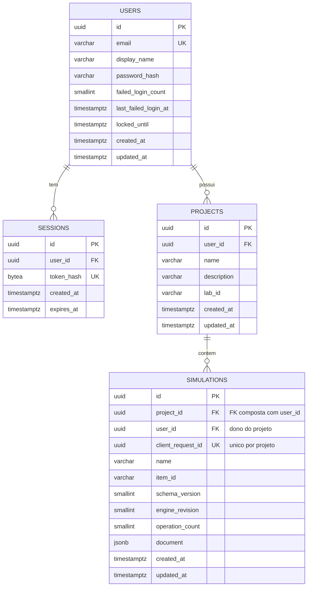
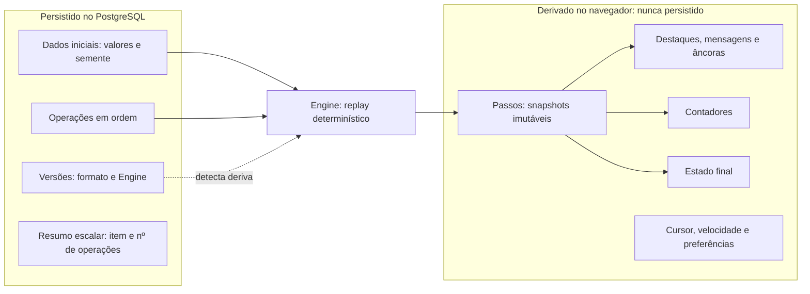

# DataStructure Studio — Modelagem de Dados

> **Versão:** 0.1 (rascunho para validação)
> **Data:** 13/11/2026
> **Base:** `REQUIREMENTS.md`, `USE_CASES.md`, `ARCHITECTURE.md` e ADR-0003, 0006, 0008 e 0009
> **Documento complementar:** [`API.md`](API.md) (contratos HTTP)
> **Escopo:** define *o que é persistido e como*. **Não** contém migrations, scripts SQL executáveis nem implementação de endpoints. O schema Prisma da seção 8 é uma **proposta** para revisão.

---

## 1. Como ler este documento

- ✅ **Confirmado:** vem de requisito, de ADR aceito ou de decisão do autor.
- 💡 **Proposta:** recomendação deste documento, aguardando aprovação.
- ❓ **Pendente:** decisão necessária antes de implementar (seção 18, numeradas **Q44 a Q64**, continuando a numeração dos documentos anteriores).
- Valores numéricos (limites, tamanhos, tempos) são 💡 sugestões, salvo indicação contrária.
- Nomes de tabelas e colunas em `snake_case`; nomes do Prisma em `camelCase`.

---

## 2. Resumo executivo

1. **Quatro tabelas bastam para o MVP:** `users`, `sessions`, `projects`, `simulations`. As três entidades sugeridas no pedido são necessárias, com um ajuste de nome (a "Workspace" é o **Projeto** dos requisitos) e **uma entidade a mais, justificada:** `Session` (decorre do ADR-0009).
2. **O histórico de simulações não tem entidade própria.** É a listagem das `simulations` de um projeto (RF-051). Não existem tabelas de operações, passos ou versões.
3. **Persiste-se a *receita*, não o resultado** (ADR-0006): dados iniciais, semente, operações em ordem e versões do formato e da Engine, em **um único documento JSONB** por simulação. **Nenhum passo, *snapshot*, destaque, mensagem, contador ou estado final vai ao banco.** Tudo isso é recalculado pela Engine ao reabrir.
4. **O custo de armazenamento é pequeno e limitado:** cerca de 1 KB para uma simulação típica e ≈ 10 KB no pior caso previsto (seção 11).
5. **A autorização é estrutural:** `simulations` carrega `user_id` e uma **chave estrangeira composta** `(project_id, user_id)` garante no banco que a simulação pertence ao dono do projeto (RNF-004, RN-020).
6. **Colunas escalares espelham o documento** (item, versões, nº de operações) para listar sem ler o JSON, e **restrições `CHECK` impedem que divirjam**.
7. **Separação de limites:** os limites de **produto** (50 elementos, 200 operações…) ficam na aplicação, com fonte única na Engine (RN-002); o banco tem apenas limites de **segurança**, mais folgados, para não exigir migration a cada ajuste de produto.
8. **Senhas:** só o *hash* em formato auto-descritivo é armazenado; **sessões:** só o *hash* do token.
9. **Exclusão física em cascata** (usuário → sessões e projetos → simulações): sem órfãos e coerente com a exclusão de dados exigida pela LGPD.
10. O schema Prisma proposto foi **validado sintaticamente** com o validador do Prisma (seção 8.2).

---

## 3. Requisitos e decisões que moldam o modelo

| Direcionador | Origem | Efeito no modelo |
|---|---|---|
| Simulação = dados iniciais + semente + operações | RF-049, RN-016, ADR-0006 | Um documento JSONB por simulação; sem tabela de operações |
| Reabrir reproduz o mesmo resultado | RF-050, RN-019, RNF-029 | Versões de formato e de Engine registradas; valores persistidos, não só a semente (seção 10.4) |
| Salvar é tudo-ou-nada | RN-017, RNF-032 | Transação única (simulação + atualização do projeto) |
| Falha de rede não duplica | ADR-0006 (idempotência) | `client_request_id` único por projeto |
| Dono dos dados | RF-038, RN-020, RNF-004 | FK `user_id`; FK composta; filtro por usuário em todo repositório (ADR-0008) |
| Histórico do projeto, resumo em lista | RF-051 | Colunas escalares de resumo; índice por projeto e data |
| Lista de projetos com nº de simulações | RF-043 | Contagem calculada, não armazenada (seção 9) |
| Projeto recente primeiro | RF-002, RF-043 | Índice `(user_id, updated_at DESC, id DESC)` |
| Sessão real com logout e expiração | RF-035, RF-036, ADR-0009 | Tabela `sessions` com *hash* do token |
| Limitação de tentativas | RN-024, RNF-005 | Contadores de falha no `users` |
| Excluir projeto remove simulações | RF-046, RN-022 | `ON DELETE CASCADE` |
| Excluir conta remove tudo (*Should*) | RF-041, RNF-007 | Cascata a partir de `users` |
| Catálogo vive na Engine | ADR-0002, ADR-0004 | Laboratório e item como texto validado na aplicação (sem tabelas de catálogo) |
| Listagens ≤ 300 ms com 1.000 simulações por usuário | RNF-008, RNF-026 | Índices por consulta (seção 12) |
| Coletar o mínimo de dados pessoais | RNF-007 | Sem IP, *user agent*, telefone etc. (seção 14) |

---

## 4. Avaliação das entidades

### 4.1 As três entidades sugeridas

| Entidade sugerida | Veredito | Análise |
|---|---|---|
| **User** | ✅ **Necessária** | Dona de projetos e sessões (RF-033 a RF-038) |
| **Workspace** | ⚠️ **Necessária, mas é o "Projeto"** | Os requisitos, casos de uso, telas e ADRs definem o **Projeto** como o contêiner nomeado de simulações, com laboratório associado (RF-042 a RF-046). A "Workspace" do pedido cumpre exatamente esse papel. **Adoto o nome `Project`** (❓ Q44) por coerência com ~40 requisitos e com as rotas já desenhadas. "Workspace" costuma sugerir um espaço **compartilhado entre pessoas** (membros, papéis), o que é *Won't* no MVP (RF-067, RF-068). Se o autor preferir "Workspace", a troca é só de nome (tabela, rotas, interface), sem mudar a estrutura. |
| **Simulation** | ✅ **Necessária** | Conteúdo salvável: dados iniciais + operações (RF-049 a RF-051) |

> **Se "Workspace" for algo diferente de "Projeto"** (por exemplo, um nível acima, agrupando projetos), isso **não está previsto** nos requisitos e não se justifica no MVP: adicionaria um nível de hierarquia sem funcionalidade que o use.

### 4.2 Entidade acrescentada

| Entidade | Veredito | Justificativa |
|---|---|---|
| **Session** | 💡 **Acrescentada** | ADR-0009 decidiu por **sessões no servidor** (logout e expiração reais, RF-035, RF-036). Sem esta tabela seria preciso JWT sem estado, que não permite invalidar no logout. Guarda só o *hash* do token. |

### 4.3 Entidades consideradas e **não** criadas

| Candidata | Decisão | Motivo |
|---|---|---|
| `Operation` (uma linha por operação) | ❌ | As operações são sempre lidas e gravadas **em conjunto** e em ordem; nunca consultadas isoladamente. Linhas exigiriam *joins*, ordem explícita e mais armazenamento por linha, sem benefício |
| `Step` / `Snapshot` / `Execution` | ❌ | Derivados determinísticos da receita; **não devem ser persistidos** (seção 11) |
| `SimulationHistory` / `SimulationVersion` | ❌ | O "histórico de simulações" (RF-051) é a lista de `simulations` do projeto |
| `LoginAttempt` | ❌ (MVP) | Contadores no `users` bastam (ADR-0009). Voltar a avaliar se for preciso limitar por e-mail inexistente (Q49) |
| `Lab` / `Item` (catálogo) | ❌ | O catálogo é código da Engine (fonte única); duplicá-lo no banco criaria duas fontes de verdade |
| `PasswordResetToken` | ⏳ | Entra junto com RF-039 (*Should*, exige serviço de e-mail) |
| `ShareLink` | ⏳ | Entra com RF-063 (*Could*) |
| `Membership` / equipes | ❌ | RF-067, RF-068 são *Won't* |
| `Preference` | ❌ | Velocidade e animação ficam no navegador (ADR-0010) |
| `AuditLog` | ❌ | Sem requisito; o registro estruturado da API cobre diagnóstico |
| `Tag`, `Folder` | ❌ | Sem requisito |

---

## 5. Diagrama entidade-relacionamento



**Leitura das cardinalidades:** um usuário tem **zero ou mais** sessões e projetos; um projeto tem **zero ou mais** simulações; cada projeto pertence a **exatamente um** usuário e cada simulação a **exatamente um** projeto.
`PROJECTS` tem uma chave única `(id, user_id)`, usada pela **chave estrangeira composta** de `SIMULATIONS (project_id, user_id)`. A unicidade `(project_id, client_request_id)` de `SIMULATIONS` não cabe no diagrama e está na seção 7.4.

### 5.1 O que vai ao banco e o que nunca vai



---

## 6. Modelo lógico

### 6.1 Esquema relacional

Notação: **PK** chave primária · **FK** chave estrangeira · **UK** chave única · `?` anulável.

```text
USERS        (id PK, email UK, display_name, password_hash,
              failed_login_count, last_failed_login_at?, locked_until?,
              created_at, updated_at)

SESSIONS     (id PK, user_id FK→USERS.id, token_hash UK,
              created_at, expires_at)

PROJECTS     (id PK, user_id FK→USERS.id, name, description?, lab_id,
              created_at, updated_at,
              UK (id, user_id))

SIMULATIONS  (id PK, project_id, user_id, client_request_id, name, item_id,
              schema_version, engine_revision, operation_count, document,
              created_at, updated_at,
              FK (project_id, user_id) → PROJECTS (id, user_id),
              UK (project_id, client_request_id))
```

### 6.2 Dependências funcionais e normalização

- Todas as tabelas estão em **3FN**. Os campos de resumo de `simulations` (`item_id`, `schema_version`, `engine_revision`, `operation_count`) são **redundantes de propósito** com o documento JSONB (desnormalização controlada, para listar sem ler o JSON). A divergência é **impedida por `CHECK`** (seção 9, RI-06), não deixada à disciplina.
- `simulations.user_id` é redundante com `projects.user_id`. A redundância é **protegida pela chave estrangeira composta** (RI-02): é impossível gravar uma simulação cujo `user_id` não seja o dono do projeto.
- **Nenhum valor derivável é armazenado** (contagem de simulações, estado final, passos).

### 6.3 Convenções

| Tema | Convenção |
|---|---|
| Nomes | Tabelas no plural e `snake_case`; colunas `snake_case`; chaves estrangeiras `<entidade>_id` |
| Identificadores | `uuid` nativo do PostgreSQL (16 bytes), gerado pela aplicação (❓ Q47) |
| Datas | `timestamptz(3)`, sempre em UTC; a API as serializa em ISO 8601 |
| Texto | `varchar(n)` com limites explícitos; texto sempre sem espaços nas pontas |
| Nulos | Só onde o significado de "ausente" existe (`description`, contadores de falha) |
| Exclusão | Física, em cascata (❓ Q56) |

---

## 7. Detalhamento por entidade

### 7.1 `users` — Usuário

**Finalidade:** conta de quem usa a plataforma de forma autenticada; dona de projetos e sessões; guarda a credencial (somente o *hash*) e o estado de bloqueio por tentativas.

| Atributo | Tipo | Nulo | Padrão | Descrição |
|---|---|---|---|---|
| `id` | `uuid` | não | gerado | **PK** |
| `email` | `varchar(254)` | não | — | Normalizado em minúsculas e sem espaços nas pontas; **único** |
| `display_name` | `varchar(60)` | não | — | Nome de exibição (RF-033) |
| `password_hash` | `varchar(255)` | não | — | *Hash* adaptativo **em formato auto-descritivo** (algoritmo, parâmetros, sal e *hash* na mesma *string*), o que permite reforçar os parâmetros no futuro sem migração de dados. **Nunca** a senha |
| `failed_login_count` | `smallint` | não | `0` | Falhas consecutivas de login dentro da janela |
| `last_failed_login_at` | `timestamptz` | sim | — | Marca o início/continuação da janela de falhas |
| `locked_until` | `timestamptz` | sim | — | Bloqueio temporário de novas tentativas |
| `created_at` | `timestamptz` | não | agora | — |
| `updated_at` | `timestamptz` | não | agora | Atualizado a cada alteração |

- **Chave primária:** `id`.
- **Chaves estrangeiras:** nenhuma.
- **Relacionamentos:** 1 → N com `sessions`; 1 → N com `projects`.
- **Restrições:**
  - `email` único.
  - `CHECK` `email` igual à sua versão em minúsculas (garante a normalização mesmo se a aplicação falhar) e com tamanho entre 3 e 254.
  - `CHECK` `display_name` com 2 a 60 caracteres após remover espaços nas pontas.
  - `CHECK` `password_hash` não vazio.
  - `CHECK` `failed_login_count` ≥ 0.
- **Índices:** o índice único de `email` serve ao *login* (busca exata por e-mail). **Nenhum índice adicional.**

> **Sobre o bloqueio:** a regra é aplicada pela aplicação (💡 5 falhas em 15 minutos → bloqueio de 15 minutos, ❓ Q49). Um sucesso zera o contador.

### 7.2 `sessions` — Sessão

**Finalidade:** representar uma sessão autenticada no servidor (ADR-0009). Permite **logout real** (apagar a linha) e **expiração controlada**.

| Atributo | Tipo | Nulo | Padrão | Descrição |
|---|---|---|---|---|
| `id` | `uuid` | não | gerado | **PK** |
| `user_id` | `uuid` | não | — | **FK** → `users.id` |
| `token_hash` | `bytea` | não | — | SHA-256 (32 bytes) do token opaco entregue ao cliente. **Único.** O token em si nunca é gravado |
| `created_at` | `timestamptz` | não | agora | — |
| `expires_at` | `timestamptz` | não | — | Expiração **absoluta** (💡 7 dias, Q11), calculada pela aplicação |

- **Chave primária:** `id`.
- **Chave estrangeira:** `user_id` → `users.id`, `ON DELETE CASCADE`.
- **Relacionamentos:** N → 1 com `users`.
- **Restrições:** `token_hash` único; `CHECK` de que `token_hash` tem exatamente 32 bytes; `CHECK` `expires_at` > `created_at`.
- **Índices:**
  - único em `token_hash` (resolve a sessão a cada requisição autenticada);
  - `user_id` (logout de todas as sessões, troca de senha, exclusão de conta, cascata);
  - `expires_at` (limpeza de sessões vencidas).
- **Sem** IP, *user agent* ou localização (minimização de dados, RNF-007).

### 7.3 `projects` — Projeto (a "Workspace" do pedido)

**Finalidade:** contêiner nomeado, de um usuário, que organiza simulações de **um laboratório** (RF-042; ❓ Q44, Q45).

| Atributo | Tipo | Nulo | Padrão | Descrição |
|---|---|---|---|---|
| `id` | `uuid` | não | gerado | **PK** |
| `user_id` | `uuid` | não | — | **FK** → `users.id` (dono) |
| `name` | `varchar(60)` | não | — | 3 a 60 caracteres (RF-042) |
| `description` | `varchar(500)` | sim | — | Opcional (💡 máx. 500, Q55) |
| `lab_id` | `varchar(40)` | não | — | Identificador do laboratório (ex.: de ordenação). **Imutável** depois de criado |
| `created_at` | `timestamptz` | não | agora | — |
| `updated_at` | `timestamptz` | não | agora | **Última atividade:** muda ao editar o projeto **e ao salvar uma simulação nele** |

- **Chave primária:** `id`.
- **Chave estrangeira:** `user_id` → `users.id`, `ON DELETE CASCADE`.
- **Relacionamentos:** N → 1 com `users`; 1 → N com `simulations`.
- **Restrições:**
  - **Única `(id, user_id)`:** não existe para identificar (o `id` já é único). Existe para ser **alvo da FK composta** de `simulations`.
  - `CHECK` `name` com 3 a 60 caracteres após remover espaços nas pontas.
  - `CHECK` `lab_id` no formato de identificador (minúsculas, dígitos e hífen). A **pertinência ao catálogo** é validada pela aplicação (a Engine é a fonte única).
  - **Nomes duplicados permitidos** (💡 Q12); portanto **não há** unicidade em `(user_id, name)`.
- **Índices:** `(user_id, updated_at DESC, id DESC)` — lista de projetos e "5 mais recentes" do dashboard, sem ordenação em memória (desempate por `id`, para paginação estável).
- **Imutabilidade de `lab_id`:** garantida pela aplicação (a API de edição não o aceita). Um *trigger* seria possível, mas é complexidade sem necessidade.

### 7.4 `simulations` — Simulação

**Finalidade:** guardar a **receita** de uma simulação (dados iniciais, semente, operações e versões) dentro de um projeto, para reabri-la e reproduzi-la (RF-049 a RF-051). É também o **histórico de simulações** do projeto.

| Atributo | Tipo | Nulo | Padrão | Descrição |
|---|---|---|---|---|
| `id` | `uuid` | não | gerado | **PK** |
| `project_id` | `uuid` | não | — | Parte da **FK composta** → `projects` |
| `user_id` | `uuid` | não | — | Parte da **FK composta** → `projects`; dono (redundante, protegido) |
| `client_request_id` | `uuid` | não | — | Identificador gerado pelo cliente por tentativa de salvar (**idempotência**, ADR-0006) |
| `name` | `varchar(80)` | não | — | Nome editável; sugestão automática "laboratório + data/hora" (RN-016) |
| `item_id` | `varchar(60)` | não | — | Estrutura/algoritmo (ex.: um algoritmo de ordenação). **Espelha** o documento |
| `schema_version` | `smallint` | não | — | Versão do formato do documento. **Espelha** o documento |
| `engine_revision` | `smallint` | não | — | Revisão da Engine que gerou o documento (detecção de deriva, ADR-0006). **Espelha** o documento |
| `operation_count` | `smallint` | não | — | Nº de operações (resumo de RF-051). **Espelha** o documento |
| `document` | `jsonb` | não | — | A receita (seção 10) |
| `created_at` | `timestamptz` | não | agora | Data exibida na lista |
| `updated_at` | `timestamptz` | não | agora | Mantida pelo padrão do ORM; só muda se houver sobrescrita (❓ Q52) ou renomeação (RF-052, *Should*) |

- **Chave primária:** `id`.
- **Chave estrangeira:** **composta** `(project_id, user_id)` → `projects (id, user_id)`, `ON DELETE CASCADE`.
- **Relacionamentos:** N → 1 com `projects` (e, por transitividade, com `users`).
- **Restrições:**
  - **Única `(project_id, client_request_id)`** — idempotência de salvamento (❓ Q51).
  - `CHECK` `name` com 1 a 80 caracteres após remover espaços nas pontas (ERR-020: nome vazio é rejeitado).
  - `CHECK` `item_id` no formato de identificador; pertinência ao catálogo e ao laboratório do projeto **validada na aplicação**.
  - `CHECK` `schema_version` ≥ 1 e `engine_revision` ≥ 1.
  - `CHECK` `operation_count` entre 0 e **1.000** — *backstop* de segurança. O limite de **produto** (💡 200, Q50) é da aplicação (seção 9, RI-15).
  - `CHECK` de que `document` é um **objeto** JSON e de que seu tamanho não passa de **64 KB** (*backstop*; limite de produto 💡 32 KB).
  - `CHECK` de **consistência** entre as colunas de resumo e o documento (RI-06).
- **Índices:**
  - `(project_id, created_at DESC, id DESC)` — histórico do projeto, "retomar a última", paginação;
  - único `(project_id, client_request_id)` — idempotência;
  - a FK composta usa o índice único `(id, user_id)` de `projects`.
- **Sem índice no JSONB:** nunca se consulta *dentro* do documento (seção 10.6).

---

## 8. Schema Prisma proposto

### 8.1 Proposta (💡, sem migrations)

> O bloco `generator`/`datasource` **depende da versão do Prisma** fixada no setup (❓ Q60). O exemplo segue o formato de Prisma 7 (URL de conexão fora do schema). Os modelos são independentes da versão. As restrições `CHECK` **não** são expressas no Prisma: entram como SQL manual nas migrations (seção 9.3).

```prisma
generator client {
  provider = "prisma-client"
  output   = "../generated"
}

datasource db {
  provider = "postgresql"
}

/// Conta de usuário. Nunca guarda a senha, apenas o hash.
model User {
  id                String    @id @default(uuid()) @db.Uuid
  email             String    @unique @db.VarChar(254) // minúsculas, sem espaços (CHECK no banco)
  displayName       String    @map("display_name") @db.VarChar(60)
  passwordHash      String    @map("password_hash") @db.VarChar(255) // formato auto-descritivo
  failedLoginCount  Int       @default(0) @map("failed_login_count") @db.SmallInt
  lastFailedLoginAt DateTime? @map("last_failed_login_at") @db.Timestamptz(3)
  lockedUntil       DateTime? @map("locked_until") @db.Timestamptz(3)
  createdAt         DateTime  @default(now()) @map("created_at") @db.Timestamptz(3)
  updatedAt         DateTime  @updatedAt @map("updated_at") @db.Timestamptz(3)

  sessions Session[]
  projects Project[]

  @@map("users")
}

/// Sessão no servidor. Só o hash (SHA-256) do token é guardado.
model Session {
  id        String   @id @default(uuid()) @db.Uuid
  userId    String   @map("user_id") @db.Uuid
  tokenHash Bytes    @unique @map("token_hash") // 32 bytes (CHECK no banco)
  createdAt DateTime @default(now()) @map("created_at") @db.Timestamptz(3)
  expiresAt DateTime @map("expires_at") @db.Timestamptz(3)

  user User @relation(fields: [userId], references: [id], onDelete: Cascade)

  @@index([userId])
  @@index([expiresAt])
  @@map("sessions")
}

/// Projeto: contêiner de simulações de um laboratório (a "Workspace" do pedido).
model Project {
  id          String   @id @default(uuid()) @db.Uuid
  userId      String   @map("user_id") @db.Uuid
  name        String   @db.VarChar(60)
  description String?  @db.VarChar(500)
  labId       String   @map("lab_id") @db.VarChar(40) // imutável; validado contra o catálogo da Engine
  createdAt   DateTime @default(now()) @map("created_at") @db.Timestamptz(3)
  updatedAt   DateTime @updatedAt @map("updated_at") @db.Timestamptz(3) // última atividade

  user        User         @relation(fields: [userId], references: [id], onDelete: Cascade)
  simulations Simulation[]

  @@unique([id, userId]) // alvo da FK composta de Simulation
  @@index([userId, updatedAt(sort: Desc), id(sort: Desc)])
  @@map("projects")
}

/// Simulação salva: a receita (dados iniciais + operações), nunca os passos.
model Simulation {
  id              String   @id @default(uuid()) @db.Uuid
  projectId       String   @map("project_id") @db.Uuid
  userId          String   @map("user_id") @db.Uuid // dono; garantido pela FK composta
  clientRequestId String   @map("client_request_id") @db.Uuid // idempotência
  name            String   @db.VarChar(80)
  itemId          String   @map("item_id") @db.VarChar(60) // espelha document.itemId
  schemaVersion   Int      @map("schema_version") @db.SmallInt // espelha document.schemaVersion
  engineRevision  Int      @map("engine_revision") @db.SmallInt // espelha document.engineRevision
  operationCount  Int      @map("operation_count") @db.SmallInt // espelha o tamanho de document.operations
  document        Json     @db.JsonB
  createdAt       DateTime @default(now()) @map("created_at") @db.Timestamptz(3)
  updatedAt       DateTime @updatedAt @map("updated_at") @db.Timestamptz(3)

  project Project @relation(fields: [projectId, userId], references: [id, userId], onDelete: Cascade)

  @@unique([projectId, clientRequestId])
  @@index([projectId, createdAt(sort: Desc), id(sort: Desc)])
  @@map("simulations")
}
```

### 8.2 Verificação realizada

- O schema (com os modelos acima) foi **validado** com o validador de schemas do Prisma (módulo de validação compatível com o Prisma 7.10.1): sintaxe, relações e a chave estrangeira composta. Um **teste negativo** (referência a campo inexistente) confirmou que o validador acusa erros.
- **Não foi possível** rodar `prisma validate` pela CLI neste ambiente (o *download* dos binários do Prisma é bloqueado). Portanto **não** foi verificado contra um PostgreSQL real, nem foram geradas migrations. Isso é feito no setup, com banco real.
- Em 13/11/2026, o registro npm mostrava **Prisma 7.x como versão estável e 8.0 em candidata a lançamento**. Como as mudanças de configuração entre majors afetam o bloco `datasource`, **fixar a versão no setup** (❓ Q60).

### 8.3 Notas sobre o schema

| Ponto | Explicação |
|---|---|
| `@@unique([id, userId])` em `Project` | Redundante com a PK, mas **necessário** como alvo da FK composta. Custo: um índice pequeno |
| `Simulation` sem relação direta com `User` | Intencional: o dono é derivado **via projeto**, e a FK composta impede inconsistência. Evita um segundo caminho de exclusão |
| `@updatedAt` em `Project` | O Prisma só o atualiza quando o **próprio registro** é atualizado; salvar uma simulação deve **tocar** `updated_at` do projeto explicitamente, na mesma transação |
| `Int @db.SmallInt` | Os valores cabem folgadamente (versões e contagens pequenas) |
| `Json @db.JsonB` | `jsonb` é o tipo adequado: validação de sintaxe no banco e leitura eficiente do documento inteiro |

---

## 9. Regras de integridade

### 9.1 Regras

| ID | Regra | Mecanismo | Origem |
|---|---|---|---|
| **RI-01** | Todo projeto pertence a **exatamente um** usuário | FK `NOT NULL` com cascata | RF-038 |
| **RI-02** | Toda simulação pertence a **exatamente um** projeto, e `simulations.user_id` é **sempre** o dono do projeto | FK **composta** `(project_id, user_id)` | RNF-004, RN-020 |
| **RI-03** | E-mail **único** e **em minúsculas** | Índice único + `CHECK` | RF-033 |
| **RI-04** | Token de sessão único; o banco só conhece o *hash* | Índice único + `CHECK` de 32 bytes | RF-036, ADR-0009 |
| **RI-05** | Salvar a mesma tentativa duas vezes não duplica | Única `(project_id, client_request_id)` | ADR-0006 |
| **RI-06** | Colunas de resumo **nunca divergem** do documento: `item_id`, `schema_version`, `engine_revision` e `operation_count` coincidem com o conteúdo de `document` | `CHECK` (expressão sobre o JSONB) | RF-051 |
| **RI-07** | `document` é um **objeto** JSON de tamanho limitado | `CHECK` (*backstop* 64 KB) | RNF-003 |
| **RI-08** | Sem órfãos: excluir usuário remove sessões e projetos; excluir projeto remove simulações | `ON DELETE CASCADE` | RF-046, RF-041 |
| **RI-09** | Datas em UTC; `updated_at` do usuário, do projeto e da simulação mudam quando ele muda; **`projects.updated_at` também muda ao salvar simulação** | `timestamptz`; transação de salvamento | RF-043, RF-045 |
| **RI-10** | Nomes com tamanho válido e sem espaços nas pontas | `CHECK` + normalização na aplicação | RF-042, ERR-008, ERR-020 |
| **RI-11** | `lab_id` e `item_id` têm formato de identificador | `CHECK` | — |
| **RI-12** | `item_id` **pertence ao laboratório** do projeto; `lab_id` pertence ao catálogo | **Aplicação** (o catálogo é da Engine) | RF-005 |
| **RI-13** | A senha **nunca** é armazenada em texto puro; apenas `password_hash` auto-descritivo. Nenhuma resposta da API o inclui | Aplicação + *whitelist* de campos nas consultas | RNF-001 |
| **RI-14** | `projects.lab_id` é imutável | **Aplicação** (a edição não o aceita) | RN-021 |
| **RI-15** | **Limites de produto** (💡 ≤ 50 elementos, ≤ 200 operações, ≤ 32 KB, cotas) valem na aplicação, com fonte única na Engine; o banco só aplica **limites de segurança** mais folgados | Zod em `contracts` + `CHECK` *backstop* | RN-002 |
| **RI-16** | Gravação composta é **atômica** (simulação + atualização do projeto) | Transação | RN-017, RNF-032 |

### 9.2 Princípio: limites de produto na aplicação, limites de segurança no banco

Se um limite de produto vivesse também no banco, ele passaria a ter **duas fontes de verdade** (contra RN-002) e mudá-lo exigiria migration. Por isso o banco usa valores **deliberadamente mais folgados** (por exemplo, 1.000 operações e 64 KB, contra 200 e 32 KB de produto): é uma rede de proteção contra *bugs* e abuso, não a regra de negócio.
Para limites que são **tamanho de coluna** (nomes), o tipo `varchar(n)` coincide com o limite de produto; aumentá-lo exige uma migration trivial.

### 9.3 O que o Prisma não expressa

O Prisma **não modela** `CHECK` nem consistência entre coluna e JSONB. As restrições `CHECK` das seções 7 e 9 entram como **SQL manual anexado às migrations** (❓ Q60). Cuidados:
- Em expressões sobre JSONB, a conversão de tipos pode **gerar erro** (e não "falha de checagem") se o documento tiver forma inesperada. As expressões devem verificar o tipo antes de converter (por exemplo, com uma construção condicional), para que a violação seja sempre uma falha de `CHECK`.
- A CLI do Prisma ignora `CHECK` ao comparar o schema com o banco; o processo precisa registrar isso (para que um novo *dev* não as remova ao regenerar migrations).

---

## 10. Estratégia de armazenamento em JSONB

### 10.1 O que é "estado de estrutura" aqui

Não se armazena **estado de estrutura** (como a pilha ou o vetor estão em cada passo). Armazena-se **apenas o estado inicial** (valores e semente) e **as operações** que, aplicadas pela Engine, reconstroem todos os estados. O estado final e todos os intermediários são **derivados**.

### 10.2 Estrutura conceitual do documento

(Definição formal em `contracts`; detalhes em [`API.md`](API.md), seção 4.)

| Campo | Conteúdo | Observações |
|---|---|---|
| `schemaVersion` | Inteiro | Versão do formato do documento |
| `engineRevision` | Inteiro | Revisão da Engine que o gerou; detecta deriva de comportamento |
| `itemId` | Texto | Estrutura/algoritmo |
| `initialData` | Objeto | Origem (`manual`, `random` ou `example`), **valores** (0 a 50 inteiros), **semente** (se aleatório) e identificador do exemplo (se for exemplo) |
| `operations` | Lista ordenada | Cada operação: tipo + parâmetros (valor, posição ou alvo). Tipos e parâmetros definidos pelos descritores da Engine |

**Não fazem parte do documento:** passos, *snapshots*, destaques, mensagens, âncoras, contadores, estado final, cursor, velocidade.

### 10.3 Regras de formato

1. Apenas **tipos JSON simples**: números inteiros (nunca fracionários), textos, listas e objetos. Sem `null` onde a ausência puder ser expressa pela falta do campo.
2. **Chaves curtas e estáveis** (camelCase), sem redundância dentro de cada operação.
3. Documento **sem campos desconhecidos**: o servidor os rejeita (proteção contra injeção de dados arbitrários e contra *mass assignment*).
4. Tudo que o documento declara (itens, tipos de operação, faixas) é validado por **Zod** em `contracts`, com os limites vindos da Engine.
5. O documento é **imutável depois de gravado** no MVP (nova versão = nova linha, ❓ Q52).

### 10.4 Persistir **valores** além da semente

Para dados aleatórios, o documento guarda **os valores gerados e a semente**. Só a semente bastaria para reproduzir, **mas** uma futura mudança no gerador pseudoaleatório faria a mesma semente produzir outros valores, **alterando silenciosamente** simulações antigas. Os valores (≤ 50 inteiros, ≈ 250 bytes) tornam o documento **autossuficiente**; a semente serve para exibição e para regenerar a mesma sequência quando o usuário desejar (RN-006). É a mesma lógica da versão de formato e da revisão da Engine. (❓ Q63.)

### 10.5 Evolução do formato

| Situação | Tratamento |
|---|---|
| Novo campo opcional | Mesma `schemaVersion`; leitores antigos o ignoram |
| Mudança incompatível | `schemaVersion` nova; o leitor **migra em memória** ao abrir (função de migração em `contracts`); o registro antigo **não é reescrito** |
| Versão desconhecida ou documento inválido | ERR-017: informa, preserva as demais simulações |
| Mudança de comportamento de um algoritmo | `engineRevision` nova; *fixtures* de documentos antigos na CI (RNF-033); decisão deliberada de migrar ou avisar |
| Migração em lote | Possível porque `schema_version` e `engine_revision` são colunas escalares (consultáveis sem abrir o JSON) |

### 10.6 Indexação e consulta

- **Sem índice GIN** e sem consultas dentro do JSONB: o documento é lido e gravado **por inteiro**. O que a interface precisa filtrar ou ordenar já está em colunas escalares.
- Se um dia for necessário filtrar por algo contido no documento (ex.: por item, em RF-047), **promover o campo a coluna** (como já ocorre com `item_id`), em vez de indexar o JSON.

### 10.7 Por que `jsonb` e não colunas ou texto

| Alternativa | Por que não |
|---|---|
| Colunas relacionais para operações | Rigidez e *joins* sem benefício (seção 4.3) |
| `json` (texto) | Sem validação binária e leitura mais lenta; sem vantagem aqui |
| `text` com JSON serializado | O banco não valida sintaxe nem permite `CHECK` sobre o conteúdo |
| Arquivo em armazenamento de objetos | Nova infraestrutura e perda de transação |

---

## 11. Estratégia para armazenar o histórico sem desperdiçar espaço

### 11.1 O que realmente precisa ser persistido

A pergunta correta é: **o que é *insubstituível*?** Tudo que a Engine consegue recalcular de forma determinística (RNF-029) **não precisa** ser guardado.

| Dado | Persistir? | Por quê |
|---|---|---|
| Dados iniciais (valores) | ✅ | Insubstituível: é a entrada |
| Semente | ✅ | Pequena; permite regenerar e exibir |
| Operações em ordem | ✅ | Insubstituível: é a ação do usuário |
| Versão do formato e revisão da Engine | ✅ | Detectar deriva e migrar |
| Nome, item, datas, nº de operações | ✅ | Listagem (RF-051) |
| **Passos / *snapshots*** | ❌ | Milhares por execução (≈ 2.500 × 50 elementos no pior caso); derivados determinísticos |
| Destaques, mensagens, âncoras | ❌ | Derivados do passo; dependem de idioma e do catálogo |
| Contadores | ❌ | Derivados dos passos |
| **Estado final** | ❌ | Derivado; guardá-lo duplicaria dados e poderia divergir |
| Execuções de operações anteriores | ❌ | Reprodutíveis pela receita |
| Cursor, velocidade, animação | ❌ | Preferência/volátil; ficam no navegador (ADR-0010) |
| Histórico da *sessão* de trabalho | ❌ | É a própria lista de operações do documento |

### 11.2 Estratégias adotadas

1. **Receita em vez de resultado** (ADR-0006): armazenamento proporcional ao **nº de operações**, não ao nº de passos (diferença de ordens de grandeza).
2. **Um documento por simulação, sem linhas por operação:** sem custo de cabeçalho por linha nem de índices extras.
3. **Nada derivado:** sem estado final, sem contagem de simulações, sem passos.
4. **Resumo escalar mínimo:** apenas o que a lista precisa (item, nº de operações, versões, datas), com consistência garantida por `CHECK`.
5. **Documento limitado:** máximo de operações e de tamanho (seção 9, RI-07, RI-15).
6. **Compressão automática do PostgreSQL:** valores acima de ≈ 2 KB são comprimidos e movidos para armazenamento auxiliar (TOAST) de forma transparente.
7. **Exclusão física em cascata:** apagar projeto ou conta libera o espaço; não há acúmulo de linhas "mortas" lógicas.
8. **Cotas** (💡 Q50) para impedir crescimento abusivo.

### 11.3 Estimativa de tamanho

Premissa: uma operação típica serializa em ≈ 50 bytes (ex.: tipo, valor, posição).

| Cenário | Cálculo aproximado | Tamanho |
|---|---|---|
| Simulação típica | 20 operações × 50 B + 50 valores × 5 B + cabeçalho ≈ 100 B | **≈ 1,4 KB** |
| Pior caso do produto | 200 operações × 50 B + 250 B + 100 B | **≈ 10,5 KB** |
| Usuário intenso: 1.000 simulações (RNF-026), típicas | 1.000 × ≈ 1,4 KB | **≈ 1,4 MB** |
| Usuário intenso, **todas no pior caso** | 1.000 × ≈ 10,5 KB | **≈ 10 MB** (antes da compressão) |
| Se guardássemos **passos** (comparação) | ≈ 2.500 passos × 50 elementos × ≈ 20 B | **≈ 2,5 MB por simulação** |

> **Conclusão:** persistir passos custaria **centenas de vezes** mais, sem acrescentar informação. As estimativas são **aproximadas** e devem ser medidas com dados reais no setup (`pg_column_size`).

### 11.4 Continuar uma simulação duplica o prefixo de operações

Pela regra RN-018 (💡 Q13), salvar após continuar uma simulação reaberta cria **uma nova linha** com as operações antigas **mais** as novas: o prefixo se repete. Avaliação:

| Opção | Análise | Decisão |
|---|---|---|
| **Aceitar a duplicação** | Custo máximo ≈ 10 KB por cópia; um usuário com 1.000 cópias consome ≈ 10 MB. Reabrir é uma leitura simples | ✅ **MVP** |
| Cadeia pai-filho com **delta** de operações | Economiza espaço, mas reabrir exige resolver a cadeia; excluir o pai quebra os filhos; mais complexidade e risco | ❌ |
| Coluna `derived_from_id` (apenas **linhagem**, sem delta) | Útil para a interface ("continuação de…"), mas não há requisito | ⏳ Adiada |

A duplicação é um custo **conhecido, limitado e barato**, e a alternativa é complexidade que o MVP não justifica.

---

## 12. Índices e consultas

| Consulta (caso de uso) | Tabela | Índice usado | Observação |
|---|---|---|---|
| Resolver sessão a cada requisição | `sessions` | único `token_hash` | Uma busca por chave única |
| Login por e-mail | `users` | único `email` | — |
| Encerrar todas as sessões / excluir conta | `sessions` | `user_id` | — |
| Limpar sessões vencidas | `sessions` | `expires_at` | Oportunista ou agendada (❓ Q58) |
| Lista de projetos (T-06) e 5 recentes (T-01) | `projects` | `(user_id, updated_at DESC, id DESC)` | Ordem já pelo índice; paginação estável |
| Abrir/editar/excluir projeto do usuário | `projects` | PK `id` + filtro por `user_id` | A busca por `id` é exata; o filtro por dono é sempre aplicado |
| Nº de simulações de cada projeto da página | `simulations` | `(project_id, …)` | Contagem agrupada para os ≤ 20 projetos da página. **Sem contador armazenado** (evita divergência) |
| Histórico de simulações do projeto (T-07) | `simulations` | `(project_id, created_at DESC, id DESC)` | Ordem já pelo índice |
| Retomar a última simulação | `simulations` | idem, primeiro registro | — |
| Abrir simulação por `id` com verificação de dono | `simulations` | PK `id` + filtro `user_id` | — |
| Idempotência de salvamento | `simulations` | único `(project_id, client_request_id)` | A violação da unicidade **é** o mecanismo |
| Cascata ao excluir projeto | `simulations` | `(project_id, …)` | Sem este índice a cascata varreria a tabela |

Com esses índices, as listagens atendem à meta de p95 ≤ 300 ms com 1.000 simulações por usuário (RNF-008, RNF-026) — **a confirmar com testes de carga no setup**.

---

## 13. Transações e concorrência

| Cenário | Tratamento |
|---|---|
| **Salvar simulação** | Uma transação: (1) conferir que o projeto existe e é do usuário; (2) inserir a simulação; (3) **tocar** `projects.updated_at`. Falha em qualquer etapa desfaz tudo (RN-017) |
| **Repetir o salvamento** (rede instável) | A violação de unicidade de `(project_id, client_request_id)` é capturada e a simulação **já existente** é devolvida |
| **Projeto excluído durante o salvamento** | A violação da chave estrangeira é traduzida em "não encontrado" (`NOT_FOUND`) |
| **Dois cliques em "Excluir projeto"** | A segunda exclusão não encontra o registro: `NOT_FOUND` (sem erro interno) |
| **Edição simultânea do mesmo projeto** | **Última escrita vence** (❓ Q64); sem controle otimista no MVP |
| **Cota excedida por requisições paralelas** | Contagem seguida de inserção não é atômica: a cota é **aproximada** (aceitável; o *backstop* de tamanho continua valendo) |
| **Login concorrente na mesma conta** | Atualização dos contadores de falha por incremento no banco; o sucesso zera |
| **Isolamento** | Padrão do PostgreSQL (*read committed*); a integridade é garantida por **restrições**, não por travas |

**Mapeamento de erros do Prisma:** violação de unicidade → regra de domínio (e-mail existente; salvamento repetido), violação de chave estrangeira → `NOT_FOUND`, registro inexistente → `NOT_FOUND`. Nenhum erro do Prisma chega ao cliente (RNF-034).

---

## 14. Segurança e proteção de dados

### 14.1 Inventário de dados pessoais (LGPD, RNF-007)

| Dado | Onde | Finalidade | Retenção |
|---|---|---|---|
| E-mail | `users.email` | Identificar e autenticar | Até a exclusão da conta |
| Nome de exibição | `users.display_name` | Exibição na interface | Idem |
| *Hash* da senha | `users.password_hash` | Autenticar | Idem |
| Datas de criação e de falhas de login | `users`, `sessions` | Operação e segurança | Idem; sessões somem ao expirar |
| Conteúdo de projetos e simulações | `projects`, `simulations` | Serviço ao usuário | Até exclusão pelo usuário ou da conta |

**Não coletado:** IP, *user agent*, localização, telefone, documento, data de nascimento. Os *logs* da API não registram senhas, tokens nem documentos inteiros (ARCHITECTURE, seção 13.5).

### 14.2 Senhas

- Só `password_hash`, em formato **auto-descritivo** (algoritmo, parâmetros, sal e *hash*), com sal único por usuário. Algoritmo e parâmetros: ADR-0009 (💡 `scrypt` nativo, ❓ Q39).
- O formato auto-descritivo permite **reforçar parâmetros** e **regravar o *hash*** no próximo login bem-sucedido.
- Nenhuma consulta que devolva dados ao cliente seleciona `password_hash` (lista de campos explícita nos repositórios).

### 14.3 Sessões

- O token só existe no cookie `httpOnly`; o banco guarda o **SHA-256** (32 bytes). Um vazamento do banco **não** permite assumir sessões.
- O token é aleatório de alta entropia; por isso um *hash* rápido (SHA-256) é adequado (diferente de senhas, que exigem *hash* adaptativo).
- Logout apaga a linha; troca de senha (RF-040, *Should*) apaga todas as sessões do usuário (índice `user_id`).
- 💡 Limite de sessões simultâneas por usuário (ex.: 10, removendo a mais antiga) — ❓ Q58.

### 14.4 Autorização no nível dos dados

1. Todo repositório recebe o usuário e **filtra por ele** (ADR-0008).
2. A **FK composta** impede, no banco, uma simulação apontando para o projeto de outro dono.
3. Recurso alheio e recurso inexistente produzem o **mesmo** resultado (`NOT_FOUND`).
4. **Descartado:** *Row-Level Security* do PostgreSQL. Dá defesa em profundidade, mas exige variáveis de sessão por requisição e interage mal com *pooling* e com o Prisma; a complexidade não compensa no MVP.

### 14.5 Privilégio mínimo e infraestrutura (❓ Q59)

- 💡 Dois papéis no PostgreSQL: **aplicação** (apenas leitura e escrita nas quatro tabelas, sem DDL) e **migração** (DDL), usado só no *deploy*/CI.
- Credenciais só por variáveis de ambiente; conexão ao banco por TLS em produção (depende de Q4); **criptografia em repouso e *backups*** conforme o provedor (RNF-035, condicionado a Q4).
- **Não adotado:** criptografia de coluna para e-mail (o dado é necessário em claro para *login*, e a minimização já limita o inventário).

### 14.6 Injeção e dados não confiáveis

- Prisma parametriza consultas; **proibido** montar SQL por concatenação. O SQL manual das migrations é revisado.
- O conteúdo de `document` **nunca é interpretado como código**; é dado validado e limitado. Textos (nomes, descrições) são exibidos escapados pelo React.
- Corpos de requisição **nunca** vão direto ao Prisma: sempre mapeados campo a campo a partir de objetos validados (proteção contra *mass assignment*).

---

## 15. Ciclo de vida dos dados

| Evento | Efeito |
|---|---|
| Cadastro | Linha em `users` |
| Login | Linha em `sessions`; contadores de falha zerados |
| Falha de login | Incrementa `failed_login_count`; pode definir `locked_until` |
| Logout | Apaga a sessão |
| Sessão vencida | Recusada; removida de forma oportunista (❓ Q58) |
| Criar/editar projeto | Linha em `projects`; `updated_at` atualizado |
| Salvar simulação | Linha em `simulations` + `projects.updated_at` (mesma transação) |
| Excluir projeto | Apaga o projeto e suas simulações (RF-046) |
| Excluir conta (*Should*) | Cascata completa (RF-041) |
| *Backups* | Política e retenção definidas com o deploy (Q4); **excluir a conta não apaga cópias antigas imediatamente** — registrar isso na política de privacidade se houver uso público |

---

## 16. Testabilidade do modelo

Seguindo o ADR-0013 (**PostgreSQL real, sem *mocks*** do Prisma), o banco precisa de testes próprios para as regras que **só ele garante**:

| Teste | Verifica |
|---|---|
| E-mail em maiúsculas é rejeitado pelo banco | RI-03 |
| Duas contas com o mesmo e-mail | RI-03 |
| Simulação com `user_id` diferente do dono do projeto é rejeitada | RI-02 |
| Excluir projeto/usuário remove simulações/sessões/projetos | RI-08 |
| Colunas de resumo divergentes do documento são rejeitadas | RI-06 |
| Documento que não é objeto, ou acima do *backstop*, é rejeitado | RI-07 |
| Salvar com o mesmo `client_request_id` devolve a mesma simulação | RI-05 |
| Falha injetada no meio do salvamento não deixa linha parcial | RI-16 |
| Acesso cruzado entre usuários em **todos** os repositórios | RNF-004 |
| Listagens usam os índices previstos (verificar o plano) | RNF-026 |
| *Fixtures* de documentos de versões anteriores são reabertos | RNF-033 |

---

## 17. Riscos do modelo

| ID | Risco | Prob. | Impacto | Mitigação |
|---|---|---|---|---|
| **DB-01** | `CHECK` fora do Prisma se perdem ao regenerar migrations | Média | Médio | Processo documentado; teste da seção 16 falha se faltarem (Q60) |
| **DB-02** | Divergência entre colunas de resumo e documento (*bug* da aplicação) | Baixa | Médio | `CHECK` de consistência; o servidor **calcula** os campos a partir do documento, nunca os recebe do cliente |
| **DB-03** | Deriva entre Engine e documentos antigos (conflito C3) | Média | Alto | `schema_version`, `engine_revision`, valores persistidos e *fixtures* na CI |
| **DB-04** | Mudança de versão maior do Prisma (7 → 8) altera configuração | Média | Baixo | Fixar versão no setup; isolar o Prisma nos repositórios |
| **DB-05** | Abuso de armazenamento por usuário autenticado | Média | Médio | Limites de produto, *backstops*, cotas (Q50) e limite de taxa nas escritas |
| **DB-06** | Bloqueio de conta usado para atrapalhar terceiros | Baixa | Médio | Bloqueio curto (💡 15 min); limitador por IP; limitação **aceita** (ver abaixo) |
| **DB-07** | FK composta confunde quem não conhece o padrão | Baixa | Baixo | Documentada na seção 7 e 8.3; alternativa simples em Q46 |
| **DB-08** | Estimativas de tamanho erradas | Baixa | Baixo | Medir no setup; os limites de produto são ajustáveis |

> **Limitação aceita (bloqueio por conta):** o bloqueio por conta revela, a quem o provoca, que a conta existe (resposta de excesso de tentativas em vez de credenciais inválidas). Como o **cadastro já revela** a existência (ERR-010, limitação aceita no ADR-0009), isso **não piora** o risco; em ambos os casos o limitador por IP limita o custo para o atacante. Se for preciso resposta uniforme, a saída é uma tabela de tentativas por identificador (`LoginAttempt`), que **não** se justifica no MVP.

---

## 18. Decisões pendentes antes da implementação

A numeração **continua** a dos documentos anteriores (Q1–Q43). A coluna **Prioridade** indica quando a decisão é necessária:
**A** = antes de criar o schema inicial · **B** = antes de implementar a API · **C** = pode ser decidida durante a implementação.

| # | Pergunta | Recomendação | Prior. | Afeta |
|---|---|---|---|---|
| **Q44** | Nome da entidade: **Project** ou **Workspace**? E "Workspace" significa o mesmo que "Projeto"? | `Project`, mesmo significado (seção 4.1) | **A** | Tabelas, rotas, interface |
| **Q45** | Um projeto tem **um único laboratório** (`lab_id` obrigatório e imutável)? (Q8) | Sim | **A** | `projects.lab_id`, validação de itens |
| **Q46** | Usar `user_id` **denormalizado + FK composta** em `simulations`, ou apenas `project_id` e filtrar por *join*? | FK composta (defesa em profundidade para RNF-004) | **A** | `simulations`, repositórios |
| **Q47** | Tipo de identificador: **UUID v4**, UUID v7 ou outro? | UUID v4 nativo (v7 só se houver ganho medido) | **A** | Todas as tabelas, URLs |
| **Q48** | E-mail: **minúsculas + `CHECK`** (recomendado) ou extensão `citext`? | Minúsculas + `CHECK` (sem extensão) | **A** | `users.email` |
| **Q60** | **Processo para `CHECK`** (SQL manual nas migrations) e **versão do Prisma** (7.x estável ou 8.x)? | Fixar a versão no setup; `CHECK` em SQL anexado; teste que as verifica | **A** | Migrations, CI |
| **Q51** | `client_request_id` **obrigatório**; repetição devolve a simulação existente (200)? | Sim | **B** | Tabela e `POST` de simulações |
| **Q52** | Ao continuar uma simulação, **sempre criar nova** ou permitir **sobrescrever**? (Q13) | MVP: sempre nova (sem `PUT`) | **B** | API, `updated_at` |
| **Q53** | **Validação por reprodução** na API (Q37)? Sem ela, o servidor não garante que o documento respeita o limite de 50 elementos ao longo das operações | Sim | **B** | API, resumo, ADR-0006 |
| **Q54** | Cadastro **sem login automático**? (Q24) | Sim (201 sem cookie) | **B** | `POST /api/auth/register` |
| **Q55** | **Limites de texto** (nome de simulação 1–80, descrição ≤ 500, nome de exibição 2–60) e **política de senha** (8–128, sem regras de composição)? (Q11) | Como proposto | **B** | Schemas e `CHECK` |
| **Q62** | **Origem ausente em mutações:** rejeitar? E valores dos **limites de taxa** por endpoint? | Rejeitar; valores da seção 7 de `API.md` | **B** | Segurança da API |
| **Q49** | **Bloqueio de login:** contadores no `users`, 5 falhas em 15 min, bloqueio de 15 min; aceitar a limitação da seção 17? | Sim | C | `users`, login |
| **Q50** | **Limites e cotas:** operações por simulação (200), tamanho do documento (32 KB), simulações por projeto, projetos por usuário. (amplia Q42) | 200 ops; 32 KB; 200 simulações por projeto; 50 projetos por usuário | C | Zod, `CHECK` *backstop* |
| **Q56** | Exclusão **física** em cascata ou lógica? | Física (LGPD) | C | Todas |
| **Q57** | Paginação por **página/tamanho** ou por cursor? | Página/tamanho (ADR-0008) | C | API |
| **Q58** | **Limpeza de sessões vencidas** (oportunista × agendada) e **limite de sessões** por usuário (10)? | Oportunista; limite de 10 | C | `sessions` |
| **Q59** | **Dois papéis no banco** (aplicação sem DDL; migração com DDL)? | Sim | C | Infraestrutura |
| **Q61** | ID malformado em rota: **400** ou 404? | 400 | C | API |
| **Q63** | Persistir **valores** gerados aleatoriamente além da semente? | Sim (seção 10.4) | C | Documento |
| **Q64** | Edição simultânea: **última escrita vence** ou controle otimista (ETag/versão)? | Última escrita vence | C | API, `projects` |

**Dependências já abertas que também afetam estes documentos:** Q3 (idioma), Q4 (deploy: TLS do banco, *backups*, hospedagem), Q11 (senha e sessão), Q13 (sobrescrever), Q24 (login automático), Q37 (reprodução no servidor), Q39 (algoritmo do *hash*), Q42 (limites).

### 18.1 Ajuste sugerido em ADR já proposto

O ADR-0006 (item 4) diz que "um resumo do **resultado**" fica em colunas escalares. Aqui o resumo escalar ficou em **item, versões e nº de operações** — o que o RF-051 pede — **sem** resumo do resultado: ele exigiria reproduzir a simulação no servidor (Q53) e criaria um dado derivado que pode divergir. Sugere-se **esclarecer o ADR-0006** nesse ponto. (Não alterei o ADR; fica para sua aprovação.)

---

## 19. Rastreabilidade: requisitos × modelo

| Requisito | Elemento do modelo |
|---|---|
| RF-033, RF-034 | `users` (`email`, `display_name`, `password_hash`, contadores de falha) |
| RF-035, RF-036 | `sessions` |
| RF-038, RNF-004 | FK `user_id`; FK composta; filtro nos repositórios |
| RF-041 (*Should*) | Cascata a partir de `users` |
| RF-042 a RF-046 | `projects` |
| RF-043 | Índice de `projects`; contagem de simulações calculada |
| RF-049, RF-050 | `simulations.document` |
| RF-051 | Índice `(project_id, created_at DESC, id DESC)`; colunas de resumo |
| RNF-001 | `password_hash` auto-descritivo |
| RNF-003 | `CHECK`s, tipos e limites |
| RNF-007 | Inventário mínimo de dados (seção 14.1) |
| RNF-026 | Índices da seção 12 |
| RNF-029, RNF-033 | `schema_version`, `engine_revision`, valores persistidos |
| RNF-032 | Transação de salvamento (RI-16) |

---

*Fim do documento. Migrations e implementação só serão iniciadas mediante solicitação.*
