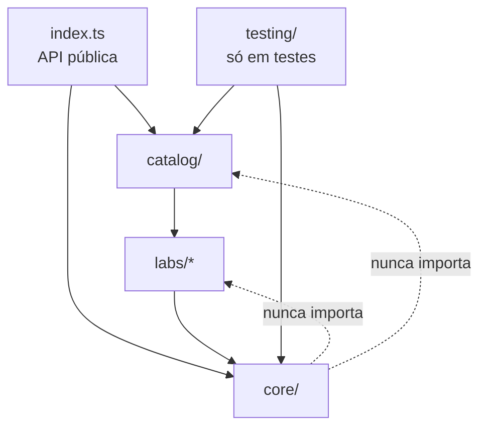
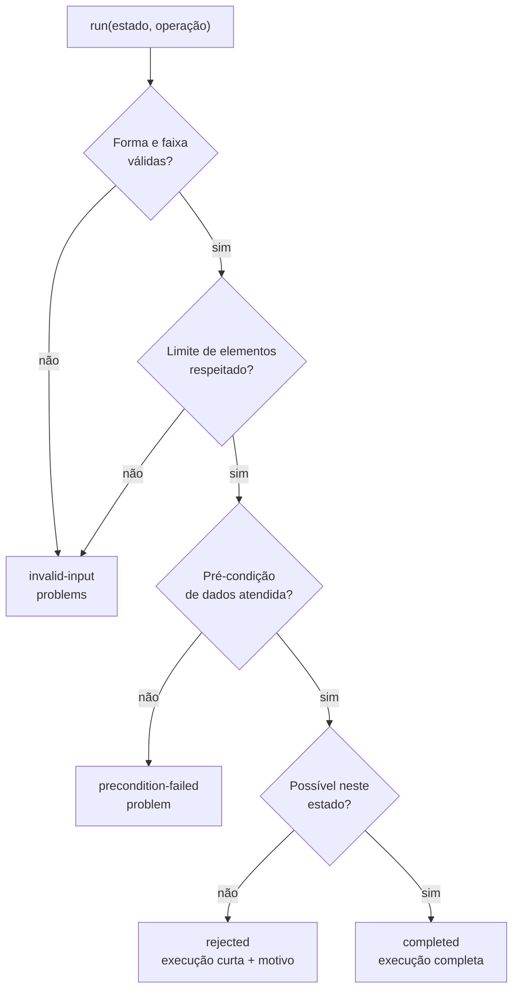
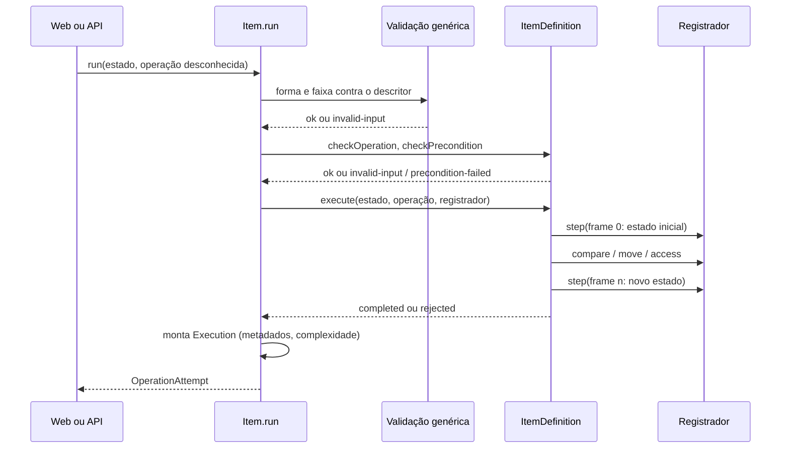

# DataStructure Engine — Contratos e Padrões

> **Versão:** 0.2 (**contratos aprovados e implementados: núcleo + Pilha**; a v0.1 era a proposta)
> **Data:** 16/11/2026 (proposta) · 17/11/2026 (implementação)
> **Base:** `ARCHITECTURE.md` §7, ADR-0002, ADR-0003, ADR-0004, ADR-0006, ADR-0013, `PROJECT_STRUCTURE.md` §6 e `API.md` §4
> **Escopo:** define **os contratos e os padrões** que toda estrutura de dados e todo algoritmo da Engine devem seguir. **Na v0.2, o núcleo (`core/`) e a primeira estrutura (Pilha) estão implementados e testados em `packages/engine`**; as demais estruturas continuam apenas como contratos. O que mudou entre a proposta e o código está na **seção 19**.

---

## 1. Como ler este documento

- ✅ **Confirmado:** vem do pedido, de requisito ou de ADR já registrado.
- 💡 **Proposta:** recomendação deste documento, aguardando aprovação.
- ❓ **Pendente:** decisão necessária (seção 15; numeração **Q74 a Q81**, continuando a dos documentos anteriores).
- **Os blocos de código TypeScript são cópias dos arquivos reais de `packages/engine/src`** (compilados com TypeScript 6.0.3, modo estrito, com `noUncheckedIndexedAccess` e `exactOptionalPropertyTypes`). A seção 14 diz o que está testado e o que não está.
- O caminho no topo de cada bloco (`packages/engine/src/...`) é o **local proposto** do arquivo.

---

## 2. Resumo executivo

1. **Uma execução é um valor, não um processo.** A Engine recebe um estado e uma operação e devolve uma `Execution` completa: estado inicial, estado final, lista de passos, resultado, complexidade e metadados (ADR-0003).
2. **Quatro desfechos, nenhum por exceção.** Entrada inválida e pré-condição não atendida **não geram execução**; operação rejeitada e operação concluída **geram**. Entrada de usuário **nunca lança exceção**; só violação de invariante (erro de programação) lança (seção 8).
3. **Estados são dados planos.** Cada família de estrutura tem um tipo de estado próprio, discriminado por `kind`. Elementos têm identidade estável (`ElementId`) e **se referenciam por id, nunca por referência de objeto**, o que elimina ciclos por construção (seção 5).
4. **Um único registrador de passos.** Algoritmos **declaram** o que fizeram (`compare`, `move`, `access`, `step`); só o registrador conta e numera. Isso torna os contadores consistentes entre todos os itens (seção 12).
5. **Texto fora da Engine.** Cada passo carrega `{chave, parâmetros}` tipados e uma âncora de pseudocódigo; os textos moram no catálogo do Web (ADR-0004).
6. **Tipagem que falha cedo.** Um único parâmetro de tipo (`ItemTypes`) amarra estado, operação, mensagens e âncoras de cada item. Mensagem com parâmetro faltando, chave inexistente ou estado não serializável **não compilam** (seção 7).
7. **Fachada sem genéricos.** O catálogo e o Web enxergam `Item`, `ItemDescriptor` e `Execution` sem parâmetros de tipo. O apagamento de tipos acontece em **um único arquivo** (`define-item.ts`), com quatro `as` comentados.
8. **Complexidade como dado.** Notação Big O vem de um **conjunto fechado**, por operação, com melhor, médio e pior caso, espaço e custo amortizado (seção 11).
9. **Testes genéricos sobre todo o catálogo.** Uma suíte de invariantes (I-01 a I-15, mais uma opcional) roda automaticamente para **todo item, todo exemplo e toda operação** (seção 14).
10. **Proposta de congelamento do contrato:** depois de **três itens de tipos visuais distintos** estarem implementados (ADR-0003), o contrato de `Step` e `Execution` passa a exigir ADR para mudar.

---

## 3. Premissas herdadas (não são rediscutidas aqui)

| Premissa | Origem |
|---|---|
| Engine em TypeScript puro, **zero dependências**, sem DOM, sem Node, sem relógio, sem `Math.random` | ADR-0002 |
| Execução **eager**; cada passo é um *snapshot* completo, imutável e serializável; passo 0 = estado anterior; último = resultado | ADR-0003 |
| Elementos com **identidade estável** entre passos (para animar movimento) | ADR-0003, RF-018 |
| Mensagem como `{chave, parâmetros}` e âncora de pseudocódigo; **texto não existe na Engine** | ADR-0004 |
| Persiste-se a **receita** (dados iniciais + operações), nunca os passos | ADR-0006 |
| Limites (`LIMITS`) com **definição única** na Engine | RN-002, ARCHITECTURE §11 |
| Simulações rodam **no navegador**; a API pode reproduzir receitas com a mesma Engine (Q37/Q53) | ADR-0005, ADR-0006 |
| Sem `Array.prototype.sort` nem funções nativas que façam o trabalho do algoritmo nas operações observadas (Q14) | ADR-0002 |

---

## 4. Organização interna da Engine

### 4.1 Estrutura proposta 💡

Refina a pasta `packages/engine/src` de `PROJECT_STRUCTURE.md` §4. As pastas `labs/<laboratório>/<item>` crescem **sob demanda**, como já definido.

```text
packages/engine/src/
├── index.ts                  API pública: ÚNICA porta de entrada
├── core/
│   ├── json.ts               JsonValue, JsonSafe, IsSerializable
│   ├── ids.ts                ElementId, LabId, ItemId, elementId()
│   ├── limits.ts             LIMITS (fonte única de RN-002)
│   ├── revision.ts           ENGINE_REVISION
│   ├── state.ts              Tipos de estado de cada família de estrutura
│   ├── inspect.ts            inspectState(): visão uniforme (contagem, ids, valores) de qualquer estado
│   ├── message.ts            Message, MessageCatalog
│   ├── item-types.ts         Operation, ItemTypes
│   ├── step.ts               Highlight, Counters, Step
│   ├── complexity.ts         Bound, Complexity
│   ├── problems.ts           InputProblem, PreconditionProblem, RejectionReason, EngineInvariantError
│   ├── execution.ts          Execution, OperationAttempt, ReplayResult
│   ├── item.ts               Descritores, ItemDefinition, StepRecorder, Item (fachada)
│   ├── define-item.ts        defineItem(): validação genérica + execução + montagem da Execution
│   ├── recorder.ts           Registrador de passos
│   ├── replay.ts             replay(): reprodução de receitas
│   └── rng.ts                PRNG semeado (mulberry32) e generateRandomValues
├── catalog/
│   └── registry.ts           Registro dos itens (listItems, getItem)
├── labs/
│   └── linear/stack/
│       ├── stack.ts          Definição da Pilha (tipos, descritor, execute)
│       └── stack.test.ts     Testes da Pilha
│   (demais laboratórios/itens: sob demanda)
└── testing/                  Apoio a testes; NUNCA importado por código de produção
    ├── invariants.ts         Suíte genérica de invariantes (I-01 a I-15) e amostras de operações
    ├── deep.ts               deepEqual, deepFreeze, deepClone
    └── type-checks.ts        Verificações só de compilação (@ts-expect-error)
```

**Duas diferenças em relação a `PROJECT_STRUCTURE.md` (aprovadas e já refletidas lá):**
1. Os **tipos de estado** moram em `core/state.ts` (em vez de uma pasta nova): são só tipos, não algoritmos.
2. `src/testing/` é uma pasta nova, **fora da API pública**, com a suíte de invariantes (seção 14). Sem ela, cada item reescreveria as mesmas verificações.

### 4.2 Regras de dependência interna 💡



| Regra | Imposição |
|---|---|
| `core/` **não importa** `labs/` nem `catalog/` | `no-restricted-imports` em `eslint.config.js` (verificada: um import proibido falha o lint) |
| Um item **não importa outro item**; o que for comum sobe para `core/` | Revisão de PR (ainda **não** automatizada: só existe um item) |
| `labs/` importa de `core/` os **contratos** e `defineItem`; nunca importa `recorder.ts` (o registrador chega ao item pelo argumento de `execute`) | Revisão |
| `testing/` **nunca** é exportado em `index.ts` e nunca é importado por código de produção | `no-restricted-imports` (verificada) |
| **Sem dependências externas, sem DOM, sem Node, sem `Date`, sem `Math.random`, sem ordenação nativa** | Regras já ativas em `eslint.config.js` (PROMPT 08) |

### 4.3 Superfície pública (`index.ts`) 💡

Exporta **somente**: os tipos de contrato e os valores `ENGINE_REVISION`, `LIMITS`, `EngineInvariantError`, `createRng`, `generateRandomValues`, `inspectState`, `listItems`, `getItem` e `replay` (um teste fixa exatamente essa lista). Tudo o mais é interno. Os itens individuais (`stackItem` etc.) **não** são exportados: chegam por `getItem('stack')`.

---

## 5. Padrão de representação das estruturas

### 5.1 Princípios ✅/💡

| # | Princípio | Por quê |
|---|---|---|
| P-1 | **Estado = dado plano**, sem classes, métodos, `Map`, `Set`, `Date`, funções ou `undefined` | Serializa por `JSON.stringify` sem perdas e passa entre navegador, API e *worker* |
| P-2 | **Referência por id, nunca por objeto**: `next: ElementId \| null`, nunca `next: ListNode` | Elimina ciclos (lista circular, grafo, nó com pai) por construção |
| P-3 | **Identidade estável**: `ElementId` é atribuído uma vez e mantido em todos os passos | A interface associa "o mesmo" elemento entre passos e anima o movimento (RF-018) |
| P-4 | **Ids determinísticos**: vêm de `state.nextId`, que cresce a cada criação | Mesma entrada, mesmos ids (RNF-029); nada de contador global |
| P-5 | **Imutabilidade**: um passo **nunca** é alterado depois de registrado; cada passo tem um estado **novo** (compartilhar elementos imutáveis entre estados é permitido) | Retroceder é trocar um índice (RN-010) |
| P-6 | **`null` em vez de `undefined`**; sem propriedades opcionais em estados | `JSON.stringify` descarta `undefined`; o teste de ida e volta falharia |
| P-7 | **`kind` discrimina** a família do estado | O Web escolhe o visualizador pelo `kind` (ADR-0011) |
| P-8 | **Formato canônico por família**: toda estrutura tem **uma** forma de ser escrita | Comparável em testes (*fixtures* dourados) e estável para persistência |

### 5.2 Tipos de estado propostos

Base: identidade, famílias de laboratório e limites.

```ts
// packages/engine/src/core/ids.ts
declare const elementIdBrand: unique symbol;

/** Identidade estável de um elemento ao longo de TODOS os passos (RF-018). Número, para JSON enxuto. */
export type ElementId = number & { readonly [elementIdBrand]: true };

export type LabId =
  | 'linear'
  | 'linked-lists'
  | 'trees'
  | 'hash-tables'
  | 'heaps'
  | 'graphs'
  | 'sorting'
  | 'searching';

export type ItemId = string;

/** Único lugar onde um número vira ElementId (geração a partir de `state.nextId`). */
export function elementId(n: number): ElementId {
  return n as ElementId;
}
```

```ts
// packages/engine/src/core/limits.ts
/** Fonte única dos limites (RN-002). Valores propostos; Q42 ainda está aberta. */
export const LIMITS = {
  maxElements: 50,
  minValue: -999,
  maxValue: 999,
  maxOperationsPerSimulation: 200,
  maxStepsPerExecution: 10_000,
} as const;
```

Um tipo por **família visual**; os oito do pedido cabem em **oito `kind`s** (algoritmos de ordenação e busca compartilham `sequence`).

```ts
// packages/engine/src/core/state.ts
import type { ElementId } from './ids';

/** Todo estado tem um discriminante (`kind`) e o contador que gera as próximas identidades. */
interface StateBase<K extends string> {
  readonly kind: K;
  /** Próxima identidade a ser atribuída; mantém a geração de ids determinística. */
  readonly nextId: number;
}

export interface Element {
  readonly id: ElementId;
  readonly value: number;
}

/** Vetores e algoritmos de ordenação/busca. Áreas auxiliares (merge sort, counting sort) ficam à parte. */
export interface SequenceState extends StateBase<'sequence'> {
  readonly elements: readonly Element[];
  readonly auxiliary: readonly { readonly name: string; readonly elements: readonly Element[] }[];
}

/** Pilha: do FUNDO para o TOPO. */
export interface StackState extends StateBase<'stack'> {
  readonly elements: readonly Element[];
}

/** Fila: da FRENTE para o FIM. */
export interface QueueState extends StateBase<'queue'> {
  readonly elements: readonly Element[];
}

/** Lista ligada: nós por referência de ID, nunca por referência de objeto (sem ciclos). */
export interface ListNode {
  readonly id: ElementId;
  readonly value: number;
  readonly next: ElementId | null;
  /** `null` em listas simples. */
  readonly prev: ElementId | null;
}
export interface LinkedListState extends StateBase<'linked-list'> {
  readonly variant: 'singly' | 'doubly' | 'circular';
  /** TODOS os nós alocados (inclusive ainda não ligados durante uma inserção), ordenados por id. */
  readonly nodes: readonly ListNode[];
  readonly head: ElementId | null;
  readonly tail: ElementId | null;
}

export interface BinaryTreeNode {
  readonly id: ElementId;
  readonly value: number;
  readonly left: ElementId | null;
  readonly right: ElementId | null;
}
export interface BinaryTreeState extends StateBase<'binary-tree'> {
  readonly nodes: readonly BinaryTreeNode[];
  readonly root: ElementId | null;
}

/** Heap implícito em vetor: filhos de i em 2i+1 e 2i+2. A árvore é só uma visão derivada. */
export interface HeapState extends StateBase<'heap'> {
  readonly order: 'min' | 'max';
  readonly elements: readonly Element[];
}

export interface HashEntry {
  readonly id: ElementId;
  readonly key: number;
  readonly value: number;
}
export interface HashTableState extends StateBase<'hash-table'> {
  readonly capacity: number;
  /** Encadeamento: sempre `capacity` baldes, cada um com sua lista de entradas. */
  readonly buckets: readonly { readonly index: number; readonly entries: readonly HashEntry[] }[];
}

export interface GraphVertex {
  readonly id: ElementId;
  /** Rótulo de exibição (dado, não frase): "A", "B"... */
  readonly label: string;
}
export interface GraphEdge {
  readonly id: ElementId;
  readonly from: ElementId;
  readonly to: ElementId;
  readonly weight: number | null;
}
export interface GraphState extends StateBase<'graph'> {
  readonly directed: boolean;
  readonly vertices: readonly GraphVertex[];
  readonly edges: readonly GraphEdge[];
}

export type StructureState =
  | SequenceState
  | StackState
  | QueueState
  | LinkedListState
  | BinaryTreeState
  | HeapState
  | HashTableState
  | GraphState;

export type StructureKind = StructureState['kind'];
```

### 5.3 Mapa das famílias pedidas 💡

| Família do pedido | `kind` do estado | Como é representada | Visualizador |
|---|---|---|---|
| **Pilhas** | `stack` | Vetor do **fundo para o topo** | Pilha |
| **Filas** | `queue` | Vetor da **frente para o fim** | Fila |
| **Listas encadeadas** | `linked-list` | Todos os nós alocados, `next`/`prev` por id, `head`/`tail` | Lista ligada |
| **Árvores** | `binary-tree` | Nós com `left`/`right` por id e `root` (árvores n-árias entram como novo `kind` quando houver item) | Árvore |
| **Heaps** | `heap` | Vetor com índices implícitos (filhos de *i* em 2*i*+1 e 2*i*+2); a árvore é uma **visão derivada** pelo visualizador | Vetor + árvore |
| **Tabelas hash** | `hash-table` | `capacity` baldes, cada um com sua lista de entradas (encadeamento); endereçamento aberto entra como novo `kind` ou variante | Baldes |
| **Grafos** | `graph` | Vértices e arestas por id; `directed`; peso `number \| null` | Grafo |
| **Ordenação e busca** | `sequence` | Vetor; áreas auxiliares (merge sort, counting sort) em `auxiliary` | Sequência |

### 5.4 Decisões de representação e justificativas

| Decisão | Justificativa | Alternativa descartada |
|---|---|---|
| **Lista ligada guarda *todos* os nós alocados**, mesmo os ainda não ligados | Mostra o passo didático "nó criado, ponteiros ainda não ajustados" (a parte que mais confunde quem aprende) | Guardar só os nós alcançáveis a partir de `head`: esconderia a etapa de religação |
| **Heap como vetor**, árvore derivada | É a representação real (e a que dá O(1) de acesso a filhos); evita manter duas fontes de verdade | Heap como árvore de nós: duplicaria a estrutura e permitiria estados inconsistentes |
| **Pilha e fila têm `kind` próprio**, embora sejam vetores | O visualizador é por tipo visual (ADR-0011): pilha cresce na vertical, fila na horizontal | Usar `sequence` para tudo: obrigaria o visualizador a adivinhar a estrutura |
| **Rótulo de vértice (`label: string`)** | É dado de exibição ("A", "B"), não frase | `number` apenas: pior para o aluno |
| **`nextId` dentro do estado** | Permite *replay* determinístico a partir de qualquer estado, sem estado global (ARCHITECTURE §7.6, regra 5) | Contador global: quebra determinismo e testes paralelos |
| **`ElementId` é `number` com marca (*branded*)** | JSON enxuto; a marca impede passar um índice de vetor onde se espera um id | `string`: mais verboso a cada passo (❓ Q75) |

> **O que fica em `Highlight`, e não no estado:** *qual* elemento está sendo comparado, o limite de "já ordenado", o pivô. Isso é informação **do passo**, não da estrutura; por isso o estado de uma ordenação é só o vetor.

---

## 6. Contratos das operações

### 6.1 Operação ✅/💡

Uma operação é `{ type, ...parâmetros }`, **plana e serializável**, exatamente como o documento persistido (`API.md` §4.2). Cada item declara a sua própria união:

```ts
type StackOperation =
  | { readonly type: 'push'; readonly value: number }
  | { readonly type: 'pop' }
  | { readonly type: 'peek' };
```

Os **parâmetros** de cada tipo de operação são declarados também **como dados**, no descritor (6.2). Isso permite que **a mesma declaração** monte o painel de operações da interface, valide a entrada e documente o item (RNF-023).

### 6.2 Descritor, definição e fachada

```ts
// packages/engine/src/core/item.ts
import type { Complexity } from './complexity';
import type { ExecutionResult, OperationAttempt } from './execution';
import type { ItemId, LabId } from './ids';
import type { ItemTypes } from './item-types';
import type { Message } from './message';
import type { InputProblem, PreconditionProblem, RejectionReason } from './problems';
import type { StructureKind, StructureState } from './state';
import type { Highlight } from './step';

// ---------- Descritor: dados que descrevem o item (a UI monta o painel a partir dele) ----------

export interface ParamDescriptor {
  readonly name: string;
  readonly role: 'value' | 'position' | 'target';
  readonly min: number;
  readonly max: number;
}

export interface OperationDescriptor<K extends string = string> {
  readonly type: K;
  readonly params: readonly ParamDescriptor[];
  readonly complexity: Complexity;
}

export interface ExampleDescriptor {
  readonly id: string;
  readonly values: readonly number[];
}

/** Descritor SEM genéricos: é o que o catálogo e o Web enxergam. */
export interface ItemDescriptor {
  readonly id: ItemId;
  readonly labId: LabId;
  /** Tipo visual/estrutural: decide qual visualizador o Web usa (ADR-0011). */
  readonly stateKind: StructureKind;
  readonly operations: readonly OperationDescriptor[];
  /** Todas as âncoras de pseudocódigo que o item pode emitir. */
  readonly anchors: readonly string[];
  /** Todas as chaves de mensagem que o item pode emitir (permite verificar em teste). */
  readonly messageKeys: readonly string[];
  readonly examples: readonly ExampleDescriptor[];
}

/** Descritor tipado, usado por quem escreve o item: amarra operações, âncoras e chaves aos seus tipos. */
export interface TypedItemDescriptor<T extends ItemTypes> extends ItemDescriptor {
  readonly operations: readonly OperationDescriptor<T['operation']['type']>[];
  readonly anchors: readonly T['anchors'][];
  readonly messageKeys: readonly (keyof T['messages'] & string)[];
}

// ---------- Registrador de passos: a ÚNICA forma de produzir passos e contar ----------

export interface StepFrame<T extends ItemTypes> {
  /** Estado da estrutura NESTE instante (novo objeto; nunca altere um estado já registrado). */
  readonly state: T['state'];
  readonly message: Message<T['messages']>;
  readonly anchor: T['anchors'] | null;
  readonly highlights?: readonly Highlight[];
}

export interface StepRecorder<T extends ItemTypes> {
  /** Fecha um passo: congela estado, destaques, mensagem e os contadores acumulados até aqui. */
  step(frame: StepFrame<T>): void;
  /** Só o registrador altera contadores: o algoritmo declara o que fez, não faz a conta. */
  compare(times?: number): void;
  move(times?: number): void;
  access(times?: number): void;
}

// ---------- Definição: o que o autor de um item escreve ----------

export interface ExecuteContext<T extends ItemTypes> {
  readonly state: T['state'];
  readonly operation: T['operation'];
  readonly recorder: StepRecorder<T>;
}

export type ExecuteOutcome<T extends ItemTypes> =
  | {
      readonly outcome: 'completed';
      readonly finalState: T['state'];
      readonly result: ExecutionResult;
    }
  | { readonly outcome: 'rejected'; readonly reason: RejectionReason };

export interface ItemDefinition<T extends ItemTypes> {
  readonly descriptor: TypedItemDescriptor<T>;

  /** Recebe valores JÁ validados (quantidade, inteiros, faixa) e devolve o estado inicial. */
  createInitialState(values: readonly number[]): T['state'];

  /** Entrada inválida que depende do estado (limite de elementos, ERR-003). Opcional. */
  checkOperation?(state: T['state'], operation: T['operation']): readonly InputProblem[];

  /** Pré-condição de dados (ex.: busca binária exige ordem, ERR-007). Opcional. */
  checkPrecondition?(state: T['state'], operation: T['operation']): PreconditionProblem | null;

  /**
   * Executa a operação registrando passos. Pode terminar `completed` ou `rejected`
   * (operação válida, mas impossível neste estado: ERR-004 a ERR-006).
   */
  execute(context: ExecuteContext<T>): ExecuteOutcome<T>;
}

// ---------- Fachada pública, SEM genéricos: o que o catálogo e o Web enxergam ----------

export type InitialStateResult =
  | { readonly ok: true; readonly state: StructureState }
  | { readonly ok: false; readonly problems: readonly InputProblem[] };

export interface Item {
  readonly descriptor: ItemDescriptor;
  /** `values` chega como `unknown` (JSON, formulário): a fachada valida antes de usar. */
  createInitialState(values: unknown): InitialStateResult;
  /** `operation` também é `unknown`. Nunca lança por entrada do usuário. */
  run(state: StructureState, operation: unknown): OperationAttempt;
}
```

**Como as quatro peças se encaixam**

| Peça | Quem escreve | Quem usa |
|---|---|---|
| `ItemDefinition<T>` | O autor do item | Somente `defineItem` |
| `TypedItemDescriptor<T>` | O autor do item | Compilador (amarra operações, âncoras e chaves aos tipos) |
| `ItemDescriptor` (sem genéricos) | — (derivado) | Catálogo, Web, API: monta formulários, valida âncoras |
| `Item` (fachada) | `defineItem` | Web e API: `createInitialState(values)` e `run(estado, operação)`; valores e operação chegam como `unknown` e são validados pela própria fachada |

### 6.3 Funções públicas da Engine

```ts
// packages/engine/src/index.ts
/**
 * Porta de entrada pública da Engine (ADR-0002): ÚNICA forma de usar o pacote.
 * Pacote puro: sem dependências, sem DOM, sem Node, sem relógio, sem aleatoriedade nativa.
 */

export { ENGINE_REVISION } from './core/revision';
export { LIMITS } from './core/limits';
export { createRng, generateRandomValues } from './core/rng';
export type { Rng } from './core/rng';
export { replay } from './core/replay';
export { listItems, getItem } from './catalog/registry';
export { EngineInvariantError } from './core/problems';
export { inspectState } from './core/inspect';

export type { ElementId, ItemId, LabId } from './core/ids';
export type { Bound, Complexity } from './core/complexity';
export type { Message, MessageCatalog, MessageParams } from './core/message';
export type { ItemTypes, Operation } from './core/item-types';
export type { Counters, Highlight, HighlightRole, HighlightTarget, Step } from './core/step';
export type {
  Execution,
  ExecutionMetadata,
  ExecutionResult,
  OperationAttempt,
  OperationSummary,
  ReplayResult,
} from './core/execution';
export type {
  ExampleDescriptor,
  InitialStateResult,
  Item,
  ItemDescriptor,
  OperationDescriptor,
  ParamDescriptor,
} from './core/item';
export type {
  InputProblem,
  InputProblemCode,
  PreconditionCode,
  PreconditionProblem,
  RejectionReason,
} from './core/problems';
export type {
  BinaryTreeNode,
  BinaryTreeState,
  Element,
  GraphEdge,
  GraphState,
  GraphVertex,
  HashEntry,
  HashTableState,
  HeapState,
  LinkedListState,
  ListNode,
  QueueState,
  SequenceState,
  StackState,
  StructureKind,
  StructureState,
} from './core/state';
```

### 6.4 Regras do contrato de operação 💡

| # | Regra |
|---|---|
| OP-1 | O **nome** da operação é `operation.type`, em `camelCase` (ex.: `insertAt`, `removeValue`) |
| OP-2 | Todo parâmetro é **inteiro** em faixa declarada no descritor (RN-002); parâmetros extras ou ausentes são entrada inválida |
| OP-3 | `run` **sempre devolve** um dos quatro desfechos; **nunca lança** por entrada de usuário |
| OP-4 | `run` é **pura**: não altera o estado recebido, não lê relógio, não usa aleatoriedade nativa (verificável: I-10 e I-11) |
| OP-5 | Operações que **geram dados aleatórios** recebem a **semente como parâmetro** ou usam valores já gerados (`generateRandomValues`); nunca sorteiam por conta própria |
| OP-6 | Todo item declara pelo menos **um exemplo** (`examples`) usado por testes e pela opção "carregar exemplo" |
| OP-7 | A complexidade é declarada **por operação** (seção 11) |

---

## 7. Estratégia de tipagem

### 7.1 Técnicas e o que cada uma garante

| Técnica | Onde | O que o compilador passa a garantir |
|---|---|---|
| **`ItemTypes`**: um parâmetro de tipo que agrupa `state`, `operation`, `messages` e `anchors` | `core/item-types.ts` | Um item não mistura o estado de uma pilha com operações de uma fila; contratos não precisam de quatro parâmetros genéricos |
| **Catálogo de mensagens tipado** (`Message<C>`) | `core/message.ts` | Cada **chave** exige exatamente **os seus parâmetros**; chave inexistente ou parâmetro faltando não compila (ADR-0004) |
| **Âncoras como união de literais** | Item | Um passo só pode citar uma âncora que o item declarou |
| **`ElementId` com marca** | `core/ids.ts` | Não se confunde índice de vetor com identidade |
| **Uniões discriminadas** (`StructureState`, `HighlightTarget`, `OperationAttempt`, `ExecutionResult`) | Contratos | `switch` exaustivo: ao criar um `kind` novo, todo lugar que o trata deixa de compilar até ser atualizado |
| **`JsonSafe` / `IsSerializable`** | `core/json.ts` | Estado ou execução com função, `undefined`, `Map`, `Set` ou `Date` **deixam de ser serializáveis em tempo de compilação** |
| **`readonly` em tudo** | Contratos | Mutação acidental de passo ou estado não compila |
| **Descritor tipado** (`TypedItemDescriptor<T>`) | `core/item.ts` | Tipos de operação, âncoras e chaves declarados no descritor **precisam** coincidir com os tipos do item |
| **`switch` exaustivo em `execute`** | Item | Operação nova na união sem tratamento não compila |

### 7.1.1 Verificações de tipo do esboço

O arquivo abaixo foi compilado junto com os contratos. As linhas com `@ts-expect-error` **precisam falhar**: se deixarem de falhar, o `tsc` acusa o erro.

```ts
// packages/engine/src/testing/type-checks.ts
/**
 * Verificações SÓ de compilação (não executa nada em tempo de execução).
 * Se alguma linha com `@ts-expect-error` deixar de falhar, o `tsc` acusa o erro.
 */
import type { Execution } from '../core/execution';
import type { Expect, IsSerializable } from '../core/json';
import type { Message } from '../core/message';
import type { StructureState } from '../core/state';
import type { StackMessages, StackTypes } from '../labs/linear/stack/stack';

// 1) Estados e execuções são serializáveis.
export type StatesAreSerializable = Expect<IsSerializable<StructureState>>;
export type StackExecutionIsSerializable = Expect<IsSerializable<Execution<StackTypes>>>;
export type ErasedExecutionIsSerializable = Expect<IsSerializable<Execution>>;

// 2) O verificador realmente reprova o que não é serializável.
interface WithFunction {
  readonly run: () => void;
}
interface WithUndefined {
  readonly maybe: number | undefined;
}
interface WithMap {
  readonly cache: Map<string, number>;
}
// @ts-expect-error função não é serializável
export type FunctionRejected = Expect<IsSerializable<WithFunction>>;
// @ts-expect-error undefined não sobrevive ao JSON
export type UndefinedRejected = Expect<IsSerializable<WithUndefined>>;
// @ts-expect-error Map não sobrevive ao JSON
export type MapRejected = Expect<IsSerializable<WithMap>>;

// 3) Mensagens são tipadas: chave e parâmetros precisam combinar.
export const validMessage: Message<StackMessages> = {
  key: 'stack.push.done',
  params: { value: 1, size: 2 },
};
// @ts-expect-error parâmetro obrigatório ausente
export const missingParam: Message<StackMessages> = {
  key: 'stack.push.done',
  params: { value: 1 },
};
// @ts-expect-error chave inexistente
export const unknownKey: Message<StackMessages> = { key: 'stack.fly', params: {} };
```

### 7.2 Opções do compilador específicas da Engine 💡 (❓ Q80)

Além da base (`strict`, `noUncheckedIndexedAccess` etc.), recomenda-se **`exactOptionalPropertyTypes: true` apenas em `packages/engine/tsconfig.json`**. Ele diferencia "propriedade ausente" de "propriedade `undefined`", que é exatamente a diferença que o JSON apaga. O esboço foi compilado com essa opção. Não se aplica à base para não impor o custo aos demais pacotes antes de haver necessidade.

### 7.3 Pontos de apagamento de tipos (os únicos `as`)

A fachada `Item` não tem genéricos, então algo precisa converter `T['state']`, `T['operation']` e `Execution<T>` para suas formas sem genéricos. Isso acontece em **`core/define-item.ts`**, em **quatro pontos**, todos comentados:

0. `raw as Record<string, unknown>`: em `parseOperation`, **depois** de confirmar que a operação é um objeto não nulo e não é lista (único `as` que não envolve `T`).
1. `state as T['state']`: logo **depois** de verificar `state.kind === descriptor.stateKind`.
2. `operation as unknown as T['operation']`: logo **depois** de validar a forma da operação contra o descritor.
3. `execution as unknown as Execution`: montagem final do resultado.

**Regra:** itens **não usam `as`** (a exceção é `elementId()`, em `core/ids.ts`, que cria um id a partir de `nextId`). Um `as` em um item é motivo de revisão.

### 7.4 `type` versus `interface` 💡

Catálogos de mensagens (`StackMessages`) usam **`type`**, não `interface`: apenas `type` aceita a restrição `{ [chave: string]: MessageParams }` sem assinatura de índice explícita. Estados e demais contratos usam `interface`.

### 7.5 O que a tipagem **não** garante (e quem garante)

| Garantia desejada | Quem garante |
|---|---|
| Uma âncora emitida existe **no descritor** em execução (e não só no tipo) | Teste I-05, I-06 |
| Todo passo mapeia a uma linha **existente do pseudocódigo** | Catálogo tipado no Web (ADR-0004) + teste de cobertura |
| Primeiro passo = estado inicial; contadores monótonos | Suíte de invariantes |
| Algoritmo **correto** (ordena de fato) | Testes do item |

---

## 8. Tratamento de operações inválidas

### 8.1 Os quatro desfechos

Materializam `ARCHITECTURE.md` §7.4 em um tipo: `OperationAttempt` (seção 10).



| Desfecho | Quando | Gera `Execution`? | Entra no histórico e na receita? | Exemplo |
|---|---|---|---|---|
| `invalid-input` | Forma, tipo, faixa ou **limite** (RN-002) | **Não** | **Não** | `push` com valor 5000 (ERR-002); `push` com 50 elementos (ERR-003) |
| `precondition-failed` | Dado não atende a exigência do algoritmo | **Não** | **Não** | Busca binária em dados desordenados (ERR-007) |
| `rejected` | Operação **válida**, mas impossível **neste estado** | **Sim**, curta | **Sim** (RF-013) | `pop` em pilha vazia (ERR-004); posição inexistente (ERR-005); valor ausente (ERR-006) |
| `completed` | Operação válida e possível | **Sim**, completa | **Sim** | `push` de 16 |

### 8.2 Como classificar (regra de decisão) ✅/💡

> **Pergunta:** *o problema está na **mensagem** ou no **mundo**?*
> - **Na mensagem** (o que o usuário pediu é malformado, fora da faixa ou ultrapassa um limite do produto): `invalid-input`. Nada acontece.
> - **No mundo, e o dado é o problema** (a estrutura é válida, mas o algoritmo exige algo que ela não tem): `precondition-failed`. O Web oferece resolver (ordenar antes).
> - **No mundo, e é uma situação didática** (pilha vazia, posição que não existe): `rejected`. É **conteúdo**: o usuário vê o que acontece.

**Consequência prática:** o limite de 50 elementos é `invalid-input` (ERR-003 bloqueia) **mesmo dependendo do estado**, porque é regra de produto e não de estrutura.

### 8.3 Códigos de problema

`InputProblemCode` reaproveita os **códigos de campo da API** (`API.md` §2.10) e acrescenta `LIMIT_EXCEEDED`. Assim a API mapeia **um para um**, sem tradução.

```ts
// packages/engine/src/core/problems.ts
/** Mesmos códigos de campo da API (API.md §2.10), mais LIMIT_EXCEEDED (ERR-003). */
export type InputProblemCode =
  'REQUIRED' | 'INVALID_TYPE' | 'OUT_OF_RANGE' | 'NOT_ALLOWED' | 'LIMIT_EXCEEDED';

export interface InputProblem {
  readonly code: InputProblemCode;
  /** Caminho do campo: "value", "operations[3].position"... */
  readonly path: string;
  readonly meta: { readonly min: number; readonly max: number } | null;
}

export type PreconditionCode = 'INPUT_NOT_SORTED';
export interface PreconditionProblem {
  readonly code: PreconditionCode;
}

/** Operação válida, mas impossível NESTE estado: vira execução curta e entra no histórico. */
export type RejectionReason = 'EMPTY_STRUCTURE' | 'POSITION_OUT_OF_RANGE' | 'VALUE_NOT_FOUND';

/** Única exceção da Engine: violação de invariante = erro de programação, nunca erro de usuário. */
export class EngineInvariantError extends Error {
  override readonly name = 'EngineInvariantError';
}
```

| Código | Significado | Mapeamento |
|---|---|---|
| `REQUIRED` | Parâmetro obrigatório ausente | API `REQUIRED` |
| `INVALID_TYPE` | Não é inteiro, ou não é o tipo esperado | API `INVALID_TYPE` (ERR-001) |
| `OUT_OF_RANGE` | Fora da faixa; `meta.min` e `meta.max` | API `OUT_OF_RANGE` (ERR-002) |
| `NOT_ALLOWED` | Parâmetro ou `type` desconhecido | API `NOT_ALLOWED` |
| `LIMIT_EXCEEDED` | Excederia o limite de elementos | Novo; ERR-003 |

`path` aponta o campo (`value`, `values[3]`). **Não há texto**: a interface escolhe a frase a partir do código e de `meta` (mesma separação de ADR-0004).

### 8.4 O que **lança exceção**

Somente `EngineInvariantError`, e **apenas por erro de programação**: teto de passos excedido, estado de outro `kind` entregue ao item, execução sem passos, item sem complexidade declarada. Interpretação: se isso ocorre, a Engine tem um defeito, e **o Web deve tratar como ERR-018** (erro inesperado, tela de contingência), nunca como erro do usuário.

### 8.5 Saída real do esboço

Entradas inválidas sobre a Pilha (executadas de verdade):

```json
{"outcome":"invalid-input","problems":[{"code":"OUT_OF_RANGE","path":"value","meta":{"min":-999,"max":999}}]}
{"outcome":"invalid-input","problems":[{"code":"INVALID_TYPE","path":"value","meta":null}]}
{"outcome":"invalid-input","problems":[{"code":"REQUIRED","path":"value","meta":null}]}
{"outcome":"invalid-input","problems":[{"code":"NOT_ALLOWED","path":"extra","meta":null}]}
{"outcome":"invalid-input","problems":[{"code":"LIMIT_EXCEEDED","path":"value","meta":{"min":0,"max":50}}]}
```

E a criação do estado inicial com valores ruins (`[1, 2.5, 99999]`) devolve **todos** os problemas de uma vez, cada um com seu caminho:

```json
{"ok":false,"problems":[{"code":"INVALID_TYPE","path":"values[1]","meta":null},{"code":"OUT_OF_RANGE","path":"values[2]","meta":{"min":-999,"max":999}}]}
```

---

## 9. Estratégia de serialização

### 9.1 O que é serializável 💡

**Tudo o que a Engine devolve** (`Execution`, `Step`, estados, `OperationAttempt`, `ReplayResult`) é JSON puro. O que **não** é serializado, por ser comportamento e não dado: `Item`, `ItemDefinition`, registrador, `Rng`.

### 9.2 Regras

| # | Regra | Como se verifica |
|---|---|---|
| S-1 | Só `string`, `number` (finito), `boolean`, `null`, listas e objetos simples | `IsSerializable<T>` em compilação |
| S-2 | Sem `undefined`: usar `null` ou omitir a propriedade (e `exactOptionalPropertyTypes`) | Compilação + I-09 |
| S-3 | Sem ciclos: referências por `ElementId` | I-09 (`JSON.stringify` falharia em ciclo) |
| S-4 | Sem `NaN`, `Infinity` ou `-0` | Validação de entrada (inteiros) + I-09 |
| S-5 | Ordem de listas é **significativa e estável** (formato canônico, P-8); a ordem de chaves de objeto **não** é | Comparação estrutural (`deepEqual`) nos testes |
| S-6 | **Ida e volta sem perdas:** `JSON.parse(JSON.stringify(x))` é estruturalmente igual a `x` | I-09, em **todo** passo de todo item |

Tipos de apoio (`core/json.ts`):

```ts
// packages/engine/src/core/json.ts
export type JsonPrimitive = string | number | boolean | null;
export type JsonValue =
  JsonPrimitive | readonly JsonValue[] | { readonly [key: string]: JsonValue };

/**
 * Mapeia T para a sua forma JSON. Se T contiver algo que não sobrevive a
 * JSON.stringify/JSON.parse (função, undefined, Map, Set, Date, classe), aquele ponto vira `never`
 * e `IsSerializable<T>` deixa de ser verdadeiro.
 */
export type JsonSafe<T> = T extends JsonPrimitive
  ? T
  : T extends (...args: never[]) => unknown
    ? never
    : T extends readonly (infer U)[]
      ? readonly JsonSafe<U>[]
      : T extends object
        ? { readonly [K in keyof T]: JsonSafe<T[K]> }
        : never;

/** Verdadeiro se T sobrevive a JSON sem perdas. */
export type IsSerializable<T> = [T] extends [JsonSafe<T>] ? true : false;

/** Uso: `type _ = Expect<IsSerializable<StackState>>;` (não compila se for `false`). */
export type Expect<T extends true> = T;
```

### 9.3 Onde a serialização é usada

| Uso | Serializa o quê | Observação |
|---|---|---|
| **Persistência** (ADR-0006) | **Só a receita** (dados + operações), que **não** é produzida pela Engine: vem do Web e é validada em `contracts` | A Engine **não persiste passos** |
| **Reabrir simulação** | Nada: a Engine **reproduz** a receita (`replay`) | Determinismo (RNF-029) |
| ***Fixtures* dourados** em testes | `Execution` inteira | Detecta mudança de comportamento (ADR-0006, item 7) |
| **Futuro:** *Web Worker* | `Execution` | Possível sem mudar o contrato |

### 9.4 Tamanho

Medido no esboço (pilha com 50 elementos, um `push`): **≈ 1,36 KB por passo** serializado (cada elemento ocupa cerca de 24 bytes). Multiplicando pelo **pior caso previsto de ≈ 2.500 passos** (ARCHITECTURE §7.6), uma `Execution` serializada inteira chegaria a **~3,4 MB** (**estimativa por multiplicação, não medida em ordenação real**; validar na prova de conceito). Na memória do navegador, os estados **compartilham** os elementos imutáveis entre passos, então o consumo real é menor que o do JSON. Como só a execução corrente é mantida (ADR-0003) e nada disso é persistido, o custo é aceitável.

### 9.5 Versionamento 💡

`metadata.engineRevision` identifica o comportamento que gerou a execução (ADR-0006). **Regra:** qualquer mudança que altere a sequência de passos de um item **incrementa a revisão** e atualiza os *fixtures* dourados **deliberadamente**. O `schemaVersion` do **documento salvo** pertence a `contracts` (`API.md` §4), não à Engine.

---

## 10. Formato dos resultados

### 10.1 Requisitos do pedido → campos

| Pedido | Campo em `Execution` |
|---|---|
| Nome da operação | `operationName` (e `operation`, com parâmetros) |
| Estado inicial | `initialState` |
| Estado final | `finalState` |
| Sequência de passos | `steps` |
| Descrição de cada passo | `steps[i].message` (`{chave, parâmetros}`) e `steps[i].anchor` (linha de pseudocódigo) |
| Elementos destacados | `steps[i].highlights` |
| Complexidade teórica | `complexity` |
| Metadados da operação | `metadata` |
| *(acréscimos)* | `outcome` (`completed`/`rejected`), `result` (valor, posição encontrada, "não encontrado") |

### 10.2 Contratos

```ts
// packages/engine/src/core/execution.ts
import type { Complexity } from './complexity';
import type { ElementId, ItemId, LabId } from './ids';
import type { InputProblem, PreconditionProblem, RejectionReason } from './problems';
import type { ItemTypes } from './item-types';
import type { Counters, Step } from './step';
import type { StructureState } from './state';

export type ExecutionResult =
  | { readonly type: 'none' }
  | { readonly type: 'value'; readonly value: number }
  | { readonly type: 'found'; readonly id: ElementId; readonly index: number }
  | { readonly type: 'not-found' };

export interface ExecutionMetadata {
  readonly itemId: ItemId;
  readonly labId: LabId;
  /** Revisão do comportamento da Engine que gerou esta execução (ADR-0006). */
  readonly engineRevision: number;
  readonly elementsBefore: number;
  readonly elementsAfter: number;
  readonly stepCount: number;
  readonly rejection: RejectionReason | null;
  readonly counters: Counters;
}

/** Resultado de uma simulação. Tudo aqui sobrevive a JSON.stringify/JSON.parse sem perdas. */
export interface Execution<T extends ItemTypes = ItemTypes> {
  /** Nome da operação (igual a `operation.type`), para listagens e histórico. */
  readonly operationName: T['operation']['type'];
  readonly operation: T['operation'];
  readonly outcome: 'completed' | 'rejected';
  readonly initialState: T['state'];
  readonly finalState: T['state'];
  readonly steps: readonly Step<T>[];
  readonly result: ExecutionResult;
  /** Complexidade TEÓRICA declarada no descritor; as contagens reais estão nos contadores. */
  readonly complexity: Complexity;
  readonly metadata: ExecutionMetadata;
}

/** Os quatro desfechos de uma tentativa (ARCHITECTURE.md §7.4). */
export type OperationAttempt<T extends ItemTypes = ItemTypes> =
  | { readonly outcome: 'invalid-input'; readonly problems: readonly InputProblem[] }
  | { readonly outcome: 'precondition-failed'; readonly problem: PreconditionProblem }
  | { readonly outcome: 'rejected' | 'completed'; readonly execution: Execution<T> };

export interface OperationSummary {
  readonly operationName: string;
  readonly outcome: 'completed' | 'rejected';
  readonly stepCount: number;
  readonly counters: Counters;
}

/** Reproduzir uma receita salva (ADR-0006) não guarda passos: só o estado final e resumos. */
export type ReplayResult =
  | {
      readonly ok: true;
      readonly finalState: StructureState;
      readonly summaries: readonly OperationSummary[];
    }
  | {
      readonly ok: false;
      /** Índice da operação que não pôde ser reproduzida; `null` quando o problema é global. */
      readonly failedAt: number | null;
      readonly reason:
        'invalid-initial-data' | 'too-many-operations' | 'invalid-input' | 'precondition-failed';
    };
```

```ts
// packages/engine/src/core/step.ts
import type { ElementId } from './ids';
import type { ItemTypes } from './item-types';
import type { Message } from './message';

export type HighlightTarget =
  | { readonly type: 'element'; readonly id: ElementId }
  | { readonly type: 'position'; readonly index: number }
  /** Intervalo de posições, extremos inclusos. */
  | { readonly type: 'range'; readonly from: number; readonly to: number }
  | { readonly type: 'edge'; readonly from: ElementId; readonly to: ElementId }
  | { readonly type: 'bucket'; readonly index: number };

/** Conjunto FECHADO: todo visualizador precisa tratar todos os papéis. */
export type HighlightRole =
  | 'comparing'
  | 'swapping'
  | 'sorted'
  | 'pivot'
  | 'found'
  | 'not-found'
  | 'search-range'
  | 'inserted'
  | 'removed'
  | 'visiting'
  | 'visited'
  | 'error'
  // ponteiros nomeados
  | 'head'
  | 'tail'
  | 'top'
  | 'front'
  | 'rear'
  | 'current'
  | 'previous'
  | 'root';

export interface Highlight {
  readonly target: HighlightTarget;
  readonly role: HighlightRole;
}

/** Acumulados até o passo (RN-012). Definições exatas: glossário técnico (Q17). */
export interface Counters {
  readonly comparisons: number;
  /** Trocas e movimentações/gravações de elemento. */
  readonly moves: number;
  readonly accesses: number;
}

/** Um momento observável da execução. Imutável e serializável. */
export interface Step<T extends ItemTypes = ItemTypes> {
  /** 0 = estado anterior à operação (RF-020). */
  readonly index: number;
  /** Snapshot COMPLETO da estrutura neste instante. */
  readonly state: T['state'];
  readonly highlights: readonly Highlight[];
  /** Descrição do passo como `{chave, parâmetros}`; o texto vive no catálogo do Web (ADR-0004). */
  readonly message: Message<T['messages']>;
  /** Linha de pseudocódigo corrente, como âncora simbólica. */
  readonly anchor: T['anchors'] | null;
  readonly counters: Counters;
}
```

```ts
// packages/engine/src/core/message.ts
export type MessageParams = {
  readonly [name: string]: number | boolean | string;
};
/** Catálogo de mensagens de um item: chave -> tipo dos parâmetros. Use `type`, não `interface`. */
export type MessageCatalog = { readonly [key: string]: MessageParams };

/** `{chave, parâmetros}` tipado: cada chave exige exatamente os seus parâmetros (ADR-0004). */
export type Message<C extends MessageCatalog = MessageCatalog> = {
  [K in keyof C & string]: { readonly key: K; readonly params: C[K] };
}[keyof C & string];
```

```ts
// packages/engine/src/core/item-types.ts
import type { MessageCatalog } from './message';
import type { StructureState } from './state';

/** A operação: `type` + parâmetros planos e serializáveis. É também o que se persiste (ADR-0006). */
export interface Operation {
  readonly type: string;
}

/** Agrupa os tipos de um item. Um único parâmetro de tipo evita propagar quatro em cada contrato. */
export interface ItemTypes {
  readonly state: StructureState;
  readonly operation: Operation;
  readonly messages: MessageCatalog;
  readonly anchors: string;
}
```

### 10.3 Decisões do formato

| Decisão | Justificativa |
|---|---|
| `initialState` e `finalState` aparecem **também** em `steps[0]` e no último passo | Atende ao contrato pedido e facilita ao Web ler o resultado sem percorrer passos. **Custo:** duplicam no JSON; **não** duplicam na memória (mesma referência). Invariantes I-01 e I-02 garantem a igualdade (❓ Q78) |
| `outcome` existe em `OperationAttempt` **e** em `Execution` | A união discriminada serve ao código que trata o desfecho; o campo na execução serve a quem só recebe a `Execution` (histórico, *fixtures*) |
| `Execution.complexity` é a **teórica**; os números reais ficam em `metadata.counters` e em cada passo | Permite ao Web comparar "o que a teoria prevê" com "o que ocorreu" |
| `result` é uma união pequena e fechada | Evita que a interface interprete o desfecho por convenção |
| Sem *timestamps*, sem duração | Determinismo (RNF-029): a mesma entrada produz o mesmo JSON |
| `ReplayResult` **não** carrega passos | Reabrir uma receita só precisa do estado final e de resumos; os passos de uma operação específica são gerados executando-a de novo |

### 10.4 Exemplo real

`push` de 16 sobre a pilha `[4, 8, 15]`, **saída real do esboço**:

```json
{
  "operationName": "push",
  "operation": {"type":"push","value":16},
  "outcome": "completed",
  "initialState": {"kind":"stack","nextId":3,"elements":[{"id":0,"value":4},{"id":1,"value":8},{"id":2,"value":15}]},
  "finalState": {"kind":"stack","nextId":4,"elements":[{"id":0,"value":4},{"id":1,"value":8},{"id":2,"value":15},{"id":3,"value":16}]},
  "steps": [
    {"index":0,"state":{"kind":"stack","nextId":3,"elements":[{"id":0,"value":4},{"id":1,"value":8},{"id":2,"value":15}]},"highlights":[],"message":{"key":"stack.push.start","params":{"value":16}},"anchor":"stack.push.entry","counters":{"comparisons":0,"moves":0,"accesses":0}},
    {"index":1,"state":{"kind":"stack","nextId":4,"elements":[{"id":0,"value":4},{"id":1,"value":8},{"id":2,"value":15},{"id":3,"value":16}]},"highlights":[{"target":{"type":"element","id":3},"role":"inserted"},{"target":{"type":"element","id":3},"role":"top"}],"message":{"key":"stack.push.done","params":{"value":16,"size":4}},"anchor":"stack.push.write","counters":{"comparisons":0,"moves":1,"accesses":0}}
  ],
  "result": {"type":"none"},
  "complexity": {"time":{"best":"O(1)","average":"O(1)","worst":"O(1)"},"space":"O(1)","amortized":null},
  "metadata": {"itemId":"stack","labId":"linear","engineRevision":1,"elementsBefore":3,"elementsAfter":4,"stepCount":2,"rejection":null,"counters":{"comparisons":0,"moves":1,"accesses":0}}
}
```

Observações sobre o exemplo: o passo 0 é o estado anterior; no passo 1 o elemento novo (`id` 3) recebe dois destaques (`inserted` e `top`); o contador `moves` sobe de 0 a 1 **no mesmo passo em que a gravação aparece**.

---

## 11. Representação da complexidade (Big O)

### 11.1 Contrato

```ts
// packages/engine/src/core/complexity.ts
/** Conjunto fechado de notações; n = tamanho da entrada, V = vértices, E = arestas. */
export type Bound =
  | 'O(1)'
  | 'O(log n)'
  | 'O(n)'
  | 'O(n log n)'
  | 'O(n^2)'
  | 'O(V)'
  | 'O(V + E)'
  | 'O(V^2)'
  | 'O((V + E) log V)';

export interface Complexity {
  readonly time: { readonly best: Bound; readonly average: Bound; readonly worst: Bound };
  readonly space: Bound;
  /** Custo amortizado, quando difere do pior caso (ex.: inserção em vetor dinâmico). */
  readonly amortized: Bound | null;
}
```

### 11.2 Decisões 💡 (❓ Q79)

| Decisão | Justificativa |
|---|---|
| **Conjunto fechado de notações** (`Bound`), não texto livre | O compilador impede "O(n²)" escrito de três jeitos; o Web mapeia cada notação a um estilo (cor, curva) |
| **Por operação**, não por item | A pilha tem O(1) em tudo; a lista ligada tem `insertHead` O(1) e `search` O(n); ordenação tem uma única operação (`sort`) |
| **Melhor, médio e pior caso** | Bubble Sort e Insertion Sort diferem justamente no melhor caso (RF-031) |
| **Espaço auxiliar** à parte | Merge Sort: tempo O(n log n), espaço O(n) |
| **`amortized` opcional** (como `null`) | Inserção em vetor dinâmico e tabela hash com redimensionamento |
| **Variáveis `n`, `V`, `E`** | Grafos precisam de duas variáveis; os demais usam `n` |
| **A nota explicativa não está na Engine** | Texto em português vive no catálogo do Web, chaveado por `itemId` e operação (ADR-0004) |

### 11.3 Teórica × medida

A execução carrega a complexidade **declarada**. Os contadores medem o que **aconteceu**. Isso permite um **teste de sanidade** de cada declaração: executar o item em tamanhos crescentes (por exemplo 8, 16, 32 e 50 elementos, com entradas geradas pelo PRNG semeado) e confirmar que o **crescimento dos contadores é compatível com a notação declarada** (I-16, opcional; é uma verificação de plausibilidade, não uma prova).

### 11.4 Exemplos de declaração esperada 💡

| Item | Operação | Melhor / médio / pior | Espaço |
|---|---|---|---|
| Pilha | `push`, `pop`, `peek` | O(1) / O(1) / O(1) | O(1) |
| Lista ligada simples | `insertHead` | O(1) / O(1) / O(1) | O(1) |
| Lista ligada simples | `search`, `removeValue` | O(1) / O(n) / O(n) | O(1) |
| Bubble Sort | `sort` | O(n) / O(n^2) / O(n^2) | O(1) |
| Merge Sort | `sort` | O(n log n) em todos os casos | O(n) |
| Busca binária | `search` | O(1) / O(log n) / O(log n) | O(1) |
| Tabela hash (encadeamento) | `insert`, `search` | O(1) / O(1) / O(n) | O(1) |
| Heap | `extract` | O(log n) em todos os casos | O(1) |
| BFS | `traverse` | O(V + E) em todos os casos | O(V) |

*(Os valores seguem a literatura usual e **serão confirmados contra a fonte bibliográfica escolhida em Q18**; este quadro é ilustrativo.)*

---

## 12. Modelo de geração de passos

### 12.1 Princípio

> O algoritmo **não monta a lista de passos**. Ele **narra** o que faz ao registrador; o registrador numera, congela e conta.



### 12.2 O registrador

`StepRecorder<T>` (definido em `core/item.ts`, seção 6.2) oferece **quatro verbos**:

| Verbo | Efeito |
|---|---|
| `step(frame)` | Fecha um passo: grava estado, destaques, mensagem, âncora e os **contadores acumulados até agora**; numera sequencialmente; **lança** se passar de `LIMITS.maxStepsPerExecution` |
| `compare(n = 1)` | Soma comparações |
| `move(n = 1)` | Soma trocas e movimentações/gravações de elemento |
| `access(n = 1)` | Soma acessos de leitura a elementos |

**Por que só o registrador conta:** a definição de "comparação", "troca" e "acesso" (Q17, RN-012) precisa ser **a mesma em todos os itens**. Se cada algoritmo mantivesse seus contadores, divergiriam. Com um registrador, a definição está em **um** arquivo.

### 12.3 Regras de geração 💡

| # | Regra |
|---|---|
| G-1 | **O primeiro `step` recebe o estado inicial** (passo 0 = estado anterior à operação) |
| G-2 | **O último `step` recebe o estado final** |
| G-3 | **Um passo por evento observável** (comparar, trocar, ligar um ponteiro, inserir, remover), não por linha de código (❓ Q74) |
| G-4 | **Cada passo tem um estado novo**; nunca se altera um estado já registrado (P-5) |
| G-5 | **Os contadores se atualizam antes do `step` que mostra o efeito**, de modo que o passo reflita o que acabou de acontecer |
| G-6 | **Toda mensagem e toda âncora** estão declaradas no descritor |
| G-7 | **Operação rejeitada**: execução **curta** (normalmente 2 passos: pergunta e constatação), estado final **igual** ao inicial, com `rejection` nos metadados |
| G-8 | **Teto de passos:** 💡 10.000 (Q42). Ultrapassar é erro de programação |
| G-9 | **Destaques** só referenciam elementos **presentes no estado do passo ou no estado do passo imediatamente anterior** (esta exceção permite animar a **saída** de um elemento removido: ele aparece em `removed` no passo seguinte à sua retirada) |
| G-10 | **Papéis de destaque são um conjunto fechado** (`HighlightRole`); um papel novo é mudança de contrato |

### 12.4 Como um algoritmo de ordenação usaria o registrador (descrição)

Para Bubble Sort, a cada par comparado: `compare()` e `step` com os dois elementos em `comparing`; se trocados, `move(2)` (ou o valor definido em Q17) e `step` com o novo vetor e os dois em `swapping`; ao fim de cada passada, `step` marcando o elemento fixado como `sorted`. O **estado** do passo é sempre só o vetor; "quem está sendo comparado" é destaque, não estado.

---

## 13. Demonstração: como uma estrutura futura usará os contratos

> **Esta é a implementação real da Pilha** (`labs/linear/stack/stack.ts`). Ainda **não** existe o catálogo de textos no Web (os textos dos passos virão com a interface).

### 13.1 Definição de um item (Pilha, `push`/`pop`/`peek`)

O autor de um item escreve **cinco coisas**: os tipos (`StackOperation`, `StackAnchor`, `StackMessages`, `StackTypes`), o **descritor**, a **criação do estado inicial**, a **verificação de limite** e o **`execute`**. Tudo o mais (validação, numeração dos passos, contadores, metadados, desfechos) vem do núcleo.

```ts
// packages/engine/src/labs/linear/stack/stack.ts
import type { Complexity } from '../../../core/complexity';
import { elementId } from '../../../core/ids';
import type { ItemDefinition } from '../../../core/item';
import { LIMITS } from '../../../core/limits';
import type { StackState } from '../../../core/state';
import { defineItem } from '../../../core/define-item';

type NoParams = { readonly [name: string]: never };

export type StackOperation =
  | { readonly type: 'push'; readonly value: number }
  | { readonly type: 'pop' }
  | { readonly type: 'peek' };

export type StackAnchor =
  | 'stack.push.entry'
  | 'stack.push.write'
  | 'stack.pop.check-empty'
  | 'stack.pop.read'
  | 'stack.pop.remove'
  | 'stack.peek.check-empty'
  | 'stack.peek.read';

export type StackMessages = {
  'stack.push.start': { value: number };
  'stack.push.done': { value: number; size: number };
  'stack.pop.start': NoParams;
  'stack.pop.reading': { value: number };
  'stack.pop.done': { value: number; size: number };
  'stack.peek.start': NoParams;
  'stack.peek.done': { value: number };
  'stack.empty': NoParams;
};

export interface StackTypes {
  readonly state: StackState;
  readonly operation: StackOperation;
  readonly messages: StackMessages;
  readonly anchors: StackAnchor;
}

const CONSTANT: Complexity = {
  time: { best: 'O(1)', average: 'O(1)', worst: 'O(1)' },
  space: 'O(1)',
  amortized: null,
};

const stackDefinition: ItemDefinition<StackTypes> = {
  descriptor: {
    id: 'stack',
    labId: 'linear',
    stateKind: 'stack',
    operations: [
      {
        type: 'push',
        params: [{ name: 'value', role: 'value', min: LIMITS.minValue, max: LIMITS.maxValue }],
        complexity: CONSTANT,
      },
      { type: 'pop', params: [], complexity: CONSTANT },
      { type: 'peek', params: [], complexity: CONSTANT },
    ],
    anchors: [
      'stack.push.entry',
      'stack.push.write',
      'stack.pop.check-empty',
      'stack.pop.read',
      'stack.pop.remove',
      'stack.peek.check-empty',
      'stack.peek.read',
    ],
    messageKeys: [
      'stack.push.start',
      'stack.push.done',
      'stack.pop.start',
      'stack.pop.reading',
      'stack.pop.done',
      'stack.peek.start',
      'stack.peek.done',
      'stack.empty',
    ],
    examples: [{ id: 'basic', values: [4, 8, 15] }],
  },

  createInitialState(values) {
    return {
      kind: 'stack',
      nextId: values.length,
      elements: values.map((value, i) => ({ id: elementId(i), value })),
    };
  },

  checkOperation(state, operation) {
    if (operation.type === 'push' && state.elements.length >= LIMITS.maxElements) {
      return [{ code: 'LIMIT_EXCEEDED', path: 'value', meta: { min: 0, max: LIMITS.maxElements } }];
    }
    return [];
  },

  execute({ state, operation, recorder }) {
    switch (operation.type) {
      case 'push': {
        const { value } = operation;
        recorder.step({
          state,
          message: { key: 'stack.push.start', params: { value } },
          anchor: 'stack.push.entry',
        });
        const element = { id: elementId(state.nextId), value };
        const next: StackState = {
          ...state,
          nextId: state.nextId + 1,
          elements: [...state.elements, element],
        };
        recorder.move();
        recorder.step({
          state: next,
          highlights: [
            { target: { type: 'element', id: element.id }, role: 'inserted' },
            { target: { type: 'element', id: element.id }, role: 'top' },
          ],
          message: { key: 'stack.push.done', params: { value, size: next.elements.length } },
          anchor: 'stack.push.write',
        });
        return { outcome: 'completed', finalState: next, result: { type: 'none' } };
      }

      case 'pop': {
        recorder.step({
          state,
          message: { key: 'stack.pop.start', params: {} },
          anchor: 'stack.pop.check-empty',
        });
        const top = state.elements.at(-1);
        if (top === undefined) {
          recorder.step({
            state,
            message: { key: 'stack.empty', params: {} },
            anchor: 'stack.pop.check-empty',
          });
          return { outcome: 'rejected', reason: 'EMPTY_STRUCTURE' };
        }
        recorder.access();
        recorder.step({
          state,
          highlights: [{ target: { type: 'element', id: top.id }, role: 'top' }],
          message: { key: 'stack.pop.reading', params: { value: top.value } },
          anchor: 'stack.pop.read',
        });
        const next: StackState = { ...state, elements: state.elements.slice(0, -1) };
        recorder.move();
        recorder.step({
          state: next,
          highlights: [{ target: { type: 'element', id: top.id }, role: 'removed' }],
          message: {
            key: 'stack.pop.done',
            params: { value: top.value, size: next.elements.length },
          },
          anchor: 'stack.pop.remove',
        });
        return {
          outcome: 'completed',
          finalState: next,
          result: { type: 'value', value: top.value },
        };
      }

      case 'peek': {
        recorder.step({
          state,
          message: { key: 'stack.peek.start', params: {} },
          anchor: 'stack.peek.check-empty',
        });
        const top = state.elements.at(-1);
        if (top === undefined) {
          recorder.step({
            state,
            message: { key: 'stack.empty', params: {} },
            anchor: 'stack.peek.check-empty',
          });
          return { outcome: 'rejected', reason: 'EMPTY_STRUCTURE' };
        }
        recorder.access();
        recorder.step({
          state,
          highlights: [{ target: { type: 'element', id: top.id }, role: 'top' }],
          message: { key: 'stack.peek.done', params: { value: top.value } },
          anchor: 'stack.peek.read',
        });
        return {
          outcome: 'completed',
          finalState: state,
          result: { type: 'value', value: top.value },
        };
      }
    }
  },
};

export const stackItem = defineItem(stackDefinition);
```

### 13.2 O que o exemplo demonstra

| Ponto | Onde se vê |
|---|---|
| Item escreve só o que é dele; validação de forma e faixa vêm **do descritor** | `push` declara `value` com faixa; nenhum `if` de validação em `execute` |
| Limite de elementos como `invalid-input` | `checkOperation` |
| Operação **rejeitada** (pilha vazia) gera execução curta e **não** lança | ramo `top === undefined` de `pop` e `peek` |
| Contadores sem aritmética manual | `recorder.move()` e `recorder.access()` |
| Destaque de elemento **removido** referenciando o passo anterior | `pop`, papel `removed` (regra G-9) |
| `switch` **exaustivo**: operação nova sem tratamento não compila | `execute` |
| Mensagens e âncoras checadas pelo compilador | Qualquer chave errada em `message` é erro de tipo |

### 13.3 Resultado real da execução

Sequência executada sobre a pilha `[4, 8, 15]` (coberta por testes):

| Operação | Desfecho | Passos |
|---|---|---|
| `push 16` | `completed` | 2 |
| `pop` (4 vezes) | `completed` | 3 cada |
| `pop` (pilha já vazia) | **`rejected`** (`EMPTY_STRUCTURE`) | 2 |

O JSON completo de `push 16` está na seção 10.4.

### 13.4 Como as demais famílias se encaixam

Todas usam **o mesmo registrador, o mesmo `Execution` e os mesmos desfechos**. O que muda é o `kind` do estado, as operações e os destaques.

| Item futuro | `kind` | Operações (exemplos) | Destaques típicos | Observação de modelagem |
|---|---|---|---|---|
| Fila | `queue` | `enqueue`, `dequeue`, `front` | `front`, `rear`, `inserted`, `removed` | Igual à Pilha, com os extremos trocados |
| Lista ligada | `linked-list` | `insertHead`, `insertAt`, `removeValue`, `search` | `current`, `previous`, `head`, `tail`, `visited`, `found` | Passos: aloca nó → ajusta `next` do novo → ajusta ponteiro do anterior. O nó **existe e não está ligado** em um passo intermediário |
| Árvore binária de busca | `binary-tree` | `insert`, `search`, `remove`, percursos | `current`, `visiting`, `visited`, `found` | Posições de layout **não** entram no estado: o visualizador as calcula |
| Heap | `heap` | `insert`, `extract` | `comparing`, `swapping` | Dois níveis de leitura (vetor e árvore) vêm do **mesmo** estado |
| Tabela hash | `hash-table` | `insert`, `search`, `remove` | `bucket`, `visiting`, `found` | `HighlightTarget` do tipo `bucket` |
| Grafo | `graph` | `bfs`, `dfs` | `visiting`, `visited`, `edge` | Fila/pilha auxiliar do percurso aparece em `Message.params` (ou futuramente em campo auxiliar) |
| Ordenação | `sequence` | `sort` | `comparing`, `swapping`, `sorted`, `pivot` | Merge Sort usa `auxiliary` |
| Busca | `sequence` | `search` | `search-range`, `comparing`, `found`, `not-found` | Busca binária declara `checkPrecondition` (`INPUT_NOT_SORTED`) |

**Acrescentar um item** exige: tipos, descritor, `createInitialState`, `execute`, textos no catálogo do Web e **nenhuma alteração** em núcleo, controles de reprodução, painel de explicação ou histórico (RNF-023, ARCHITECTURE §7.7).

---

## 14. Estratégia de testes

### 14.1 Camadas

| Camada | Tipo | Foco | Onde fica |
|---|---|---|---|
| **Tipos** | Testes de compilação (`@ts-expect-error`, `expectTypeOf`) | Serialização (`IsSerializable`), tipagem de mensagens, exaustividade | `core/*.test-d.ts` ou `*.test.ts` |
| **Núcleo** | Unitários | Validação de operação, registrador, PRNG, limites, montagem da `Execution` | `core/*.test.ts` |
| **Suíte de invariantes** | **Genérica**, roda sobre **todo o catálogo** | I-01 a I-15 (abaixo) | `testing/invariants.ts`, acionada por um teste que percorre `listItems()` |
| **Item** | Unitários e de propriedades | Corretude do algoritmo; casos de borda; rejeições; `fixtures` dourados | `labs/<lab>/<item>/<item>.test.ts` |
| **Arquitetura** | Lint e verificação do `package.json` | Sem dependências; fronteiras internas | `eslint.config.js` e teste de arquitetura |
| **Cobertura** | Portão na CI | 💡 ≥ 90% de linhas, ramos, funções e instruções | Já configurado (PROMPT 08) |

### 14.2 Invariantes verificadas automaticamente em todo item

Para **cada item**, **cada exemplo** e **cada operação** do descritor (com entradas válidas e válidas-mas-rejeitadas):

| # | Invariante | Implementada e testada |
|---|---|:-:|
| I-01 | `steps[0].state` é igual a `initialState` | ✅ |
| I-02 | O último passo é igual a `finalState` | ✅ |
| I-03 | Os índices dos passos são `0..n-1`, contíguos | ✅ |
| I-04 | Os contadores **não decrescem** de um passo ao seguinte | ✅ |
| I-05 | Toda âncora emitida está em `descriptor.anchors` | ✅ |
| I-06 | Toda chave de mensagem emitida está em `descriptor.messageKeys` | ✅ |
| I-07 | Ids únicos dentro de cada estado | ✅ |
| I-08 | Todo destaque de elemento referencia o passo ou o anterior (G-9) | ✅ |
| I-09 | **Ida e volta por JSON sem perdas** em cada passo (ausência de `undefined`, ciclos, `NaN`) | ✅ |
| I-10 | **Determinismo:** duas execuções da mesma entrada geram resultados iguais | ✅ |
| I-11 | **Imutabilidade:** executar com o estado de entrada **congelado em profundidade** (`Object.freeze` recursivo) não lança nem altera nada | ✅ |
| I-12 | Número de passos ≤ `LIMITS.maxStepsPerExecution` | ✅ |
| I-13 | Operação `rejected`: `initialState` igual a `finalState` e `rejection` preenchida | ✅ |
| I-14 | `metadata.stepCount` é igual a `steps.length` | ✅ |
| I-15 | O estado final respeita `LIMITS` (elementos ≤ 50, valores na faixa) | ✅ |
| I-16 | *(opcional)* Crescimento dos contadores compatível com a complexidade declarada (11.3) | — |

*Todas, exceto a I-16 (opcional), estão implementadas em `testing/invariants.ts` e rodam sobre **todo o catálogo** (cada exemplo, a estrutura vazia e cada operação, com valores mínimo, zero e máximo). Há ainda **testes que corrompem uma propriedade de cada vez** de uma execução real e exigem que a invariante correspondente dispare (inclusive I-10 e I-11, com itens deliberadamente defeituosos): sem isso a suíte poderia passar sem verificar nada.*

### 14.3 Testes por item (lista de verificação)

1. **Corretude:** comparar com a versão **nativa** (permitida **apenas em testes**): ordenar com `Array.prototype.sort`, buscar com `indexOf`, e conferir o resultado do item.
2. **Propriedades com PRNG semeado:** o resultado da ordenação é uma **permutação** da entrada e está ordenado; ordenar duas vezes é idempotente; para listas, o comprimento após `n` inserções e `m` remoções é o esperado. (Sem biblioteca de propriedades, ADR-0013.)
3. **Casos de borda:** vazio, um elemento, repetidos, já ordenado, inversamente ordenado, limite de 50.
4. **Rejeições e inválidos:** cada ERR relevante tem um teste.
5. ***Fixtures* dourados:** a `Execution` completa de **poucas** entradas canônicas guardada em arquivo e comparada; mudança deliberada exige atualizar o *fixture* **e** `engineRevision`.
6. **Textos:** nenhum teste da Engine depende de texto.

### 14.4 Estado da verificação (v0.2)

| Verificado | Como |
|---|---|
| Tipos em modo estrito, com `exactOptionalPropertyTypes` | `tsc` 6.0.3, zero erros; `testing/type-checks.ts` falha se um `@ts-expect-error` deixar de falhar |
| Núcleo, Pilha, PRNG, `replay`, `inspectState`, API pública | **102 testes** em `packages/engine` (74 antes da suíte de detecção; 28 a mais após ela) |
| Invariantes I-01 a I-15 sobre o catálogo e **detecção** de violações | `registry.test.ts` e `invariants.test.ts` |
| Cobertura da Engine | 98,9% instruções, 99,5% ramos, 100% funções, 98,7% linhas (piso: 90%) |
| Fronteiras internas (`core` → `labs`/`catalog`; produção → `testing`; dependências externas) | Regras de lint, **provadas** com arquivos violadores temporários |
| Repositório inteiro | `pnpm check` (formato, lint, tipos, testes, build) com código 0; 110 testes no total |
| PRNG | Valores fixados conferidos contra uma implementação independente do mulberry32 |

| **Não** verificado / pendente | Observação |
|---|---|
| Famílias além da Pilha e da Lista encadeada | Os tipos de `queue`, `binary-tree`, `heap`, `hash-table` e `graph` compilam e `inspectState` os cobre, mas nenhum algoritmo real os exercitou (`linked-list` passou a ser exercitada em 17/11/2026, ver §19.4) |
| Desempenho e memória com ordenação real (~2.500 passos) | A estimativa da seção 9.4 continua sendo aritmética |
| I-16 (crescimento dos contadores × complexidade declarada) | Só faz sentido com algoritmos de ordenação/busca |
| Teste de arquitetura "Engine sem `dependencies`" (ADR-0014) | Hoje garantido pelo lint (imports não relativos proibidos) e por revisão; falta o teste que lê o `package.json` |
| Regra "item não importa item" | Revisão de PR, até existir mais de um item |
| Execução das novas verificações no Windows e na CI do GitHub | Verificado apenas no ambiente desta sessão (Linux) |

## 15. Decisões pendentes (continuam a numeração; última usada: Q73)

| # | Pergunta | Recomendação | Bloqueia a 1ª estrutura? |
|---|---|---|---|
| **Q74** | **Granularidade do passo:** um por evento observável (comparar, trocar, ligar ponteiro) ou um por linha de pseudocódigo? | Por evento observável | ✅ **Adotada** (17/11/2026, por \"pode começar\") |
| **Q75** | **Tipo de `ElementId`:** `number` com marca ou `string`? | `number` com marca | ✅ **Adotada** |
| **Q76** | **Contadores:** manter `comparisons`, `moves`, `accesses` (com `moves` unindo trocas e movimentações, como em RN-012), ou separar `swaps` e `writes`? (Depende de **Q17**) | Manter os três; fechar as definições em glossário **antes** do primeiro algoritmo de ordenação | ✅ **Adotada para a Pilha**; para ordenação segue pendente (Q17) |
| **Q77** | **Parâmetros de mensagem** podem ser `string` (tokens de enumeração) ou apenas `number` e `boolean`? | Permitir `string` **somente para tokens** (nunca frases) | Não |
| **Q78** | **`initialState` e `finalState` duplicados** em `steps[0]` e no último passo (10.3): manter ou derivar? | Manter (atende o contrato pedido; sem custo em memória) | Não |
| **Q79** | **Complexidade:** conjunto **fechado** de notações (11.2) ou texto livre? | Fechado; ampliar sob demanda | Não |
| **Q80** | **`exactOptionalPropertyTypes`** apenas na Engine, ou também na base? | Só na Engine por ora | Não |
| **Q81** | **Estruturas auxiliares** (Merge Sort, Counting Sort): campo `auxiliary` em `sequence` (como esboçado) ou `kind` próprio? | `auxiliary` em `sequence` | Não (só para Merge Sort) |

**Pendências anteriores que afetam esta etapa:** **Q14** (definição de "implementação própria", 💡 já proposta em ADR-0002), **Q17** (definições de contagem; ver Q76), **Q18** (fonte bibliográfica da complexidade), **Q42** (valores de `LIMITS`), **Q37/Q53** (reprodução no servidor, que usa `replay`), **Q3** (idioma do catálogo).

---

## 16. Próximos passos

1. ✅ Contratos aprovados e Q74 a Q76 adotadas pela recomendação.
2. ✅ Decisões registradas como **ADR-0015** (`DECISIONS/ADR-0015-contratos-da-engine.md`); `PROJECT_STRUCTURE.md` atualizado.
3. ✅ Núcleo (`core/`) implementado em `packages/engine`, com testes reais e a suíte de invariantes.
4. ✅ Primeira estrutura (**Pilha**) implementada como fatia da Engine (ainda sem interface).
5. ⏳ **Congelar** o contrato de `Step` e `Execution` somente depois de **três itens de tipos visuais distintos** (ADR-0003).
6. ⏳ Fechar **Q17** (definição de comparação, troca e acesso) antes do primeiro algoritmo de ordenação.

---

## 17. Riscos do contrato

| ID | Risco | Mitigação |
|---|---|---|
| **EC-01** | O formato do passo se mostrar insuficiente quando entrarem **grafos**, **árvores balanceadas** (rotações) ou **hash com redimensionamento** | Congelar só depois de três tipos visuais distintos; `kind` novos são extensões, não rupturas; *spike* de contrato de uma família "difícil" (árvore AVL ou BFS) **antes** de congelar |
| **EC-02** | Contagem inconsistente entre algoritmos (Q17) | Registrador único; glossário técnico antes de ordenação |
| **EC-03** | Estados muito grandes (memória) | Limites de produto; compartilhamento de elementos imutáveis; medir na prova de conceito |
| **EC-04** | Autor de item burlar a tipagem com `as` | Regra "sem `as` em itens" na revisão; apagamento de tipos concentrado em `defineItem` |
| **EC-05** | Divergência entre o descritor e o catálogo de textos do Web | Catálogo tipado contra `messageKeys` e `anchors` (ADR-0004) |
| **EC-06** | Mudança de comportamento invalidar simulações salvas | `engineRevision` e *fixtures* dourados (ADR-0006) |
| **EC-07** | Texto escapar para dentro da Engine (rótulos, mensagens de erro) | Rótulos só como dados ("A", "B"); problemas só como código; revisão |

---

## 18. Rastreabilidade

| Pedido do prompt | Seção |
|---|---|
| 1. Organização interna do engine | 4 |
| 2. Padrão de representação das estruturas | 5 |
| 3. Contratos das operações | 6 |
| 4. Estratégia de tipagem | 7 |
| 5. Tratamento de operações inválidas | 8 |
| 6. Estratégia de serialização | 9 |
| 7. Formato dos resultados | 10 |
| 8. Estratégia de testes | 14 |
| 9. Representação da complexidade Big O | 11 |
| 10. Modelo para geração de passos | 12 |
| Contrato conceitual dos resultados | 10.1 |
| Demonstração com estrutura futura | 13 |
| Restrições (sem React, DOM, Express; sem ciclos; sem implementar todas) | 3, 5.1, 7, 9.2 |

| Requisito ou decisão | Onde se materializa |
|---|---|
| RF-016, RF-017 (visualização e destaques) | 5, 10 (`highlights`) |
| RF-018 (animação de movimento) | P-3, G-9 |
| RF-020 (execução em passos) | 10, 12 |
| RF-024 (explicação por passo) | `message` |
| RF-029 (pseudocódigo) | `anchor` |
| RF-030, RN-012 (contadores) | 12.2 |
| RF-031 (complexidade) | 11 |
| RF-012, RF-013, RF-015 (validação e rejeição) | 8 |
| RN-002 (limites) | `LIMITS`, 8.2 |
| RN-010 (retroceder = passo anterior) | P-5, 10 |
| RNF-020 (independência) | 3, 4.2 |
| RNF-023 (acrescentar itens sem alterar o núcleo) | 6.2, 13.4 |
| RNF-028, RNF-029 (testes e determinismo) | 14, 9.5 |
| ADR-0002, 0003, 0004, 0006 | 3 |

---

## 19. Registro de implementação (v0.2, 17/11/2026)

### 19.1 O que mudou em relação à proposta v0.1

| # | Mudança | Motivo |
|---|---|---|
| 1 | `ReplayResult` de falha passou a ter `failedAt: number \| null` e quatro motivos: `invalid-initial-data`, `too-many-operations`, `invalid-input`, `precondition-failed` | Dados iniciais inválidos e excesso de operações são problemas **globais** da receita, não de uma operação; `RN`/`LIMITS.maxOperationsPerSimulation` precisava ser imposto |
| 2 | `ENGINE_REVISION` começou em **1** (era 0 no esqueleto) | `API.md` §4 exige `engineRevision` ≥ 1; o teste do Web foi ajustado de "rev. 0" para "rev. 1" |
| 3 | Novo `core/inspect.ts` (`inspectState`) | Contar elementos e listar ids/valores é necessário ao núcleo (metadados) e à suíte de invariantes; `switch` exaustivo por `kind` |
| 4 | `core/engine-api.ts` (só assinaturas) foi **removido**: `Rng`/`createRng` em `rng.ts`, `replay` em `replay.ts`, catálogo em `catalog/registry.ts` | A proposta usava assinaturas declarativas; agora há implementação |
| 5 | A Pilha ficou em `labs/linear/stack/` (a proposta mostrava `labs/stack/`) | Segue a árvore de `PROJECT_STRUCTURE.md`: `labs/<laboratório>/<item>` |
| 6 | Verificações de compilação foram para `testing/type-checks.ts` (eram `checks.ts`) | `core/` não pode importar `labs/` |
| 7 | `exactOptionalPropertyTypes: true` ligado em `packages/engine/tsconfig.json` | Decisão Q80 (recomendação) |
| 8 | Regras de lint de fronteira interna adicionadas a `eslint.config.js` | Seção 4.2 |

### 19.2 Definições de contagem adotadas para a Pilha (provisórias, até a Q17)

| Contador | Na Pilha |
|---|---|
| `comparisons` | Não se aplica (0) |
| `accesses` | Leitura do elemento do **topo** (`pop`, `peek`) |
| `moves` | Gravação (`push`) ou retirada (`pop`) de **um** elemento |

### 19.3 Limitações conhecidas

- O `build` do Web cresceu de 219,7 kB para 226,3 kB (+6,5 kB) porque o Web importa `ENGINE_REVISION` pelo `index.ts`, que agora reexporta o catálogo inteiro. Não é problema hoje; **na etapa do visualizador, conferir o tamanho** e, se necessário, usar importações mais específicas ou `sideEffects: false`. Medições: 219,7 kB (antes da Engine), 226,3 kB (Pilha), 232,2 kB (lista v0.1) e **241,2 kB** (lista v0.2): cada item novo soma ~6 a 9 kB porque o catálogo inteiro entra no pacote do Web, que só precisa de `ENGINE_REVISION`. Tendência a corrigir antes de mais itens.
- Falta o catálogo de textos (chaves → português) no Web; os passos da Pilha só têm `{chave, parâmetros}`.

### 19.4 Segundo item: lista simplesmente encadeada (PROMPT 10, 17/11/2026)

O catálogo passou a ter dois itens: `stack` (família `stack`, vetor) e `singly-linked-list` (família `linked-list`, nós por id), **de tipos visuais distintos**. Documentação completa em [`SINGLY_LINKED_LIST.md`](SINGLY_LINKED_LIST.md); decisões em [ADR-0016](DECISIONS/ADR-0016-lista-encadeada-modelo-e-item.md).

- Operações: `insertHead`, `insertTail`, `toArray`. Resultado `values` usado pela primeira vez.
- Usou **sem alterar nenhum contrato** do `core/`: `LinkedListState`, `Highlight` (`head`, `tail`, `current`, `visited`, alvo `edge`), `ExecutionResult` e o registrador serviram como estavam. Isso é evidência a favor do congelamento (ADR-0015 §10), que ainda espera um terceiro tipo visual (árvore, grafo ou hash).
- Contadores (provisórios, Q17/Q84): `moves` = gravação de ponteiro; `accesses` = leitura de nó; `comparisons` = 0.
- Novo teste de conformidade entre o item e uma lista real (`list.ts`) com sequências aleatórias semeadas.
- Totais após a entrega: 166 testes na Engine (eram 102 + 5 amostrados pelo registro).
- Perguntas Q82 a Q84: respondidas pelo autor (ver `SINGLY_LINKED_LIST.md` §10).

### 19.5 Operações avançadas e rastreamento da lista (PROMPT 11, 18/11/2026)

A lista passou de 3 para **10 operações** (`insertAt`, `removeHead`, `removeTail`, `removeAt`, `search`, `getAt`, `traverse` somadas a `insertHead`, `insertTail`, `toArray`). Documentação completa em [`SINGLY_LINKED_LIST.md`](SINGLY_LINKED_LIST.md) (v0.2).

**Nenhum contrato do `core/` foi alterado.** O que a lista exercitou pela primeira vez, sem exigir mudança:

| Recurso do contrato | Como a lista o usou |
|---|---|
| `RejectionReason` `EMPTY_STRUCTURE` e `POSITION_OUT_OF_RANGE` (§8) | Remoção/consulta em lista vazia (ERR-004) e posição que não existe nesta lista (ERR-005): execução curta de 2 passos, estado intacto, parâmetros `{position, size}` na mensagem |
| `InputProblem` `OUT_OF_RANGE` para `role: 'position'` | Posição negativa, não inteira ou > 49 barrada pelo descritor, sem execução |
| `ExecutionResult` `found` / `not-found` (§10) | `search`: valor ausente é resultado normal (`completed`), não erro |
| `Highlight` com alvo `edge` e papéis `previous`, `removed`, `found`, `not-found`, `visited`, `current` | Ligação recém-criada, nó desligado, rastro do percurso |
| `ParamDescriptor.role` `position` e `target` | Formulário da interface montado do descritor |
| `Complexity` com melhor ≠ médio = pior | Operações posicionais: O(1) / O(n) / O(n) |

**Rastreamento.** O `Step` e o `StepRecorder` já cobriam os seis itens do PROMPT 11 (estado, descrição, nó atual, nós destacados, operação, pseudocódigo). A tabela de correspondência está em `SINGLY_LINKED_LIST.md` §4. A parte reaproveitável ficou em `steps.ts` do item (percurso `walk`, rejeições, destaques); **não** foi promovida ao `core/` por ser específica de listas ligadas (decisão: promover só quando uma segunda estrutura, como a árvore, precisar de um percurso igual).

**Padrão de organização de um item grande**, a repetir nos próximos: `types.ts` (tipos) · `<estado>-state.ts` (funções puras sobre o estado) · `steps.ts` (peças de rastreamento) · um arquivo por grupo de operações · arquivo do item (descritor + despacho). O arquivo único de 400 linhas da v0.1 não escalaria para 10 operações.

**Mudança de comportamento aprovado?** Nenhuma. As 3 operações da v0.1 foram **movidas** (de `singly-linked-list.ts` para `insert.ts` e `query.ts`) sem alterar passos, mensagens, âncoras ou contadores; os 166 testes anteriores passam sem edição.

**Resultados:** 292 testes na Engine (166 anteriores + 126 novos), cobertura de instruções 98,7% e de ramos 98,36%. O teste "âncoras e mensagens declaradas = usadas" passou a fazer parte da lista e vale como modelo para os próximos itens.

**Perguntas novas:** Q85 (remover por valor), Q86 (congelar retratos), Q87 (resultado de `traverse`): respondidas em 19/11, ver §19.6.

### 19.6 Respostas Q85 a Q87 e fechamento do congelamento (19/11/2026)

- **Q85, remover por valor:** aprovada. Não implementada: fica para o prompt que a pedir (é a operação em que o ERR-006 `VALUE_NOT_FOUND` ocorre).
- **Q87, `traverse`:** continua sem resultado.
- **Q86, congelamento:** aprovada, mas a pergunta partia de uma premissa errada minha. O `core/recorder.ts` **já congelava cada passo** (`deepFreeze`) desde o PROMPT 09; a v0.2 de `SINGLY_LINKED_LIST.md` dizia o contrário e foi corrigida. O que faltava e foi feito: **a `Execution` inteira é congelada** em `define-item.ts` (o array de passos e os metadados ainda eram alteráveis). Efeito colateral já existente e agora documentado: o estado de entrada do chamador também fica congelado após `run`.
- **Testes:** novo `core/freeze.test.ts` (8 testes): todas as estruturas do catálogo entregam execuções 100% congeladas; alterar passo, array de passos, metadados, contadores ou destaques lança `TypeError`; o registrador congela o passo no instante do registro (teste falha se esse congelamento for retirado, e também falha se o da `Execution` for retirado). Os dois congelamentos têm papéis diferentes: o do registrador pega alteração *durante* a execução; o da `Execution`, depois dela.
- **Totais:** 300 testes na Engine, cobertura 98,7% (instruções) e 98,36% (ramos), build do Web 241,30 kB.

---

*Fim do documento.*
