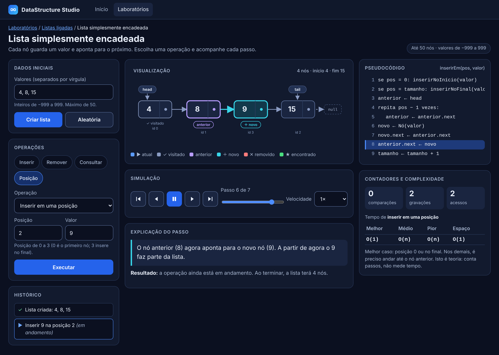
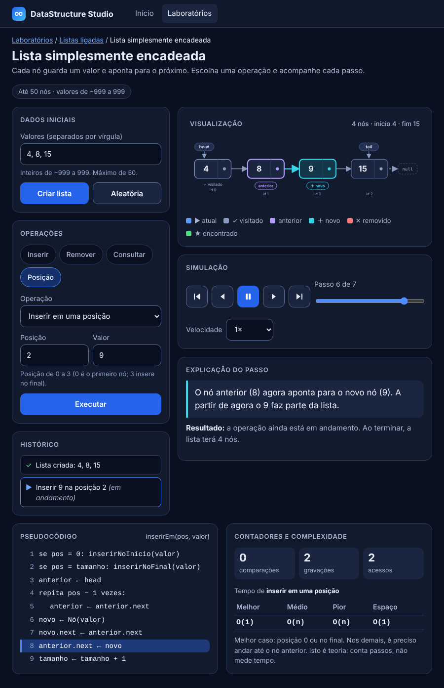
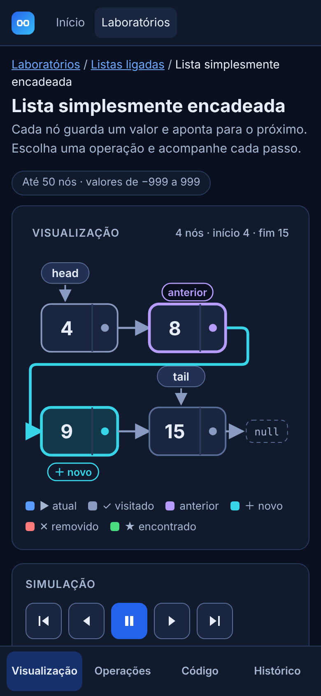
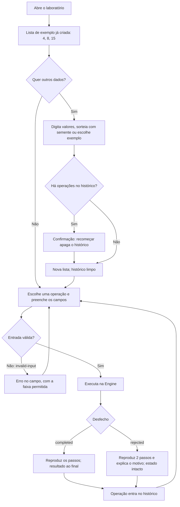
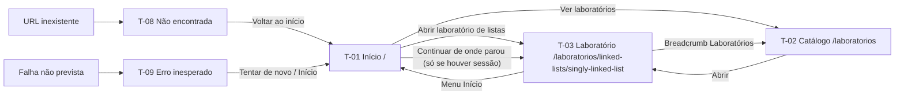
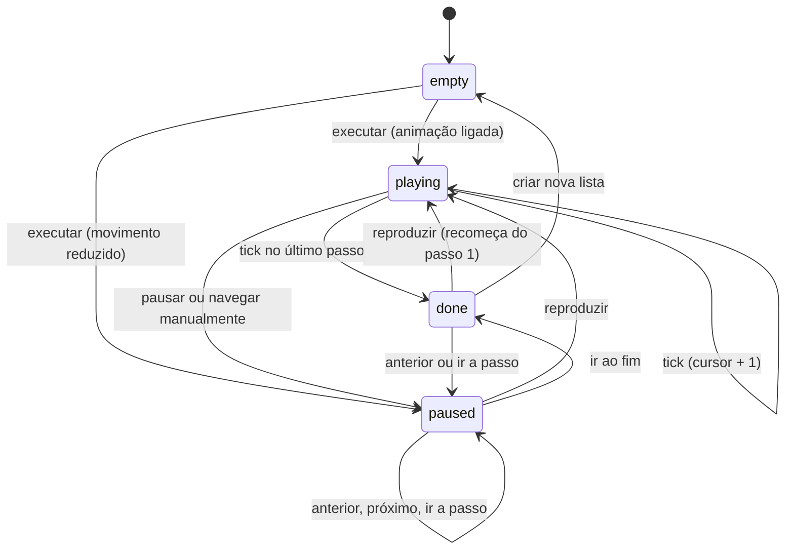
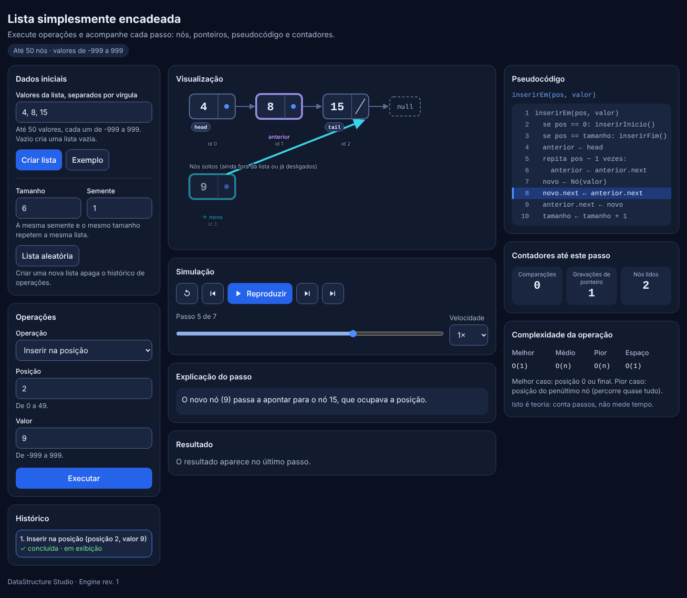

# Interface do DataStructure Studio: design e estrutura do laboratório de listas

- **Versão:** 0.3 · **Data:** 21/11/2026 · **Status:** **Aprovada; laboratório da lista implementado no PROMPT 13** (Apêndice B). Início, Catálogo, roteador e abas do celular seguem pendentes.
- **Escopo:** identidade visual, telas, componentes, navegação, estado, acessibilidade e plano de implementação do front-end, com foco no laboratório de **Lista simplesmente encadeada**.
- **Não faz parte:** backend, autenticação, projetos salvos, outros laboratórios (a Pilha existe na Engine, mas sua interface não está neste escopo).
- **Documentos de base:** [ARCHITECTURE.md](../architecture/ARCHITECTURE.md) §8 e §12 · [USER_FLOWS.md](../requirements/USER_FLOWS.md) §3 a §5 · [ENGINE.md](../architecture/ENGINE.md) · [SINGLY_LINKED_LIST.md](../architecture/SINGLY_LINKED_LIST.md) · ADR-0004 (conteúdo por chaves), ADR-0010 (estado), ADR-0011 (SVG).
- Marcações: ✅ já decidido em documento anterior · 💡 decisão minha nesta proposta · ❓ precisa de resposta sua (seção 17).

---

## 1. Princípios

1. **A interface mostra o que o motor realmente produz.** Cada pixel vem de um dado da Engine: um passo, um destaque, um contador, uma complexidade. Nenhuma tela inventa números, usuários, projetos ou estatísticas.
2. **O passo atual é a única fonte da verdade.** Visualização, explicação, pseudocódigo e contadores leem o mesmo `steps[cursor]` (ARCHITECTURE §8.4) ✅.
3. **Cor nunca é o único sinal.** Todo destaque tem também forma ou rótulo (RNF-018) ✅.
4. **O texto didático mora na interface, não na Engine** (ADR-0004) ✅. A Engine entrega chaves e parâmetros; a interface escreve as frases em português.
5. **Pouco, e bom.** Três telas de verdade (Início, Catálogo, Laboratório) mais as duas de contingência (404 e erro). Nada de links mortos para funções que ainda não existem.

---

## 2. O que o motor impõe à interface

A interface é desenhada **a partir** destes fatos, verificados no código (19/11/2026):

| Fato do motor | Consequência no desenho |
|---|---|
| A lista tem **10 operações** com parâmetros do tipo `value`, `position` e `target`, cada um com `min`/`max` no descritor | O formulário de operações é **gerado do descritor**; limites e mensagens de erro não são escritos à mão |
| `run` devolve **4 desfechos**: `completed`, `rejected`, `invalid-input`, `precondition-failed` | `invalid-input` aparece **no campo** (não gera execução); `rejected` gera uma execução curta explicada e entra no histórico; `completed` é o caso comum |
| **5 tipos de resultado**: `none`, `value`, `found {id,index}`, `not-found`, `values` | A área de resultado tem 5 apresentações (seção 6.3) |
| O nó **nasce solto** e **sai desligado** (existe em `nodes` sem estar na ordem `head → next`) | O visualizador desenha nós **fora da cadeia** em uma faixa à parte, e a ligação nasce no passo certo |
| **47 chaves de mensagem** e **46 âncoras** de pseudocódigo só na lista | O catálogo de conteúdo é obrigatório e precisa de teste de cobertura |
| **20 papéis de destaque**, conjunto **fechado** (a lista usa 9) | Mapa `Record<HighlightRole, …>` exaustivo: papel novo no motor = erro de compilação na interface |
| Cada passo traz **contadores acumulados** (`comparisons`, `moves`, `accesses`) | Painel de contadores acompanha o cursor, não o fim |
| Complexidade **por operação**, com melhor, médio e pior caso e espaço extra | Painel de complexidade muda com a operação selecionada e mostra os 4 valores |
| Limites **50 nós** e valores **−999 a 999** | Aparecem como regra do produto (chip e textos de ajuda) e como validação do campo |
| `Execution` e o estado de entrada ficam **congelados** | A store pode guardá-los sem copiar; nenhum componente os altera |
| Mesma entrada produz a mesma execução (determinismo) | "Aleatória" usa **semente visível**; repetir a semente repete a lista |

**Pré-requisito no motor** 💡 (❓ Q95): o `index.ts` da Engine **não exporta** hoje os tipos `SinglyLinkedListMessages` e `SinglyLinkedListAnchor`, e a fachada `Item` apaga os tipos. Sem eles, o catálogo de textos não pode ser verificado pelo compilador (ADR-0004 §2 prevê exatamente essa exportação). Proposta: exportar os dois tipos (só tipos, sem mudar o que existe em tempo de execução) e, além disso, um teste que compara o catálogo com `descriptor.anchors` e `descriptor.messageKeys`.

---

## 3. Identidade visual

### 3.1 Direção

Tecnológica e sóbria: fundo azul-noite, superfícies em camadas, **azul** como cor de destaque (ação, foco, passo atual), tipografia do sistema e bastante respiro. Pouca decoração; o conteúdo (nós e setas) é o protagonista.



*Mockup estático do laboratório, com dados reais do motor: passo 6 de 7 de "inserir 9 na posição 2" em `[4, 8, 15]`. Serve para validar identidade e disposição, não é o produto.*

### 3.2 Tokens (💡)

Definidos uma vez como variáveis CSS (`@theme` do Tailwind v4) com **nomes semânticos**, não literais, para que o tema claro, no futuro, só troque valores.

| Token | Valor | Uso |
|---|---|---|
| `bg` | `#0B1020` | Fundo da página |
| `surface` | `#121A2E` | Cartões e painéis |
| `raised` | `#1A2540` | Campos, contadores, mensagem do passo |
| `raised-2` | `#223153` | Rótulos de ponteiro (`head`, `tail`) |
| `border` | `#2A3A5C` | Divisórias decorativas |
| `border-strong` | `#5A6E99` | Borda de campos e botões (precisa ser visível) |
| `text` | `#E8EEF9` | Texto principal |
| `muted` | `#A8B7D1` | Texto de apoio |
| `faint` | `#8FA3C7` | Números de linha, comentários |
| `accent` | `#4D8DFF` | Bordas e ícones de destaque |
| `accent-text` | `#6EA8FF` | Links e texto em azul |
| `btn` / `btn-hover` | `#2563EB` / `#1D4ED8` | Botão primário (texto branco) |
| `focus` | `#93C5FD` | Anel de foco (3 px, deslocamento 2 px) |
| `ok` / `err` / `warn` | `#6EE7A0` / `#FF9A9A` / `#FFC27A` | Textos de sucesso, erro e aviso |

**Contraste medido** (cálculo WCAG, não estimativa): 28 pares verificados, **nenhuma falha**. Texto principal sobre superfície 14,86:1; texto de apoio 8,54:1; link azul 7,18:1; botão primário 5,17:1; borda de campo 3,40:1 (mínimo 3:1 para componentes); anel de foco 8,42:1 sobre `raised`. Meta: **WCAG 2.2 AA** (RNF-016).

### 3.3 Papéis de destaque: cor **e** marcador

O motor entrega o papel; a interface decide a aparência. Os nove papéis que a lista usa:

| Papel | Cor | Marcador que não depende de cor | Quando aparece |
|---|---|---|---|
| `head` | neutro (`raised-2`) | Rótulo **head** com seta | Sempre que há início |
| `tail` | neutro | Rótulo **tail** com seta | Sempre que há fim |
| `current` | azul `#5B9BFF` | Borda grossa + legenda "▶ atual" | Nó que o percurso está lendo |
| `visited` | cinza-azul `#8A9BC2` | "✓ visitado" sob o nó | Nós já percorridos |
| `previous` | violeta `#B79CFF` | Etiqueta **anterior** | Nó antes do ponto de inserção/remoção |
| `inserted` | ciano `#38D5E8` | Etiqueta **＋ novo**; seta ciano mais grossa | Nó e aresta recém-criados |
| `removed` | vermelho `#FF7B7B` | Traço diagonal no nó + "✕ removido" | Nó desligado/liberado |
| `found` | verde `#4ADE80` | "★ encontrado" | Resultado de pesquisa/consulta |
| `not-found` | laranja `#FFA24C` | "? ausente" | Pesquisa sem resultado |

Os outros 11 papéis do contrato (`comparing`, `swapping`, `sorted`, `pivot`, `search-range`, `visiting`, `error`, `top`, `front`, `rear`, `root`) **não** são usados pela lista. Terão uma aparência neutra provisória (apenas para o compilador exigir o tratamento) e serão desenhados quando o laboratório correspondente existir.

### 3.4 Tipografia (💡)

- **Fonte do sistema** (`system-ui`, `Segoe UI`, `Roboto`…) para interface e **monoespaçada do sistema** (`ui-monospace`, `Cascadia Code`, `Consolas`…) para valores e pseudocódigo.
- **Sem fonte da web**: zero dependência, zero requisição externa, sem piscar de troca de fonte, compatível com CSP restritiva (ARCHITECTURE §10). A leitura continua boa; a identidade vem de cor, espaçamento e forma.
- Corpo 16 px / 1,5. Texto de apoio nunca abaixo de 13 px; pseudocódigo 14 px; valor do nó 24–26 px em negrito.

### 3.5 Forma, movimento e ícones

- **Raio** 14 px em cartões, 10 px em campos e botões, 999 px em rótulos. **Alvos de toque ≥ 44 px** (medido no mockup de 320 a 1440 px; única exceção: os 4 botões de filtro de categoria, com 40 px no desktop, que serão levados a 44 px na implementação; o mínimo do WCAG 2.2 AA é 24 px).
- **Movimento** (ADR-0011 ✅): só transições CSS em elementos com chave estável (a identidade do nó é o `ElementId`). Duração acompanha a velocidade escolhida. O nó novo surge com leve escala e opacidade; a seta se "desenha"; o destaque troca de cor em ~200 ms. `prefers-reduced-motion` e a preferência do usuário **desligam o movimento sem perder informação** (RNF-018).
- **Ícones:** ~12 SVGs embutidos no código (reproduzir, pausar, passo, início, fim, logo…). Sem biblioteca de ícones (seção 14).

---

## 4. Telas

### 4.1 Mapa

| Tela | Rota | Conteúdo |
|---|---|---|
| T-01 Início | `/` | Apresenta o produto e leva ao laboratório |
| T-02 Catálogo | `/laboratorios` | Laboratórios e itens **reais** da Engine |
| T-03 Laboratório | `/laboratorios/linked-lists/singly-linked-list` | A área de trabalho |
| T-08 Não encontrada | qualquer outra | Mensagem simples e volta ao início |
| T-09 Erro inesperado | (fronteira de erro) | Tentar de novo ou voltar ao início |

💡 Os identificadores na URL são os **ids do motor** (`linked-lists`, `singly-linked-list`), em vez de traduzi-los: uma única fonte de nomes. ❓ Q96.

**Fora desta fase, de propósito:** Cadastrar, Entrar, Meus projetos e Projeto (T-04 a T-07). Não há backend, então o menu **não mostra** Projetos nem Entrar (os documentos admitiam "ocultar", ✅ RN-035). Quando existirem, entram no menu sem refazer nada.

### 4.2 T-01 Início (sem dados fictícios)

Só conteúdo que existe:

1. **Título e frase de valor**: "Aprenda estruturas de dados vendo cada passo".
2. **Ação principal**: *Abrir laboratório de listas* (leva a T-03). Ação secundária: *Ver laboratórios* (T-02).
3. **Como funciona**, três cartões estáticos que descrevem o fluxo **real** do laboratório: *Escolha uma operação → Acompanhe cada passo (explicação, pseudocódigo e contadores) → Compare a complexidade*.
4. **Limites do laboratório**, lidos de `LIMITS`: "Até 50 nós, valores de −999 a 999".
5. **Continuar de onde parou**: cartão que **só aparece** se a store tiver uma sessão real (ex.: "Lista encadeada, 5 operações"). Sem sessão, não existe.
6. **Rodapé**: "Motor, revisão N" (lido de `ENGINE_REVISION`).

*Não existe:* gráficos, contadores de usuários, "projetos recentes", progresso, conquistas.

### 4.3 T-02 Catálogo (reflete a Engine)

Cartões gerados de `listItems()`, agrupados por `labId`, com nome, descrição e quantidade de operações **lidas do descritor**:

| Laboratório | Item | Estado | Cartão |
|---|---|---|---|
| Listas ligadas | Lista simplesmente encadeada | **Disponível** | "10 operações", botão *Abrir* |
| Estruturas lineares | Pilha | **Em construção** | "3 operações", sem botão; texto "A Engine já executa; a visualização ainda não foi construída" |

💡 "Disponível" não é um campo do motor: é um registro **da interface** dizendo para quais itens existem visualizador e conteúdo. Assim o catálogo não mente. ❓ Q91.
💡 **Sem selo de dificuldade** por ora (o motor não tem esse dado e inventá-lo seria ficção). ❓ Q92.

### 4.4 T-03 Laboratório

Detalhado na seção 5.

---

## 5. O laboratório (T-03)

### 5.1 Regiões (de USER_FLOWS §4 ✅) e onde ficam

| Região | Nome | Componente | Observação |
|---|---|---|---|
| R-01 | Seletor de estrutura | `ItemHeader` | Hoje só há um item; mostra título, descrição e chip de limites. Troca de item volta quando houver mais |
| R-02 | Dados iniciais | `InitialDataPanel` | Valores manuais, **Aleatória** (tamanho + semente) e **Exemplo** (`descriptor.examples`) |
| R-03 | Operações | `OperationPanel` | Agrupadas (Inserir, Remover, Consultar, Percorrer), campos gerados do descritor |
| R-04 | Visualização | `ListVisualizer` | SVG, nós, setas, destaques, descrição textual |
| R-05 | Controles | `PlaybackControls` | Início, anterior, reproduzir/pausar, próximo, fim, barra de passos, velocidade |
| R-06 | Explicação | `StepExplanation` + `ResultPanel` | Texto do passo (região viva) e resultado da operação |
| R-07 | Pseudocódigo | `PseudocodePanel` | Linha do passo realçada |
| R-08 | Contadores e complexidade | `CountersPanel` + `ComplexityPanel` | Contadores até o passo; tabela da operação |
| R-09 | Histórico | `HistoryPanel` | Todas as operações, inclusive recusadas |
| R-10 | Persistência | **não existe nesta fase** | Depende de backend |

### 5.2 Disposição por largura

| Largura | Disposição |
|---|---|
| **≥ 1181 px** | 3 colunas: **esquerda 320** (Dados, Operações, Histórico) · **centro flexível** (Visualização, Controles, Explicação) · **direita 380** (Pseudocódigo, Contadores e complexidade) |
| **761–1180 px** | 2 colunas: esquerda 320 + centro; a coluna direita desce para baixo, em duas colunas |
| **≤ 760 px** | 1 coluna com **barra de abas fixa** embaixo: **Visualização · Operações · Código · Histórico**. A aba "Visualização" mantém visualização, controles e explicação juntos. **Nenhuma função some** (RNF-015) |

 

### 5.3 Ordem de foco do teclado ✅ (USER_FLOWS §4)

Dados → Operações → Controles → Visualização → Explicação → Pseudocódigo → Contadores → Histórico. Link "Ir para o laboratório" no topo da página. No celular, a ordem das abas acompanha a mesma lógica.

### 5.4 Fluxo dentro do laboratório



💡 O laboratório **abre com a lista de exemplo `[4, 8, 15]` já criada** (vinda de `descriptor.examples`), em vez de uma lista vazia, para o visitante poder experimentar em um clique. Se preferir abrir vazio, é uma linha. ❓ (sem número: ajuste trivial).

---

## 6. Comportamento de cada região

### 6.1 Dados iniciais (R-02)

- Campo de texto com valores separados por vírgula; **validação ao enviar** com as regras do motor (inteiros, −999 a 999, máximo 50) e **mensagem por posição** ("o 3º valor, 1200, está fora de −999 a 999") a partir dos `InputProblem.path` (`values[2]`).
- **Aleatória**: tamanho (0 a 50) e **semente** visível e editável; `generateRandomValues(seed, count)`. Mesma semente, mesma lista.
- **Exemplo**: botões vindos de `descriptor.examples`.
- Criar lista com histórico não vazio pede confirmação (`<dialog>` nativo, D-03 ✅).

### 6.2 Operações (R-03)

- Operações agrupadas em **Inserir** (início, final, posição), **Remover** (início, final, posição), **Consultar** (pesquisar, ler posição) e **Percorrer** (percorrer, converter em array). Os nomes em português vêm do catálogo de conteúdo; os tipos e os campos vêm do descritor.
- Cada campo mostra **ajuda dinâmica com o estado atual**: "Posição de 0 a 3 (0 é o primeiro nó; 3 insere no final)". A faixa depende do tamanho da lista e da operação (inserir aceita até `tamanho`; remover e ler aceitam até `tamanho − 1`).
- ⚠ **A interface não decide o que é válido.** Ela pré-valida pelo descritor para dar resposta imediata, mas quem decide é a Engine: `invalid-input` volta como erro no campo, `rejected` vira passo explicado.
- Operações que não precisam de campo (remover do início, percorrer…) executam com um clique.

### 6.3 Mensagens e resultados (R-06)

**Explicação do passo**: uma frase didática, vinda de `message.key` + `params`, **anunciada por leitor de tela** (`role="status"`, `aria-live="polite"`, RNF-019 ✅). Cita os valores reais ("O nó anterior (8) agora aponta para o novo nó (9)…").

**Resultado**, por tipo, sempre em texto (e também na região viva ao final):

| `result.type` | Mensagem |
|---|---|
| `none` | "Pronto: a lista agora tem N nós." |
| `value` | "Valor removido: 15" / "Valor na posição 2: 15" |
| `found` | "Encontrado: 15 está na posição 2 (nó id 2)" |
| `not-found` | "Valor 99 não está na lista (percorremos os 3 nós)." Aviso, não erro |
| `values` | "Array: [4, 8, 15]" |

**Recusas** (`rejected`) e **entradas inválidas** usam a mesma caixa, com tom de explicação (não de falha do sistema, RF-013 ✅): "A lista está vazia, não há nó para remover." / "Posição 7 inexistente. Esta lista aceita posições de 0 a 2."

### 6.4 Controles de simulação (R-05)

- **Botões**: voltar ao início, passo anterior, reproduzir/pausar, próximo passo, ir ao fim. Todos com texto acessível ("Passo anterior"); ícone sozinho nunca.
- **Barra de passos** (`<input type="range">`) com "Passo 6 de 7": pode arrastar para qualquer passo.
- **Velocidade**: 0,5× · 1× · 2× · 4×. Muda também a duração da animação (RF-022 ✅).
- 💡 Navegar manualmente **pausa** a reprodução (ARCHITECTURE §8.4, Q30 ✅ proposta).
- 💡 Ao executar uma operação, a reprodução **começa sozinha** (exceto com movimento reduzido, quando começa pausada no passo 1). ❓ Q90.
- 💡 Executar enquanto outra reprodução está em curso **conclui a anterior** (salta para o fim) e inicia a nova. Nada se perde, porque o estado já está calculado. ❓ Q97.

### 6.5 Pseudocódigo (R-07)

Lista numerada, com a linha do `anchor` do passo realçada (fundo azul, barra lateral e `aria-current="step"`: não só cor). Mostra o nome da operação em cima. **Regras de autoria do texto** (descobertas no mockup): linhas de até **34 caracteres**, sem quebra automática, e o bloco rola na horizontal como segurança (`tabindex="0"`). Operações que delegam (ex.: `removeTail` chama `removeAt`) mostram **uma operação por vez**: a linha do passo pode mudar de bloco.

### 6.6 Contadores e complexidade (R-08)

- **Contadores até este passo**: comparações, gravações (`moves`), acessos. Rótulos em português simples: "gravações" para gravação de ponteiro. Definições provisórias até a Q17 ✅.
- **Complexidade da operação selecionada**: tabela Melhor / Médio / Pior / Espaço, com uma nota curta sobre **quando** ocorre cada caso. Sempre com a frase: *"Isto é teoria: conta passos, não mede tempo."* (a Engine não mede tempo).

### 6.7 Histórico (R-09)

Lista cronológica de **todas** as operações, inclusive recusadas, cada uma com ícone **e** texto do desfecho (✓ concluída · ⚠ recusada). A operação em andamento é marcada. Clicar em uma operação **a reexecuta** sobre a lista atual? **Não**: o histórico é registro, não atalho (evita ambiguidade: reexecutar sobre qual estado?). 💡

---

## 7. Navegação



- **Menu persistente**: *Início* · *Laboratórios*. A página atual tem `aria-current="page"`.
- **Breadcrumb** no laboratório: Laboratórios / Listas ligadas / Lista simplesmente encadeada.
- **URL = lugar** (voltar, recarregar e compartilhar funcionam). **A sessão não vai na URL**: a lista e o histórico vivem na store; recarregar a página recomeça pelo exemplo ✅ (ARCHITECTURE §12.3; o rascunho em `sessionStorage` é a Q40, adiada).
- **Sair do laboratório e voltar** pelo menu **não perde a sessão** (a store sobrevive à navegação interna).
- Ao trocar de rota, o foco vai para o título da página e o título do documento muda (`<title>`), para leitores de tela.

---

## 8. Componentes

Organização por *features* ✅ (ARCHITECTURE §8.3), simplificada ao que existe:

```text
apps/web/src/
├── app/                      # providers, rotas, AppShell, páginas T-01/T-02/T-03/T-08/T-09
├── features/
│   ├── lab/
│   │   ├── store/            # store Zustand + reducer de reprodução (puro)
│   │   ├── components/       # painéis do laboratório
│   │   └── hooks/            # useAutoplay (temporizador fino)
│   └── visualizers/
│       └── linked-list/      # layout puro, SVG, descrição textual, destaques
├── content/
│   └── pt-BR/                # mensagens, pseudocódigo, nomes, notas de complexidade, problemas
├── shared/
│   ├── ui/                   # Button, IconButton, Field, Card, Tabs, Dialog, VisuallyHidden
│   └── icons.tsx             # os ~12 SVGs
└── styles/                   # @theme (tokens) e estilos base
```

### 8.1 Árvore de componentes do laboratório

| Componente | Responsabilidade | Lê da store |
|---|---|---|
| `LabPage` | Monta o laboratório e a disposição por largura | — |
| `ItemHeader` | Título, descrição, chip de limites | — |
| `InitialDataPanel` | Criar lista (manual, aleatória, exemplo) | ação `createList` |
| `OperationPanel` | Escolher operação, campos do descritor, executar | ação `runOperation`, tamanho da lista |
| `ListVisualizer` | Desenhar o passo atual | `currentStep` ou estado em repouso |
| `PlaybackControls` | Botões, barra de passos, velocidade | `status`, `cursor`, `speed` |
| `StepExplanation` | Frase do passo, região viva | `currentStep.message` |
| `ResultPanel` | Resultado ou recusa da operação | `execution.result` / desfecho |
| `PseudocodePanel` | Linhas e realce | `currentStep.anchor`, operação |
| `CountersPanel` | Três contadores | `currentStep.counters` |
| `ComplexityPanel` | Tabela da operação | `execution.complexity` |
| `HistoryPanel` | Lista de operações | `history` |
| `MobileTabs` | Abas em ≤ 760 px | — (estado local) |

**Base compartilhada:** `Button`, `IconButton` (exige `label`), `Field` (rótulo, ajuda, erro ligados por `aria-describedby`), `Card`, `Tabs`, `Dialog` (sobre `<dialog>`), `VisuallyHidden`.

### 8.2 Regras

1. **Componentes não chamam a Engine para executar** (ARCHITECTURE §12.2 ✅). Só as ações da store.
2. **Visualizador é função pura** do passo: sem estado relevante, sem acesso à store.
3. **Nada de HTML bruto** (`dangerouslySetInnerHTML` proibido, ARCHITECTURE §10).
4. **Dependências entre `features/`** passam por `shared/`; `lab` usa `visualizers`, nunca o contrário.

---

## 9. Estado (Zustand com escopo restrito ✅)

### 9.1 O que vive onde

| Natureza | Onde |
|---|---|
| Sessão do laboratório (lista, histórico, execução, cursor, status) | **Store Zustand** |
| Preferências (velocidade, animação) | Store, persistida em `localStorage` com `try/catch` |
| Qual laboratório/item | **URL** |
| Campo em edição, aba ativa, diálogo aberto | `useState` local |

### 9.2 Forma da store (💡)

```ts
interface LabSession {
  itemId: string;                       // 'singly-linked-list'
  structure: StructureState;            // a lista em repouso (final da última operação)
  history: OperationRecord[];           // operação, desfecho, problemas ou rejeição
  execution: Execution | null;          // a execução corrente (já congelada pela Engine)
  cursor: number;                       // índice do passo atual
  status: 'empty' | 'playing' | 'paused' | 'done';
  speed: 0.5 | 1 | 2 | 4;
  seed: number;                         // semente da lista aleatória
}
// derivados (seletores, não armazenados): currentStep, isFirst, isLast, canRun,
// stateToShow = execution ? execution.steps[cursor].state : structure
```

Ações: `createList(values)`, `runOperation(op)`, `play`, `pause`, `next`, `previous`, `first`, `last`, `seek(i)`, `setSpeed`, `tick`.

### 9.3 Reprodução como máquina de estados pura



- Um **reducer puro** concentra todas as transições, testável sem React ✅. O temporizador (`useAutoplay`) só dispara `tick` na velocidade escolhida.
- A lista em repouso (`structure`) é atualizada **no momento da execução**, porque a Engine já devolveu o resultado completo; a reprodução é só apresentação. Por isso é seguro executar outra operação no meio de uma reprodução (Q97).

---

## 10. Visualizador da lista

### 10.1 Layout como função pura

`layout(state, width) → { nós com posição, arestas com caminho, faixa de nós soltos, alturas }`: testável sem navegador ✅. Regras:

1. **Cadeia principal**: nós alcançáveis a partir de `head`, na ordem de `next` (mesma definição de "estar na lista" da Engine).
2. **Quebra em linhas por largura** (💡 ❓ Q89): quantos nós cabem por linha depende da largura disponível; a ligação entre linhas é uma **seta em cotovelo** que contorna. O mockup de celular prova a necessidade: com um SVG de largura fixa escalado, os rótulos caíam a ~6 px. Quebrar mantém tudo legível **sem rolagem horizontal** (que esconderia nós do leitor e do foco).
3. **Faixa de nós soltos** abaixo da cadeia: o nó recém-criado (antes de ser ligado) e o nó desligado (antes de ser liberado) aparecem **fora da cadeia**, com seu próprio rótulo, e a seta nasce no passo em que a Engine a cria.
4. **Ponteiros** `head` e `tail` como rótulos acima dos nós, com seta curta. Fim da cadeia: caixa tracejada **`null`**. Lista vazia: `head → null`, com texto "Lista vazia".
5. **Faixas reservadas** para o cotovelo e para os rótulos, para que um não cubra o outro (no mockup de celular, o rótulo `tail` quase encosta no cotovelo: a regra deve reservar essa faixa).
6. **50 nós**: com quebra, cabem em ~13 linhas de 4 nós no celular e ~4 de 13 no desktop; a altura do SVG cresce, a página rola na vertical.

### 10.2 Anatomia do nó

Retângulo de dois compartimentos: **valor** (esquerda) e **ponteiro** (direita, ponto ligado à seta; `null` quando não há próximo). Sob o nó: marcador do papel (seção 3.3) e o **id** do nó em tamanho pequeno (útil para o aluno ver que o `ElementId` não muda quando o nó muda de posição).

### 10.3 Descrição textual (acessibilidade e testes)

Para cada passo o visualizador produz também texto: *"Lista com 4 nós: 4, 8, 9, 15. Início: 4. Fim: 15. O nó 8 é o anterior e o nó 9 é o novo, já ligado a partir do 8."*, usado como `aria-label` do SVG (`role="img"`) e nos testes ✅ (ARCHITECTURE §8.5). A legenda dos destaques também é texto.

### 10.4 Animação

Transições CSS por chave estável (`ElementId`): nó novo (escala + opacidade), seta (desenho do traço), troca de destaque (cor e espessura), remoção (esmaecer). Duração = base ÷ velocidade. **Sem movimento reduzido** → troca instantânea de destaque, mesma informação.

### 10.5 Armadilhas já encontradas no mockup (viram regra)

| Achado | Regra |
|---|---|
| SVG escalado ilegível no celular | Layout por largura com quebra de linha (10.1) |
| Pseudocódigo com linhas largas estourava o cartão | Linhas ≤ 34 caracteres, sem quebra, bloco rolável |
| Grid aninhado com coluna `auto` alargava o painel (7 px de rolagem horizontal) | **`minmax(0, 1fr)` também em grids aninhados** |
| Posição do `tail` colidindo com o cotovelo | Faixas reservadas no layout |

---

## 11. Conteúdo didático (catálogo em português)

Em `content/pt-BR/` ✅ (ADR-0004). **Idioma único por enquanto**, sem biblioteca de i18n (ADR-0004 descartou).

| Arquivo | Conteúdo | Volume hoje |
|---|---|---|
| `messages.ts` | Uma função por chave de mensagem, com parâmetros tipados, que devolve a frase | 47 |
| `pseudocode.ts` | Texto (e indentação) da linha de cada âncora; o bloco de uma operação é a lista das suas âncoras | 46 |
| `operations.ts` | Nome em português, grupo e ajuda de cada operação | 10 |
| `complexity.ts` | Nota "quando acontece cada caso" por operação | 10 |
| `problems.ts` | Texto de cada `InputProblemCode` e `RejectionReason`, com os parâmetros (`meta`) | ~8 |
| `items.ts` | Nome e descrição de laboratórios e itens | 2 labs / 2 itens |

- **Tom**: direto, no presente, com os valores reais ("O nó anterior (8)…"), sem jargão sem explicação. "gravação" para gravação de ponteiro; "nó anterior"; "nó solto".
- **Cobertura garantida por teste** (e por compilador, se a Q95 for aprovada): toda chave, toda âncora e toda operação têm texto; ninguém vê uma chave crua na tela.
- Esse é o **maior volume de escrita** da fase (~125 textos); entra como fatia própria (seção 15).

---

## 12. Acessibilidade (meta WCAG 2.2 AA, RNF-016)

| Requisito | Como é atendido |
|---|---|
| Teclado em tudo (RNF-017) | Só elementos nativos (`button`, `input`, `select`, `dialog`); foco visível de 3 px; ordem lógica (5.3); link "Ir para o laboratório" |
| Cor não é o único sinal (RNF-018) | Papéis têm marcador (3.3); estado do histórico tem ícone **e** texto; erros têm ícone e texto |
| Movimento reduzido (RNF-018) | `prefers-reduced-motion` + preferência própria; a reprodução continua, sem animar |
| Leitor de tela anuncia o passo (RNF-019) | `role="status"` + `aria-live="polite"` na explicação; resultado também anunciado |
| Visualização acessível | `role="img"` com descrição textual completa do estado (10.3) |
| Rótulos e erros | `Field` liga rótulo, ajuda e erro por `aria-describedby`; erro com `aria-invalid` |
| Alvos de toque | ≥ 44 px (mockup: só os 4 filtros de categoria têm 40 px, corrigir na implementação) |
| Contraste | 28 pares medidos, todos aprovados (3.2) |
| Título e foco ao navegar | `<title>` por rota; foco no `h1` |
| Diálogo de confirmação | `<dialog>` nativo: foco preso e fechado com Esc |
| Zoom e reflow | Layout fluido, sem rolagem horizontal da página de 320 px a 1440 px (medido no mockup) |

**Como será verificado** (🧩 ainda por construir): testes automatizados de papéis e rótulos (Testing Library, Q94) e um **roteiro manual** de teclado e leitor de tela. A auditoria automática com ferramenta (axe) fica para quando o Playwright entrar (adiado ✅).

---

## 13. Responsividade

- **Fluida**, com os três pontos de quebra da seção 5.2. Prioridade: notebook e tablet; celular com **todas** as funções (RNF-015 ✅).
- **Abas** só reorganizam, não removem.
- **Sem rolagem horizontal** da página em nenhuma largura de 320 a 1440 px (medido no mockup; vira teste).
- Visualizador: quebra por largura (10.1). Pseudocódigo: rolagem interna só como segurança.
- **Tailwind v4** gera um arquivo CSS estático, compatível com CSP restritiva. Para manter assim: **posições do SVG vão em atributos** (`x`, `y`, `transform`, `d`), **não** em `style=""` (que exigiria `unsafe-inline`). ✅ pendência da ARCHITECTURE §10 ("a validar com Tailwind/SVG") resolvida por regra.

---

## 14. Dependências propostas (política: nada entra sem justificativa ✅)

Versões consultadas no registro do npm em 19/11/2026.

| Pacote | Versão | Onde | Justificativa | Alternativa descartada |
|---|---|---|---|---|
| `tailwindcss` + `@tailwindcss/vite` | **4.3.5** | `apps/web` (dev) | Tokens, responsividade e modo escuro consistentes com pouco CSS escrito (ARCHITECTURE §5: "mantida por conveniência"). Plugin do Vite, **sem PostCSS**; aceita Vite 8 (`peer vite ^5.2 … ^8`) | CSS Modules / CSS escrito à mão: mais código e mais risco de inconsistência |
| `zustand` | **5.1.0** | `apps/web` | Reprodução é lida por ~8 regiões e por um temporizador fora da árvore React (ARCHITECTURE §5 ✅); ~1 kB | Context + `useReducer`: re-renderiza tudo a cada tick; Redux: cerimônia sem ganho |
| `react-router` | **8.5.2** | `apps/web` | Rotas com URL própria, voltar e recarregar (ARCHITECTURE §8.7 ✅). Requer React ≥ 19.2.7 (temos 19.3.1) e Node ≥ 22.22 (já exigido) | Roteador próprio: reinventa a roda |
| `@testing-library/react` + `@testing-library/user-event` | a fixar na implementação | `apps/web` (dev) | Testar por papéis e rótulos acessíveis, que é exatamente o contrato de acessibilidade (Q94) | Testar por seletor CSS: não prova acessibilidade |

**Não serão adicionados:** biblioteca de ícones (12 SVGs embutidos), fonte da web (fontes do sistema), biblioteca de animação (CSS), biblioteca de componentes (elementos nativos; ADR-0014 só se surgir lacuna real), i18n (idioma único), TanStack Query (não há servidor nesta fase).

⚠ **Custo de pacote.** O build do Web já está em **241,30 kB** (73,78 kB comprimido) porque o Web importa o catálogo inteiro da Engine. Antes de somar o roteador e a interface, proponho **orçamento de 130 kB comprimidos** e medir ao fim de cada fatia. Se estourar, a primeira medida é importar só o item usado (código-fonte da Engine já é "JIT"). Versões exatas e API do roteador serão conferidas na documentação oficial no momento da instalação, como nas etapas anteriores.

---

## 15. Plano de implementação em fatias

Cada fatia termina com `pnpm check` verde e é entregável sozinha.

| Fatia | Entrega | Pronta quando |
|---|---|---|
| **12.1 Fundação** | Dependências; tokens (`@theme`); roteador; `AppShell` e menu; T-01, T-02, T-08, T-09 com conteúdo real; esqueleto do catálogo de textos; exportação dos tipos da Engine (Q95) | Navega entre as telas; catálogo lê `listItems()`; teste de cobertura do catálogo existe (mesmo que ainda falhando por pendências marcadas) |
| **12.2 Visualizador** | `layout` puro, SVG, nós soltos, setas, destaques com marcador, descrição textual, animação CSS | Renderiza **todas as execuções amostradas do motor** sem erro; testes do `layout` e da descrição; sem rolagem horizontal de 320 a 1440 |
| **12.3 Reprodução** | Store, reducer, `PlaybackControls`, `StepExplanation`, `ResultPanel` | Reducer 100% testado; executar e reproduzir uma operação ponta a ponta |
| **12.4 Painéis** | Dados iniciais, operações (formulário do descritor), pseudocódigo, contadores, complexidade, histórico | As 10 operações funcionam; recusa e entrada inválida explicadas; textos completos |
| **12.5 Responsividade e acessibilidade** | Abas ≤ 760 px, foco, região viva, movimento reduzido, roteiro de teclado | Roteiro manual cumprido; testes por papéis; orçamento de pacote respeitado |

💡 Cada fatia pode ser **um prompt**, na ordem que você preferir. ✅ **Numeração corrigida pelo autor:** a implementação é a partir do PROMPT 13, então as fatias passam a ser "13.x" quando forem feitas. O que o PROMPT 13 já cobriu está no **Apêndice B**: o visualizador (12.2), a reprodução (12.3) e os painéis (12.4) estão feitos; a fundação (12.1) e a responsividade/acessibilidade (12.5) estão **parciais**.

---

## 16. Riscos

| # | Risco | Mitigação |
|---|---|---|
| R-1 | **Pacote cresce** (Engine inteira + roteador + interface) | Orçamento de 130 kB comprimidos; medir por fatia; importar só o item usado |
| R-2 | **Volume de texto** (~125 itens) atrasa ou fica inconsistente | Fatia própria; teste de cobertura; revisão de tom em lote |
| R-3 | **Layout com quebra e cotovelo** é a parte mais difícil do visualizador | É função pura e testável; fatia 12.2 isolada; validada contra todas as execuções do motor |
| R-4 | **Acessibilidade de SVG animado** (R-09 da ARCHITECTURE) | Descrição textual desde a primeira versão; roteiro manual; movimento reduzido na especificação |
| R-5 | **Mockup é estático** e não foi testado com leitor de tela real | Tratar a fatia 12.5 como validação, não formalidade |
| R-6 | **Reprodução com `setInterval`** pode acumular atrasos | `tick` é derivado do cursor (idempotente); o relógio só dispara eventos |

---

## 17. Decisões

✅ **Todas aprovadas pelo autor em 20/11/2026, com a recomendação indicada.** Numeração global (última usada: Q97).

| # | Pergunta | Decisão |
|---|---|---|
| ✅ **Q88** | Aprovar as dependências: `tailwindcss` + `@tailwindcss/vite` 4.3.5, `zustand` 5.1.0, `react-router` 8.5.2 (e nenhuma biblioteca de ícones, fontes, animação ou componentes)? | **Aprovar** |
| ✅ **Q89** | Lista longa: **quebrar em linhas** com seta em cotovelo, ou **rolagem horizontal**? | **Quebrar em linhas** (provado no mockup; rolagem esconde nós do leitor de tela) |
| ✅ **Q90** | Ao executar, a reprodução **começa sozinha** (e pausada se houver movimento reduzido), ou o usuário sempre aperta Reproduzir? | **Começa sozinha** |
| ✅ **Q91** | Catálogo mostra a **Pilha como "Em construção"** (real, desabilitada) ou a oculta até ter interface? | **Mostrar**, com texto honesto |
| ✅ **Q92** | Selo de **dificuldade** nos cartões do catálogo? O motor não tem esse dado | **Omitir** até haver 3 ou mais laboratórios |
| ✅ **Q93** | **Tema claro**: preparar só os tokens (sem alternância) ou já oferecer o botão? | **Só os tokens** agora |
| ✅ **Q94** | Testes de componente com `@testing-library/react` e `user-event` (dev)? | **Sim** |
| ✅ **Q95** | Exportar `SinglyLinkedListMessages` e `SinglyLinkedListAnchor` pela API pública da Engine (só tipos), cumprindo o ADR-0004 §2? | **Sim** |
| ✅ **Q96** | Rota com ids do motor (`/laboratorios/linked-lists/singly-linked-list`) ou slugs em português? | **Ids do motor** (uma fonte de nomes) |
| ✅ **Q97** | Executar durante uma reprodução: **concluir a anterior e iniciar a nova**, ou bloquear o botão? | **Concluir e iniciar** |

---

## Apêndice A. Validação do mockup

Feita por medição, não a olho:

| Verificação | Resultado |
|---|---|
| Contraste WCAG de 28 pares de cor (texto 4,5:1; componentes 3:1) | **0 falhas** |
| Rolagem horizontal da página em 1440, 1280, 1024, 900, 768, 390 e 320 px | **0 px em todas** (após corrigir dois defeitos encontrados: pseudocódigo largo e grid aninhado sem `minmax(0, 1fr)`) |
| Alvos interativos menores que 44 px (exceto os rótulos de filtro de operação, 40 px) | **nenhum** nas larguras testadas |
| Legibilidade do SVG no celular | **Reprovada** com SVG escalado (rótulos ~6 px); **aprovada** com quebra em linhas (rótulos ≥ 13 px) |

Limites da validação: é um **mockup estático** (HTML), sem interação, sem animação e sem leitor de tela. Valida identidade, disposição e medidas; não valida comportamento.

---

## Apêndice B. O que o PROMPT 13 implementou (21/11/2026)

### B.1 Escopo

O PROMPT 13 pediu a **integração da Engine com o laboratório**: executar operações e ver a estrutura passo a passo. Foi feito só isso, mais a base mínima para isso funcionar. **Não** foram feitos: roteador, telas T-01/T-02/T-08/T-09, abas do celular, confirmação ao recriar a lista. Por isso `react-router` **não foi instalado** (Q88 aprovou o pacote, mas nada o usa ainda; instalar sem uso contraria a regra de dependências). `App` mostra o laboratório direto.

### B.2 Dependências adicionadas (todas aprovadas na Q88/Q94, versões exatas)

`zustand` 5.1.0 · `tailwindcss` e `@tailwindcss/vite` 4.3.5 · `@testing-library/react` 16.3.3, `@testing-library/dom` 10.4.2 (dependência exigida por ela) e `@testing-library/user-event` 14.6.13. Na Engine: só **tipos** exportados (Q95): `SinglyLinkedListAnchor`, `SinglyLinkedListMessages`, `SinglyLinkedListOperation`.

### B.3 Estrutura criada em `apps/web/src`

```text
styles/index.css                    tokens (@theme), foco, movimento reduzido
content/pt-BR/                      textos (messages, pseudocode, operations, problems,
                                    complexity, results, text) + content.test.ts
features/lab/
  playback.ts                       reducer PURO da reprodução          (+ playback.test.ts)
  session.ts                        transições da sessão, ÚNICO ponto que chama a Engine
                                    para criar lista e executar         (+ session.test.ts)
  selectors.ts                      passo atual e estado a desenhar
  operation-input.ts                texto digitado → valores brutos (sem validar)
  store.ts                          store Zustand fina; injeta item e política de autoplay
  LabContext.tsx                    provider, hooks, relógio (useAutoplay)
  LabPage.tsx                       composição da tela                  (+ LabPage.test.tsx)
  components/                       InitialDataPanel, OperationPanel, PlaybackControls,
                                    StepExplanation (+ ResultPanel), PseudocodePanel,
                                    CountersPanel (+ ComplexityPanel), HistoryPanel, ui, icons
features/visualizers/
  useElementWidth.ts
  linked-list/                      layout.ts (puro), roles.ts, describe.ts,
                                    ListVisualizer.tsx                  (+ layout.test.ts)
```

### B.4 Como a integração funciona

| Pergunta | Resposta |
|---|---|
| Quem chama a Engine? | **Só** `session.ts`, via ações da store (`createList`, `runOperation`). Nenhum componente importa `item.run` |
| O que a interface decide sobre validade? | **Nada.** Vazio vira `undefined`, texto segue como texto, número segue como número; a Engine responde `REQUIRED`, `INVALID_TYPE`, `OUT_OF_RANGE`, `LIMIT_EXCEEDED` e a interface só **traduz** o código |
| De onde vem o que se desenha? | Do `steps[cursor]` da execução real (estado, destaques, mensagem, âncora, contadores). Sem execução, da lista em repouso |
| Onde fica a lógica de interação? | `playback.ts` e `session.ts` (funções puras, sem React). Componentes só leem estado e disparam ações |
| Como se preservam os estados anteriores? | `history` guarda cada `Execution` inteira (imutável, congelada pela Engine). Navegar nunca altera `structure`, `history` nem `execution` (testado por identidade de referência) |
| O que é "reiniciar"? | Volta ao **passo 1 e pausa**. "Repetir" (no último passo) recomeça tocando. Criar nova lista apaga execução e histórico |
| E se executar no meio de uma reprodução? (Q97) | A nova substitui a exibição; a anterior **já está no histórico** e seu estado final já é a lista em repouso, então nada se perde |
| Falha inesperada da Engine? | Vira aviso na tela (`role="alert"`), a lista e o histórico ficam como estavam |
| Autoplay (Q90) | Começa tocando, exceto com `prefers-reduced-motion` |

### B.5 Desvios da proposta (declarados)

| Proposta | Feito | Motivo |
|---|---|---|
| Filtros de categoria + `select` | `select` com `optgroup` (Inserir, Remover, Consultar, Percorrer) | Menos código, nativo e acessível; cumpre o mesmo agrupamento |
| Ajuda dinâmica "posição de 0 a n" | Ajuda **estática** do descritor ("De 0 a 49") | A faixa real depende da operação e do tamanho: calculá-la seria **recriar regra da Engine**. Quem informa o tamanho real é a mensagem de recusa |
| Confirmação (`<dialog>`) ao recriar a lista com histórico | Aviso em texto: "Criar uma nova lista apaga o histórico" | Pendente: o `showModal` do jsdom é incerto nos testes |
| Abas no celular (≤ 760 px) | Uma coluna empilhada, com a **visualização primeiro** | Pendente (12.5). Sem rolagem horizontal em 390 px (medido) |
| Mockup com 5 botões e rótulos | Botões com ícone + `aria-label`; o de reproduzir mostra o texto | Alvos ≥ 44 px, nome acessível em todos |

### B.6 Visualizador (como ficou)



*Captura real do build (Chromium, 1440 px): "inserir 9 na posição 2" em `[4, 8, 15]`, passo 5 de 7, com o nó novo ainda solto. A versão de 390 px está em `img/lab-implementado-mobile.png`.*

- `layoutList(estado, largura)` é **pura**: cadeia por `head → next`, quebra em linhas por largura, seta que contorna pelas margens, caixa `null`, faixa de **nós soltos** (nó recém-criado e nó já desligado) com sua seta.
- Cada nó leva `data-node-id`, `data-zone` (`chain`/`tray`) e `data-roles`, que os testes usam para provar o que está desenhado.
- Papéis: `Record<HighlightRole, …>` exaustivo; marcadores de texto (＋ novo, ✕ removido, ★ encontrado…) e **risco diagonal** no removido, então a cor nunca é o único sinal.
- Descrição textual de cada passo é o `aria-label` do SVG.
- Ajuste feito ao olhar a tela: a seta do nó solto chegava ao nó de destino por cima do rótulo `tail`; passou a chegar pelo canto direito, e o texto da faixa de soltos ganhou contorno.

### B.7 Testes (todos executados; `pnpm check` verde)

| Arquivo | Testes | O que prova |
|---|---|---|
| `playback.test.ts` | 18 | Todas as transições do reducer, bordas, tick atrasado ignorado, reiniciar, imutabilidade |
| `session.test.ts` | 24 | Resultados reais da Engine, recusa × entrada inválida, falha interna, histórico preservado, encadeamento, congelamento, sincronização por cursor |
| `layout.test.ts` | 21 | Cadeia, vazio, nó solto, quebra de linha, nenhuma seta fora do desenho (160 a 1200 px), 50 nós sem sobreposição, descrição, papéis |
| `content.test.ts` | 17 | **47 chaves** de mensagem e **46 âncoras** com texto, frases completas em execuções reais, linhas de pseudocódigo ≤ 36 caracteres, todo passo real cai numa linha existente |
| `LabPage.test.tsx` | 36 | Inserção visual, remoção visual, pesquisa, avançar/voltar, reiniciar, autoplay (relógio falso), erros, sincronização Engine × interface |
| `App.test.tsx` | 1 | Renderiza o laboratório |
| **Web** | **117** | |

Verificação dos testes por **mutação** (quebrar o código de propósito): retroceder avançando, lista em repouso sem atualizar, nós soltos sem desenhar, reiniciar sem efeito, falha da Engine propagada e uma âncora sem texto de pseudocódigo foram **todos detectados**.

Medidas no build: JS 281,65 kB (85,95 kB comprimido) + CSS 13,55 kB (3,86 kB); orçamento de 130 kB comprimidos respeitado. Sem rolagem horizontal e sem alvo menor que 44 px em 1440 e 390 px.

### B.8 Limites desta validação

- Testes de componente rodam em **jsdom**, que não mede layout: a largura do SVG usa um valor padrão nos testes, e o comportamento por largura é validado no `layout` puro e por captura de tela (Chromium), não por teste automatizado.
- **Não** foi testado com leitor de tela real nem em navegador além do Chromium.
- Contadores seguem provisórios (Q17).
