# DataStructure Studio — Fluxos de Navegação e Mapa de Telas

> **Versão:** 0.1 (rascunho para validação)
> **Data:** 12/11/2026
> **Base:** `docs/product/PROJECT_OVERVIEW.md`, `docs/requirements/REQUIREMENTS.md` e `docs/requirements/USE_CASES.md`
> **Escopo:** define *por quais telas e caminhos* as pessoas passam para realizar os casos de uso do MVP. **Não** define layout visual, componentes, tecnologias nem arquitetura.

---

## 1. Como ler este documento

### 1.1 Convenções
- ✅ **Previsto nos requisitos ou casos de uso.**
- 💡 **Sugestão** deste documento, **não prevista** nos requisitos. Todas estão consolidadas na seção 11 (`SUG-UX-nn`).
- ❓ **Em aberto**, a decidir pelo autor (seção 11.2).

### 1.2 Identificadores
| Prefixo | Significado |
|---|---|
| **T-nn** | Tela (página) |
| **D-nn** | Diálogo ou sobreposição (não é página) |
| **R-nn** | Região funcional dentro da tela de laboratório (T-03) |
| **F-nn** | Fluxo de usuário (diagrama) |
| **J-nn** | Jornada ilustrativa |
| **UC / RF / RNF / RN / ERR / CONF** | Itens de `USE_CASES.md` e `REQUIREMENTS.md` |

### 1.3 Como se relacionam os documentos
`USE_CASES.md` diz **o que** cada ator faz e quais regras valem. Este documento diz **onde** e **em que ordem** isso acontece na interface.

---

## 2. Princípios de navegação

1. **Aprender primeiro, cadastrar depois.** O visitante chega a um laboratório e executa operações sem barreira de login (RN-001, RF-037). A conta só é exigida para salvar e gerenciar projetos.
2. **A tela de laboratório é o centro do produto.** Todas as demais telas existem para levar a ela (T-01, T-02, T-06, T-07) ou para sustentar a persistência (T-04, T-05).
3. **Sem becos sem saída.** Toda tela, inclusive as de erro, oferece caminho de volta (RF-003, RNF-034).
4. **Trabalho não salvo é protegido.** Ações que o descartariam pedem confirmação (CONF-01, CONF-02, CONF-04).
5. **Erros comunicam, não assustam.** Operações inválidas são conteúdo didático (RN-004); falhas de rede mantêm o trabalho em memória (RN-017).
6. **Cada tela relevante tem URL própria** e funciona com voltar/avançar/recarregar (RF-003).

---

## 3. Mapa de telas do MVP

### 3.1 Telas (páginas)

| ID | Tela | Acesso | Atores | Finalidade e conteúdo principal | Casos de uso | Requisitos |
|---|---|---|---|---|---|---|
| **T-01** | **Início / Dashboard** | Pública | Visitante, Autenticado | Atalhos para laboratórios; para o autenticado, os 5 projetos mais recentes e atalho para criar projeto; para o visitante, convite para criar conta. | UC-001 | RF-001, RF-002, RF-003 |
| **T-02** | **Catálogo de laboratórios** | Pública | Visitante, Autenticado | Lista de laboratórios com nome, descrição curta, itens e dificuldade; futuros marcados "em breve" (não clicáveis). | UC-002 | RF-004 |
| **T-03** | **Laboratório (área de simulação)** | Pública (salvar exige login) | Visitante, Autenticado | Núcleo do produto: seleção de estrutura/algoritmo, definição de dados, operações, visualização, controles de execução, explicação, pseudocódigo, contadores/complexidade, histórico da sessão e ação Salvar (detalhado na seção 4). | UC-003 a UC-013, UC-019, UC-020 | RF-005 a RF-031, RF-037, RF-049, RF-050 |
| **T-04** | **Cadastrar** | Pública | Visitante | Formulário de e-mail, nome de exibição e senha, com validação. | UC-014 | RF-033, RF-012 |
| **T-05** | **Entrar** | Pública | Visitante | Formulário de e-mail e senha; mensagens genéricas de falha. | UC-015 | RF-034, RF-036 |
| **T-06** | **Meus projetos** | **Protegida** | Autenticado | Lista paginada de projetos (nome, laboratório, última atualização, nº de simulações); ações: abrir, editar, excluir, criar. | UC-017, UC-018, UC-021, UC-022 | RF-042 a RF-046 |
| **T-07** | **Projeto e histórico de simulações** | **Protegida** | Autenticado | Dados do projeto e lista cronológica das simulações salvas (nome, data, resumo); ações: retomar a última, abrir outra. | UC-020 | RF-044, RF-050, RF-051 |
| **T-08** | **Página não encontrada** | Pública | Todos | Mensagem simples e caminho de volta ao início. Também usada para recursos inacessíveis, sem revelar existência (ERR-014, ERR-019). | UC-003 E1, UC-020 E1 | RF-003, RF-038 |
| **T-09** | **Erro inesperado (contingência)** | Pública | Todos | Tela recuperável para falhas não previstas: tentar novamente ou voltar ao início; sem detalhes internos (ERR-018). | UC-003 E2, UC-009 E1 | RNF-034 |

### 3.2 Diálogos e sobreposições

> Tratá-los como **diálogos** em vez de páginas é uma sugestão de UX (💡 SUG-UX-01, ❓ Q27). O que é requisito é o comportamento, não o formato.

| ID | Diálogo | Disparado em | Conteúdo | Casos de uso | Requisitos |
|---|---|---|---|---|---|
| **D-01** | **Criar / editar projeto** | T-06, T-01, durante D-02 | Nome (obrigatório), descrição (opcional), laboratório; validação em campo | UC-017, UC-021 | RF-042, RF-045 |
| **D-02** | **Salvar simulação** | T-03 | Escolha do projeto (ou criar novo) e nome sugerido editável; confirmação de sucesso ou erro com "tentar novamente" | UC-019 | RF-049 |
| **D-03** | **Confirmação** | T-03, T-06 | Mensagens CONF-01, CONF-02, CONF-03 e CONF-04, com confirmar e cancelar | UC-003, UC-004, UC-013, UC-022 | RF-005, RF-014, RF-046 |
| **D-04** | **Convite para entrar** | T-03 (visitante aciona Salvar) | Aviso de que o trabalho não salvo pode ser perdido; opções: Entrar, Cadastrar, Continuar sem salvar | UC-019 A1 | RF-037 |
| **D-05** | **Sessão expirada** | Qualquer ação protegida | Pede novo login **sem perder** a simulação em memória e retoma a ação | UC-015 A3, UC-019 A4 | RF-036 |

### 3.3 Itens do menu principal (presente em todas as telas)

| Item | Visitante | Autenticado | Destino |
|---|---|---|---|
| Início | ✔ | ✔ | T-01 |
| Laboratórios | ✔ | ✔ | T-02 |
| Projetos | oculto ou leva ao login (RN-035) | ✔ | T-06 |
| Entrar | ✔ | — | T-05 |
| Cadastrar | ✔ | — | T-04 |
| Conta (nome de exibição e **Sair**) | — | ✔ | UC-016 |

Fonte: RF-001. O item atual é identificado visualmente e para leitores de tela.

---

## 4. A tela de laboratório (T-03) por regiões funcionais

> Define **o que existe** e **quais requisitos cada região cumpre**. A disposição visual é decisão de design, não deste documento.

| Região | Nome | Conteúdo | Casos de uso | Requisitos |
|---|---|---|---|---|
| **R-01** | Seletor de estrutura/algoritmo | Lista dos itens do laboratório; troca com confirmação quando há trabalho não salvo | UC-003 | RF-005 |
| **R-02** | Definição de dados de entrada | Manual, aleatório (tamanho + semente) e exemplos predefinidos; validação e limites | UC-004 | RF-011, RF-012, RF-015 |
| **R-03** | Painel de operações | Inserir, remover, pesquisar, ordenar (conforme o item); limpar/reiniciar | UC-005 a UC-008, UC-013 | RF-007 a RF-010, RF-014 |
| **R-04** | Área de visualização | Estado da estrutura, destaques, animação; representação explícita de vazio | UC-009 | RF-016, RF-017, RF-018 |
| **R-05** | Controles de execução | Iniciar/pausar, avançar, retroceder, reiniciar, velocidade, "Passo X de N" | UC-009, UC-010 | RF-021, RF-022, RF-023 |
| **R-06** | Explicação do passo | Texto didático do passo atual | UC-009, UC-010 | RF-024 |
| **R-07** | Pseudocódigo | Código do item com a linha do passo atual realçada | UC-011 | RF-028, RF-029 |
| **R-08** | Contadores e complexidade | Comparações, trocas/movimentações, acessos, passos; complexidade teórica | UC-011 | RF-030, RF-031 |
| **R-09** | Histórico da sessão | Lista cronológica das operações, inclusive inválidas | UC-012 | RF-025, RF-013 |
| **R-10** | Persistência e contexto | Ação **Salvar**; indicação do projeto/simulação em contexto (quando houver) | UC-019, UC-020 | RF-037, RF-049 |

**Notas**
- 💡 **Ordem de foco do teclado sugerida** (SUG-UX-04): R-01 → R-02 → R-03 → R-05 → R-04 → R-06 → R-07 → R-08 → R-09 → R-10. Atende RNF-017.
- 💡 **Em telas pequenas** as regiões podem ser agrupadas em abas (ex.: Visualização, Pseudocódigo, Explicação, Histórico), desde que **nenhuma função desapareça** (RNF-015, conflito C4 de `REQUIREMENTS.md`; SUG-UX-05).
- A explicação do passo deve ser **anunciável por leitores de tela** (RNF-019, *Should*).
- Se a lógica dos algoritmos rodar no servidor (decisão ❓ Q2), R-04 a R-08 passam a ter também estado de **carregamento**; isso não muda o fluxo, apenas adiciona esse estado.

---

## 5. Rotas sugeridas (💡 SUG-UX-02)

RF-003 exige URLs dedicadas, mas **não** o formato. A tabela abaixo é apenas ilustrativa e será fechada na etapa de arquitetura.

| Tela | Rota sugerida | Acesso |
|---|---|---|
| T-01 | `/` | Pública |
| T-02 | `/laboratorios` | Pública |
| T-03 | `/laboratorios/:laboratorio/:item` | Pública |
| T-03 em contexto de projeto | mesma rota com identificação do projeto e da simulação (ex.: parâmetros de consulta) | Protegida |
| T-04 | `/cadastrar` | Pública |
| T-05 | `/entrar` | Pública |
| T-06 | `/projetos` | Protegida |
| T-07 | `/projetos/:id` | Protegida |
| T-08 | qualquer rota inexistente | Pública |
| T-09 | exibida em caso de falha inesperada | Pública |

---

## 6. Regras de acesso à navegação

| Situação | Comportamento | Origem |
|---|---|---|
| Visitante acessa T-06 ou T-07 | É levado a T-05; 💡 após entrar, volta ao destino pedido | RN-035, SUG-07 |
| Autenticado acessa T-04 ou T-05 | 💡 É redirecionado ao dashboard | SUG-10 |
| Projeto inexistente ou de outro usuário | T-08, com resposta **idêntica** nos dois casos | RN-020, ERR-014 |
| Sessão expira em ação protegida | D-05; simulação em memória preservada; ação retomada | RN-025, ERR-013 |
| Após sair | Páginas protegidas redirecionam ao login, inclusive pelo botão "voltar" | RN-026 |
| URL inexistente | T-08 | RF-003, ERR-019 |
| Falha inesperada | T-09, recuperável | RNF-034, ERR-018 |

---

## 7. Fluxo de navegação global

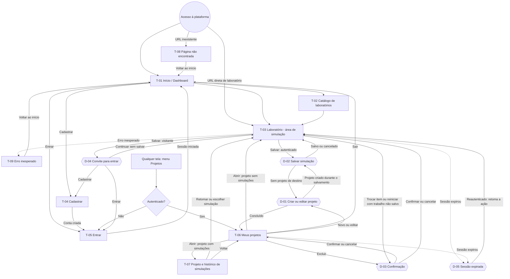

**Leitura:** linhas contínuas são caminhos normais; tracejadas são desvios de exceção (sessão expirada, erro inesperado). Hexágonos são diálogos, não páginas.

---

## 8. Fluxos de usuário detalhados

### F-01 — Acessar um laboratório (UC-003)

Sai do dashboard, do catálogo ou de uma URL direta e termina com o item aberto em estado inicial.

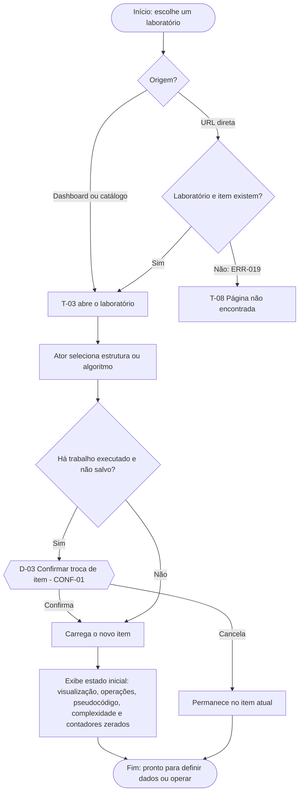

**Regras:** RN-001, RN-015, RN-027, RN-028. **Requisitos:** RF-003, RF-004, RF-005.

---

### F-02 — Inserir elementos em uma estrutura (UC-005)

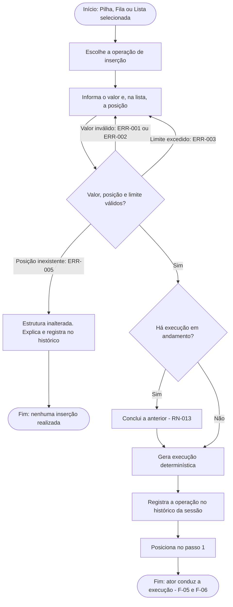

**Notas**
- Valor inválido ou limite excedido devolvem o ator ao campo, **sem alterar nada** (RN-003).
- O comportamento "conclui a anterior" é 💡 (RN-013, ❓ Q21).
- Sobre se a execução inicia sozinha ou aguarda o ator: 💡 aguarda no passo 1 (SUG-01, ❓ Q20).

**Requisitos:** RF-007, RF-008, RF-012, RF-013, RF-015, RF-020, RF-025.

---

### F-03 — Remover elementos (UC-006)

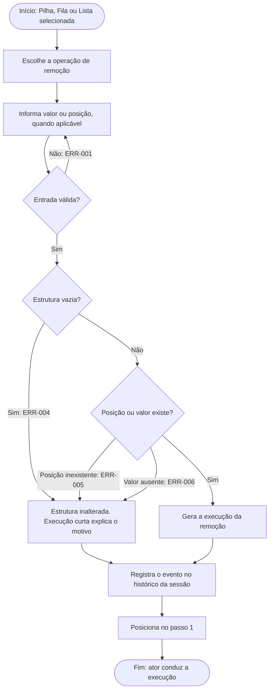

**Notas:** em Pilha e Fila não há valor nem posição a informar; o teste "posição ou valor existe?" só se aplica à Lista ligada. A operação inválida **gera conteúdo didático**, não um alerta técnico (RN-004).

**Requisitos:** RF-007, RF-008, RF-013, RF-020, RF-025.

---

### F-04 — Pesquisar elementos (UC-007)

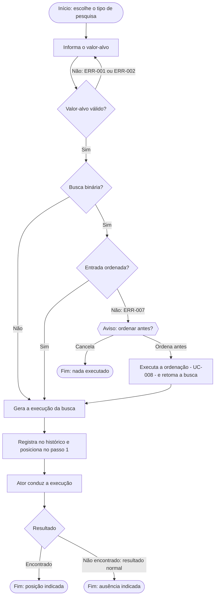

**Notas**
- "Não encontrado" é **resultado normal**, não erro (RN-008).
- A busca binária **nunca** roda em silêncio sobre dados desordenados (RN-007).
- Qual algoritmo faz a ordenação prévia é ❓ Q22 (💡 SUG-08).
- Consultar topo/frente de Pilha e Fila segue o mesmo desenho, sem alterar a estrutura (UC-007 A5).

**Requisitos:** RF-008, RF-010, RF-020, RF-030.

---

### F-05 — Executar uma operação passo a passo (UC-009)

Estados do **controle de execução** (R-05):

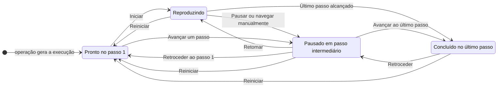

**Notas**
- Uma **nova operação** substitui a execução e reinicia o ciclo em "Pronto" (RN-013 💡).
- Se a execução tiver **um único passo**, "Pronto" e "Concluído" coincidem.
- "Navegar manualmente durante a reprodução pausa a reprodução" é 💡 (SUG-04, ❓ Q30).
- A cada passo exibido, todas as regiões se atualizam **juntas**: visualização (R-04), explicação (R-06), pseudocódigo (R-07), contadores (R-08) e indicador (R-05).
- Ao chegar ao fim, a reprodução para e sinaliza (RN-011). Mudar a velocidade durante a reprodução vale a partir do passo seguinte (RN-011).
- Com movimento reduzido ou animação desligada, as transições são instantâneas (RN-029).

**Requisitos:** RF-016 a RF-018, RF-020 a RF-024, RF-029, RF-030 · RNF-009, RNF-018.

---

### F-06 — Avançar e retroceder na simulação (UC-010)

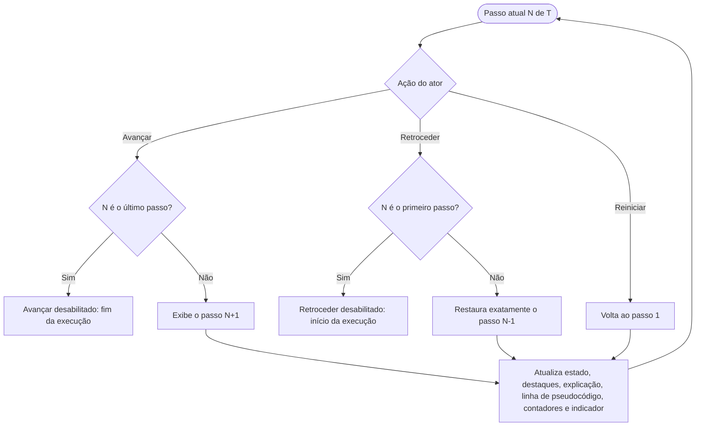

**Invariante central (RN-010):** o passo N-1 restaurado ao retroceder é **idêntico** ao que foi exibido antes de avançar, incluindo os contadores, que **diminuem** (RN-012). Navegar **não** altera o histórico da sessão nem o estado lógico final (RN-013).

**Requisitos:** RF-021, RF-023, RF-024, RF-029, RF-030 · RNF-017.

---

### F-07 — Salvar um projeto (UC-019)

Salvar = gravar uma **simulação** dentro de um **projeto** (ver nota de UC-019).

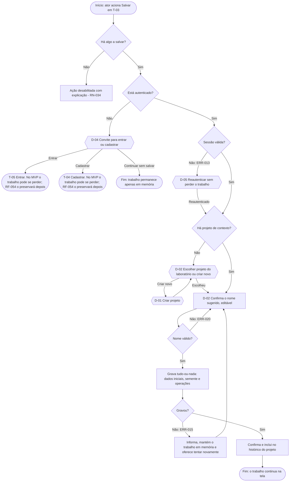

**Notas**
- Se a simulação veio de um projeto reaberto e foi continuada, salvar cria **nova entrada** por padrão (RN-018, ❓ Q13).
- O aviso de perda de trabalho do visitante é obrigatório até RF-054 existir (conflito C1 de `REQUIREMENTS.md`). A alternativa de login em diálogo está em ❓ Q25.

**Requisitos:** RF-037, RF-042, RF-049, RF-051 · RNF-032.

---

### F-08 — Recuperar um projeto salvo (UC-020)

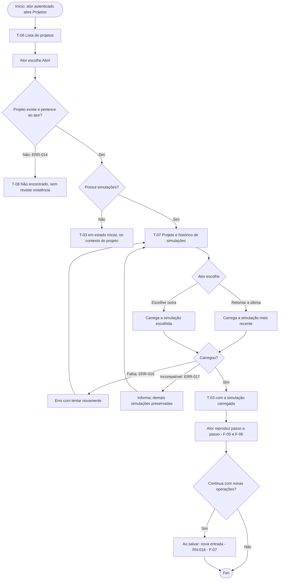

**Notas**
- Reabrir e reproduzir deve gerar **o mesmo estado final e a mesma sequência de passos** (RN-019, RNF-029).
- Projeto **sem** simulações vai direto a T-03 (RN-030); T-07 só aparece quando há o que escolher. 💡 SUG-UX-09
- Estando em T-03 em contexto de projeto, um atalho **"Voltar ao projeto"** leva a T-07. 💡 SUG-UX-03
- Reabrir "no estado final" ou "reproduzindo desde o início" é ❓ Q23 (💡 reprodução sequencial a partir do início).

**Requisitos:** RF-003, RF-038, RF-043, RF-044, RF-050, RF-051 · RNF-029, RNF-033.

---

### F-09 — Cadastro, login, sessão e logout (UC-014, UC-015, UC-016)

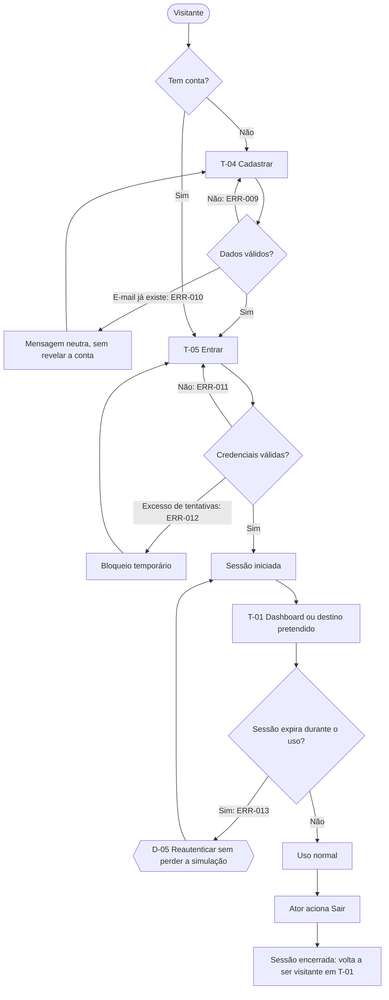

**Notas:** após o cadastro o ator segue para T-05 (💡 login automático é ❓ Q24). "Destino pretendido" depende de SUG-07. Depois de sair, o botão "voltar" não exibe dados da conta (RN-026).

**Requisitos:** RF-033, RF-034, RF-035, RF-036 · RNF-005.

---

### F-10 — Gerenciar projetos (UC-017, UC-018, UC-021, UC-022)

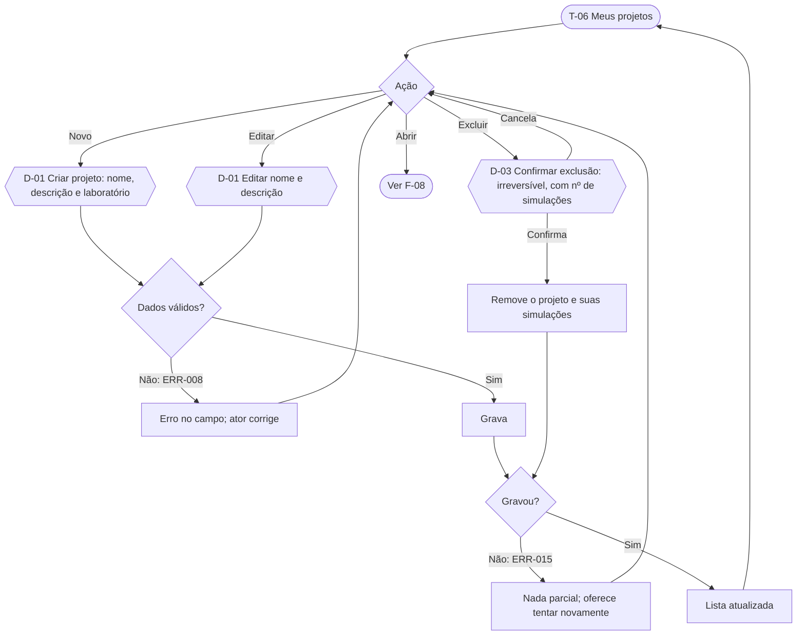

**Requisitos:** RF-042 a RF-046, RF-038 · RNF-026.

---

## 9. Jornadas ilustrativas (💡)

> Cenários de apoio para validar o mapa de telas; não são requisitos.

**J-01 — Estudante visitante estuda o Bubble Sort**
T-01 → T-02 → T-03 (seleciona *Bubble Sort*) → define dados (exemplo "ordem inversa") → ordena → conduz passo a passo, lendo a explicação e acompanhando a linha de pseudocódigo → retrocede para rever uma troca → compara os contadores com a complexidade teórica.
*Cobre:* UC-001 a UC-004, UC-008 a UC-011.

**J-02 — Visitante decide guardar o experimento**
Na J-01, aciona **Salvar** → D-04 (convite) → T-04 (cadastra) → T-05 (entra) → T-01 → T-06 → cria um projeto (D-01) → retorna a T-03 e repete o experimento → **Salvar** (D-02) → confirmação.
*Observação:* no MVP, o experimento da J-01 **não** é preservado ao entrar (RF-054 só vem depois). Daí a pergunta Q25.
*Cobre:* UC-014, UC-015, UC-017, UC-019.

**J-03 — Usuária retoma o estudo no dia seguinte**
T-05 → T-01 (vê o projeto recente) → T-07 (histórico de simulações) → abre a última → reproduz até o ponto de parada → continua com novas operações → **Salvar** (nova entrada).
*Cobre:* UC-015, UC-001, UC-020, UC-009, UC-010, UC-019.

---

## 10. Estados de tela (RNF-013)

Toda tela com dados remotos deve prever **carregamento, vazio e erro**.

| Tela | Carregando | Vazio | Erro |
|---|---|---|---|
| T-01 | Bloco de projetos recentes | Autenticado sem projetos: chamada para criar. Visitante: convite para criar conta | ERR-016 no bloco; laboratórios seguem disponíveis |
| T-02 | ❓ Depende de o catálogo ser estático ou remoto (arquitetura) | — | ERR-018 |
| T-03 | Montagem da tela; carregamento de simulação salva; (se a lógica rodar no servidor) geração dos passos | Estrutura vazia com representação explícita; histórico vazio; sem execução | ERR-016 (carregar simulação), ERR-017, ERR-015 (salvar), ERR-018; ERR-001 a ERR-007 nas operações |
| T-04 | Envio do formulário | — | ERR-009, ERR-010 |
| T-05 | Envio do formulário | — | ERR-011, ERR-012, ERR-013 |
| T-06 | Lista de projetos | Sem projetos: chamada para criar | ERR-016, ERR-013 |
| T-07 | Histórico de simulações | Improvável no MVP (RN-030 leva direto ao laboratório); tratar mesmo assim com mensagem e ação "Nova simulação" | ERR-014, ERR-016, ERR-017 |
| T-08 | — | — | — (é a própria tela de erro) |
| T-09 | — | — | — (é a própria tela de erro) |

---

## 11. Sugestões e pontos em aberto

### 11.1 Sugestões deste documento (não previstas nos requisitos)

| ID | Sugestão | Onde aparece |
|---|---|---|
| SUG-UX-01 | Criar/editar projeto, salvar simulação e confirmações como **diálogos**, não páginas. | Seção 3.2 |
| SUG-UX-02 | **Rotas sugeridas** e identificação do projeto em T-03 por parâmetro. | Seção 5 |
| SUG-UX-03 | Atalho **"Voltar ao projeto"** em T-03 quando em contexto de projeto. | F-08 |
| SUG-UX-04 | **Ordem de foco do teclado** em T-03. | Seção 4 |
| SUG-UX-05 | **Abas** em telas pequenas, sem perda de funções. | Seção 4 |
| SUG-UX-06 | **Retorno ao destino original** após login. | Seção 6 (SUG-07 de `USE_CASES.md`) |
| SUG-UX-07 | **Redirecionar** o autenticado que abre T-04/T-05. | Seção 6 (SUG-10 de `USE_CASES.md`) |
| SUG-UX-08 | **Indicador de "trabalho não salvo"** em T-03, para antecipar CONF-01/CONF-02 e o aviso ao sair. | Não detalhado; avaliar com Q26 |
| SUG-UX-09 | **T-07 só aparece quando há simulações**; senão o projeto abre direto em T-03. | F-08 (decorre de RN-030) |
| SUG-UX-10 | As sugestões SUG-01 a SUG-12 de `USE_CASES.md` (execução aguarda "Iniciar", RN-013, RN-033, reprodução sequencial etc.) também valem aqui. | F-02, F-05, F-08 |

### 11.2 Novas perguntas (continuam a numeração; as Q20–Q31 estão em `USE_CASES.md`)

| # | Pergunta | Sugestão | Afeta |
|---|---|---|---|
| Q32 | T-07 (histórico de simulações) é **página própria** ou painel dentro de T-03? | Página própria | T-07, F-08 |
| Q33 | O catálogo deve **exibir laboratórios "em breve"** (visão de roadmap) ou só os disponíveis? | Exibir, para comunicar a evolução | T-02, RN-027 |
| Q34 | O **catálogo (T-02) e o dashboard (T-01)** são redundantes no MVP, com poucos laboratórios? Faz sentido fundi-los? | Manter separados (RF-001/RF-004 os tratam como distintos) | T-01, T-02 |

### 11.3 Perguntas já abertas que continuam valendo
**Q2** (onde roda a lógica), **Q3** (idioma), **Q8** (um laboratório por projeto), **Q13** (salvar após continuar), **Q15** (suporte a celular), **Q20 a Q31** (ver `USE_CASES.md`, seção 9.2).

---

## 12. Rastreabilidade: casos de uso × telas

| Caso de uso | Telas e diálogos |
|---|---|
| UC-001 | T-01 |
| UC-002 | T-02 |
| UC-003 | T-02, T-03, D-03, T-08 |
| UC-004 | T-03 (R-02), D-03 |
| UC-005 a UC-008 | T-03 (R-03, R-04 a R-09) |
| UC-009, UC-010 | T-03 (R-04 a R-08), T-09 |
| UC-011 | T-03 (R-07, R-08) |
| UC-012 | T-03 (R-09) |
| UC-013 | T-03 (R-03), D-03 |
| UC-014 | T-04 |
| UC-015 | T-05, D-05 |
| UC-016 | Menu (Conta), T-01 |
| UC-017 | D-01, T-06 |
| UC-018 | T-06 |
| UC-019 | T-03 (R-10), D-02, D-04, D-01, D-05 |
| UC-020 | T-06, T-07, T-03, T-08 |
| UC-021 | D-01, T-06 |
| UC-022 | D-03, T-06 |

**Verificação:** os 22 casos de uso do MVP têm ao menos uma tela ou diálogo. Todas as telas e diálogos servem a ao menos um caso de uso.

---

*Fim do documento. A arquitetura só será iniciada mediante solicitação.*
