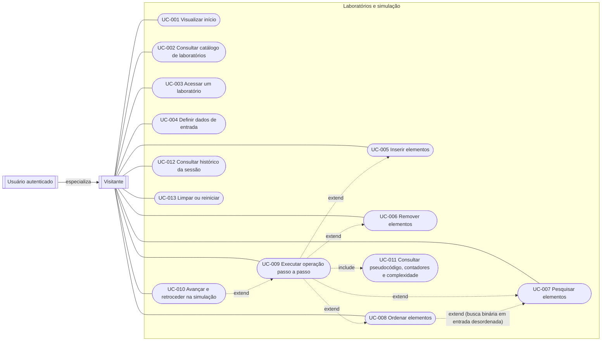
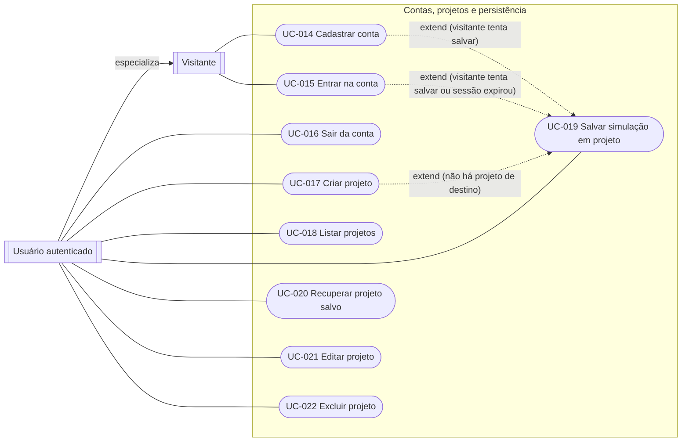

# DataStructure Studio — Casos de Uso

> **Versão:** 0.1 (rascunho para validação)
> **Data:** 12/11/2026
> **Base:** `docs/product/PROJECT_OVERVIEW.md` v0.1 e `docs/requirements/REQUIREMENTS.md` v0.1
> **Documento complementar:** `docs/requirements/USER_FLOWS.md` (fluxos de navegação e mapa de telas)
> **Escopo:** descreve *como as pessoas interagem com o sistema* para cumprir os requisitos do MVP. Não define arquitetura, modelo de dados, tecnologias nem layout visual.

---

## 1. Como ler este documento

### 1.1 Convenções de status
- ✅ **Confirmado:** vem diretamente dos requisitos ou de decisão do autor.
- 💡 **Sugestão:** comportamento **não previsto nos requisitos**, proposto aqui para fechar uma lacuna. Está sempre marcado e consolidado na seção 9.
- ❓ **Em aberto:** precisa de decisão do autor (ver seção 9.2).

### 1.2 Escopo dos casos de uso
Este documento detalha os **22 casos de uso do MVP**, que cobrem todos os requisitos *Must*. Os casos de uso derivados de requisitos *Should/Could* aparecem apenas como uma tabela de extensões futuras (seção 7), sem detalhamento.

### 1.3 Identificadores usados
| Prefixo | Significado |
|---|---|
| **UC-nnn** | Caso de uso |
| **A-nn** | Ator |
| **RN-nnn** | Regra de negócio (seção 4) |
| **ERR-nnn** | Erro ou operação inválida (seção 5) |
| **RF-nnn / RNF-nnn** | Requisitos (de `REQUIREMENTS.md`) |
| **SUG-nn** | Sugestão deste documento (seção 9) |

### 1.4 Nomenclatura dos fluxos
- **Fluxo principal:** caminho feliz, em passos numerados.
- **Fluxos alternativos (A):** variações válidas, sem falha (ex.: outra opção de entrada).
- **Fluxos de exceção (E):** situações de erro ou operação inválida.

Os termos *laboratório, estrutura/algoritmo, operação, execução, passo, simulação, projeto, histórico da sessão e histórico de simulações* seguem o glossário da seção 2 de `REQUIREMENTS.md`.

---

## 2. Atores do sistema

### 2.1 Atores do MVP

| ID | Ator | Tipo | Descrição | Requisitos |
|---|---|---|---|---|
| **A-01** | **Visitante** | Primário | Pessoa que usa a plataforma **sem conta**. Pode explorar laboratórios, executar operações, acompanhar passo a passo, ler pseudocódigo e complexidade. Não pode salvar nem gerenciar projetos. | RF-037 |
| **A-02** | **Usuário autenticado** | Primário | Pessoa com conta e sessão ativa. **Especialização do Visitante**: faz tudo o que o visitante faz e também gerencia projetos e salva/recupera simulações. | RF-033 a RF-038, RF-042 a RF-051 |

> **Herança:** onde um caso de uso lista "Visitante", o Usuário autenticado também pode executá-lo.

### 2.2 Atores futuros ou não considerados

| Ator | Situação | Observação |
|---|---|---|
| **Serviço de e-mail** | Secundário (sistema externo), **fora do MVP** | Necessário somente para recuperação de senha (RF-039, *Should*). |
| **Professor / monitor** | **Won't** (RF-068) | Sem requisito no MVP. |
| **Administrador** | ❓ Não há requisito que o exija | Se houver necessidade de moderação ou suporte, é um ator novo; não foi assumido. |
| **Temporizador de reprodução** | Não é ator | É comportamento interno do sistema na reprodução automática (UC-009). |

---

## 3. Visão geral dos casos de uso

### 3.1 Convenção dos diagramas
O Mermaid não possui diagrama de casos de uso nativo. Usamos `flowchart` com esta convenção: **retângulo de borda dupla** = ator; **elipse** = caso de uso; linha contínua = participação; seta tracejada = relacionamento entre casos de uso. Em `«include»`, a seta vai do caso base ao incluído. Em `«extend»`, a seta vai do caso que estende ao caso base.

### 3.2 Diagrama 1 — Laboratórios e simulação

### 3.3 Diagrama 2 — Contas, projetos e persistência

### 3.4 Resumo dos casos de uso

| ID | Caso de uso | Ator | Prioridade | Requisitos principais |
|---|---|---|---|---|
| UC-001 | Visualizar início (dashboard) | Visitante | Must | RF-001, RF-002, RF-003 |
| UC-002 | Consultar catálogo de laboratórios | Visitante | Must | RF-004 |
| UC-003 | **Acessar um laboratório** | Visitante | Must | RF-003, RF-004, RF-005 |
| UC-004 | Definir dados de entrada | Visitante | Must | RF-011, RF-012, RF-015 |
| UC-005 | **Inserir elementos em uma estrutura** | Visitante | Must | RF-007, RF-008, RF-012, RF-015 |
| UC-006 | **Remover elementos** | Visitante | Must | RF-007, RF-008, RF-013 |
| UC-007 | **Pesquisar elementos** | Visitante | Must | RF-008, RF-010 |
| UC-008 | Ordenar elementos | Visitante | Must | RF-009 |
| UC-009 | **Executar uma operação passo a passo** | Visitante | Must | RF-016 a RF-018, RF-020 a RF-024 |
| UC-010 | **Retroceder e avançar na simulação** | Visitante | Must | RF-021, RF-023 |
| UC-011 | Consultar pseudocódigo, contadores e complexidade | Visitante | Must | RF-028 a RF-031 |
| UC-012 | Consultar histórico da sessão | Visitante | Must | RF-025 |
| UC-013 | Limpar ou reiniciar | Visitante | Must | RF-014 |
| UC-014 | Cadastrar conta | Visitante | Must | RF-033 |
| UC-015 | Entrar na conta | Visitante | Must | RF-034, RF-036 |
| UC-016 | Sair da conta | Usuário autenticado | Must | RF-035 |
| UC-017 | Criar projeto | Usuário autenticado | Must | RF-042 |
| UC-018 | Listar projetos | Usuário autenticado | Must | RF-043 |
| UC-019 | **Salvar simulação em projeto** | Usuário autenticado | Must | RF-049, RF-037 |
| UC-020 | **Recuperar projeto salvo** | Usuário autenticado | Must | RF-044, RF-050, RF-051 |
| UC-021 | Editar projeto | Usuário autenticado | Must | RF-045 |
| UC-022 | Excluir projeto | Usuário autenticado | Must | RF-046 |

**Em negrito**, os fluxos pedidos de forma especial.

> **Sobre "salvar um projeto":** no modelo adotado (glossário), o **projeto** é o contêiner e a **simulação** é o conteúdo salvável. Portanto "salvar um projeto" é implementado como **UC-019 (salvar simulação em um projeto)**, que inclui escolher ou criar o projeto de destino (UC-017). Isto está coerente com RF-049.

---

## 4. Regras de negócio

> Todas derivam dos requisitos (coluna *Fonte*). Quando uma regra **acrescenta algo que os requisitos não dizem**, aparece como 💡.

| ID | Regra | Fonte | Status |
|---|---|---|---|
| **RN-001** | O visitante pode usar laboratórios, execução passo a passo, pseudocódigo e complexidade. Salvar e gerenciar projetos exigem login. | RF-037 | ✅ |
| **RN-002** | Os valores dos elementos são **inteiros**, com limite de **50 elementos** e faixa de **-999 a 999**. Os limites ficam em um único ponto de configuração. | RF-015, premissa P2 | ✅ regra / 💡 valores |
| **RN-003** | Uma entrada inválida nunca altera o estado da estrutura nem inicia uma execução. | RF-012 | ✅ |
| **RN-004** | Operações inválidas (pilha vazia, posição inexistente, remover valor ausente) são **resultado explicado**, não falha do sistema: a estrutura permanece inalterada e o evento vai ao histórico da sessão. | RF-013 | ✅ |
| **RN-005** | Toda operação ou algoritmo gera uma **execução determinística**: primeiro passo = estado anterior; último passo = resultado esperado; sempre termina. | RF-020, RNF-029 | ✅ |
| **RN-006** | A geração aleatória usa **semente**; a mesma semente reproduz o mesmo conjunto. A semente faz parte dos dados da simulação. | RF-011, RNF-029 | ✅ |
| **RN-007** | A busca binária exige entrada ordenada. Se não estiver, o sistema avisa e oferece ordenar antes; **nunca** executa em silêncio com resultado incorreto. | RF-010 | ✅ |
| **RN-008** | A busca linear retorna a **primeira ocorrência**. "Valor não encontrado" é um **resultado normal** da pesquisa, não um erro. | RF-008, RF-010 | ✅ |
| **RN-009** | A ordenação produz saída ordenada que é permutação da entrada e **preserva a ordem relativa** de elementos repetidos (Bubble, Insertion e Merge são estáveis). | RF-009 | ✅ |
| **RN-010** | Retroceder do passo N restaura **exatamente** o estado do passo N-1 (estado, destaques, explicação, linha de pseudocódigo e contadores). Retroceder é desabilitado no 1º passo; avançar, no último. | RF-021 | ✅ |
| **RN-011** | Na reprodução automática, ao chegar ao último passo ela para e sinaliza o fim. Mudar a velocidade vale a partir do passo seguinte, sem reiniciar. Há pelo menos 3 velocidades. | RF-021, RF-022 | ✅ |
| **RN-012** | Os contadores (comparações, trocas/movimentações, acessos, passos) seguem **definições padronizadas** e acompanham o passo exibido: ao retroceder, diminuem. | RF-030 | ✅ |
| **RN-013** | 💡 **Navegar pelos passos não altera o estado lógico da simulação**: o estado lógico é sempre o resultado final da última operação disparada. Se o usuário disparar nova operação com uma execução em andamento ou em passo intermediário, a anterior é considerada concluída e a nova parte do seu estado final. | — (lacuna) | 💡 ❓ Q21 |
| **RN-014** | O **histórico da sessão** registra cada operação concluída, inclusive as inválidas, em ordem cronológica, com tipo, parâmetros e resultado. Reiniciar o limpa (após confirmação). | RF-025, RF-014 | ✅ |
| **RN-015** | Descartar trabalho executado e **não salvo** (trocar de item, reiniciar/esvaziar) exige confirmação. Se não houve execução, não há confirmação. | RF-005, RF-014 | ✅ (💡 estendida em RN-033) |
| **RN-016** | Ao salvar, grava-se: dados iniciais, semente (se houver), itens e **sequência de operações**, com nome e data. O nome é sugerido automaticamente (💡 laboratório + data/hora) e é editável. | RF-049 | ✅ / 💡 formato do nome |
| **RN-017** | Salvar é **tudo-ou-nada**. Em falha, o usuário é informado, o trabalho em memória é preservado e é possível tentar de novo. | RF-049, RNF-032 | ✅ |
| **RN-018** | Salvar após continuar uma simulação reaberta **cria nova entrada** e não sobrescreve a original, salvo escolha explícita do usuário. | RF-050 | 💡 ❓ Q13 |
| **RN-019** | Reabrir e reproduzir uma simulação produz o **mesmo estado final e a mesma sequência de passos** da execução original. | RF-050 | ✅ |
| **RN-020** | Cada usuário só acessa os **próprios** projetos e simulações. O acesso indevido é negado **sem revelar** se o recurso existe. | RF-038, RNF-004 | ✅ |
| **RN-021** | Projeto: nome obrigatório (💡 3 a 60 caracteres), descrição opcional, laboratório associado. 💡 Um projeto pertence a **um** laboratório. Nomes duplicados: 💡 permitidos. | RF-042 | ✅ / 💡 ❓ Q8, Q12 |
| **RN-022** | Excluir projeto exige **confirmação explícita**, que informa a irreversibilidade e a quantidade de simulações; a exclusão remove também as simulações. | RF-046 | ✅ |
| **RN-023** | Cadastro: e-mail, nome de exibição e senha (💡 ≥ 8 caracteres). E-mail já cadastrado é tratado **sem expor dados** da conta existente. | RF-033 | ✅ / 💡 política de senha |
| **RN-024** | Login com credenciais inválidas gera mensagem **genérica** (não revela se o e-mail existe). Tentativas repetidas sofrem limitação. | RF-034, RNF-005 | ✅ |
| **RN-025** | A sessão dura um tempo configurável (💡 7 dias). Ao expirar, a próxima ação protegida pede novo login **sem perder** a simulação em memória. Sessão adulterada é rejeitada. | RF-036 | ✅ / 💡 duração |
| **RN-026** | Após sair, páginas protegidas redirecionam ao login e os dados da conta ficam inacessíveis, inclusive com o botão "voltar". | RF-035 | ✅ |
| **RN-027** | O catálogo exibe os laboratórios do Catálogo MVP; laboratórios futuros, se exibidos, ficam "em breve" e **não clicáveis**. É acessível sem login. | RF-004 | ✅ |
| **RN-028** | Trocar de estrutura/algoritmo reinicia a visualização para o **estado inicial do novo item**. | RF-005 | ✅ |
| **RN-029** | Com a preferência de movimento reduzido ativa, ou com a animação desligada, as transições são instantâneas e **nenhuma informação se perde**. | RF-018, RNF-018 | ✅ |
| **RN-030** | Abrir projeto **sem** simulações abre o laboratório em estado inicial. Abrir projeto **com** simulações oferece retomar a última ou escolher outra. | RF-044 | ✅ |
| **RN-031** | O dashboard mostra, para o autenticado, os **5 projetos mais recentes** (por última atualização). Sem projetos: estado vazio com chamada para criar. Visitante: convite para criar conta, sem elementos vazios ou quebrados. | RF-002 | ✅ (💡 valor 5) |
| **RN-032** | A listagem de projetos é **paginada** (💡 20 por página), do mais recente para o mais antigo. | RF-043, RNF-026 | ✅ |
| **RN-033** | 💡 **Definir novos dados iniciais equivale a reiniciar a simulação**: substitui o conjunto, zera contadores e histórico, com a confirmação de RN-015 se houver trabalho executado. Para Pilha, Fila e Lista, definir dados iniciais é opcional (a estrutura começa vazia). | — (lacuna) | 💡 ❓ Q29 |
| **RN-034** | 💡 Só é possível salvar quando há **algo a salvar**: dados iniciais definidos ou ao menos uma operação no histórico. O nome da simulação não pode ser vazio. | — (lacuna) | 💡 ❓ Q28 |
| **RN-035** | As páginas de projetos exigem autenticação; o visitante que tenta acessá-las é levado ao login. | RF-001, RF-038, RF-035 | ✅ |
| **RN-036** | Mensagens de erro usam linguagem simples e indicam **campo e motivo**. | RF-012, RNF-013 | ✅ |

---

## 5. Tratamento de erros, operações inválidas e confirmações

### 5.1 Princípios
1. **Erro de entrada ou operação inválida nunca corrompe o estado** (RN-003, RN-004).
2. Toda tela com dados remotos tem estado de **carregamento, vazio e erro** (RNF-013).
3. Erros inesperados **não derrubam** a aplicação: há tela de contingência recuperável e resposta padronizada da API, sem expor detalhes internos (RNF-034).
4. Erros de domínio (pilha vazia etc.) são tratados como **conteúdo didático** (RF-013), não como alerta técnico.

### 5.2 Catálogo de erros

> As mensagens são **exemplos em português** (💡 SUG-12; o idioma definitivo é uma decisão em aberto ❓ Q3).

| ID | Situação | Comportamento do sistema | Mensagem (exemplo) | Requisitos |
|---|---|---|---|---|
| **ERR-001** | Entrada vazia ou não numérica | Rejeita; destaca o campo; nada muda; mantém o foco no campo | "O campo *Valor* aceita apenas números inteiros." | RF-012 |
| **ERR-002** | Valor fora da faixa permitida | Rejeita; informa a faixa vigente | "Use valores entre -999 e 999." | RF-015 |
| **ERR-003** | Limite de elementos excedido | Bloqueia a inserção/geração; informa o limite | "O limite é de 50 elementos nesta versão." | RF-015 |
| **ERR-004** | Operação em estrutura vazia (desempilhar, desenfileirar, consultar topo/frente, remover) | Estrutura inalterada; gera execução curta com explicação; registra no histórico | "A pilha está vazia: não há elemento para remover." | RF-013 |
| **ERR-005** | Posição inexistente na lista | Estrutura inalterada; informa a faixa válida; registra no histórico | "Posição 7 inexistente. Esta lista aceita posições de 0 a 4." | RF-013 |
| **ERR-006** | Remoção de valor ausente | Estrutura inalterada; mostra o percurso feito (opcional) e explica; registra | "O valor 42 não está na lista." | RF-013 |
| **ERR-007** | Busca binária em entrada não ordenada | Não executa; avisa; oferece **ordenar antes** ou **cancelar** | "A busca binária exige dados ordenados. Deseja ordenar antes?" | RF-010 |
| **ERR-008** | Nome de projeto vazio ou fora do tamanho | Rejeita no campo | "O nome deve ter entre 3 e 60 caracteres." | RF-042 |
| **ERR-009** | Dados de cadastro inválidos (e-mail, nome ou senha fora da política) | Rejeita; indica o campo e a regra | "A senha precisa ter pelo menos 8 caracteres." | RF-033 |
| **ERR-010** | E-mail já cadastrado | **Mensagem neutra**, sem confirmar a existência da conta | "Não foi possível concluir o cadastro. Tente entrar ou use outro e-mail." | RF-033, RN-023 |
| **ERR-011** | Credenciais inválidas | Mensagem **genérica**, não revela qual campo errou | "E-mail ou senha incorretos." | RF-034 |
| **ERR-012** | Excesso de tentativas de login | Bloqueia temporariamente novas tentativas | "Muitas tentativas. Aguarde alguns minutos e tente novamente." | RNF-005 |
| **ERR-013** | Sessão expirada ou inválida | Pede novo login **sem perder** a simulação em memória; retoma a ação após entrar | "Sua sessão expirou. Entre novamente para continuar." | RF-036 |
| **ERR-014** | Recurso inexistente ou de outro usuário | Negado; resposta idêntica nos dois casos; leva a "não encontrado" | "Não encontramos este projeto." | RF-038, RNF-004 |
| **ERR-015** | Falha ao gravar (salvar, criar, editar, excluir) | Nada parcial é gravado; trabalho em memória preservado; oferece **tentar novamente** | "Não foi possível salvar. Seu trabalho continua aqui; tente novamente." | RF-049, RNF-032 |
| **ERR-016** | Falha ao carregar dados (lista de projetos, projeto, simulação) | Estado de erro na região afetada, com **tentar novamente**; o resto da tela segue utilizável | "Não foi possível carregar seus projetos." | RNF-013, RNF-034 |
| **ERR-017** | Simulação salva não pode ser reaberta (formato antigo/corrompido) | Informa; preserva as demais simulações; não derruba a tela | "Esta simulação não pôde ser reaberta." | 💡 RNF-033 (*Should*) |
| **ERR-018** | Erro inesperado no cliente ou na API | Tela de contingência **recuperável** (voltar ao início/recarregar); estado preservado quando possível; sem detalhes internos | "Algo deu errado. Você pode tentar novamente." | RNF-034 |
| **ERR-019** | Página ou URL inexistente | Página "não encontrado" com caminho de volta | "Página não encontrada." | RF-003 |
| **ERR-020** | 💡 Nome de simulação vazio ao salvar | Rejeita no campo | "Dê um nome para a simulação." | 💡 RN-034 |

### 5.3 Confirmações (não são erros)

| ID | Gatilho | Texto de confirmação (exemplo) | Requisitos |
|---|---|---|---|
| **CONF-01** | Trocar de estrutura/algoritmo com trabalho executado e não salvo | "Trocar de item descarta o que você fez e não salvou. Continuar?" | RF-005 |
| **CONF-02** | Esvaziar/restaurar com trabalho executado e não salvo | "Isso reinicia a simulação e limpa o histórico desta sessão." | RF-014 |
| **CONF-03** | 💡 Substituir os dados iniciais com trabalho executado | Igual a CONF-02 | RN-033 |
| **CONF-04** | Excluir projeto | "Excluir *Meu projeto* removerá também 4 simulações. Esta ação não pode ser desfeita." | RF-046 |

---

## 6. Casos de uso detalhados

### 6.1 Navegação e acesso

#### UC-001 — Visualizar início (dashboard)

| Campo | Conteúdo |
|---|---|
| **Ator** | Visitante (inclui Usuário autenticado) |
| **Pré-condições** | Nenhuma. |
| **Pós-condições** | O ator vê as opções disponíveis e consegue chegar ao próximo destino com um clique. |
| **Requisitos** | RF-001, RF-002, RF-003, RNF-013 |
| **Regras de negócio** | RN-001, RN-031 |
| **Erros tratados** | ERR-016 |

**Fluxo principal**
1. O ator acessa o endereço raiz da plataforma.
2. O sistema exibe a navegação principal (RF-001) e o dashboard.
3. O sistema apresenta atalhos para os laboratórios.
4. Se o ator está autenticado, o sistema exibe os 5 projetos mais recentes, ordenados por última atualização.
5. O ator seleciona um cartão e o sistema o leva ao destino (UC-003 ou UC-020).

**Fluxos alternativos**
- **A1 — Autenticado sem projetos (passo 4):** o sistema exibe estado vazio com chamada para criar o primeiro projeto (UC-017).
- **A2 — Visitante (passo 4):** o sistema exibe os laboratórios e um convite para criar conta (UC-014), sem blocos vazios ou quebrados.

**Fluxos de exceção**
- **E1 — Falha ao carregar projetos recentes (ERR-016):** o bloco de projetos mostra erro com "tentar novamente"; os laboratórios continuam acessíveis.

---

#### UC-002 — Consultar catálogo de laboratórios

| Campo | Conteúdo |
|---|---|
| **Ator** | Visitante |
| **Pré-condições** | Nenhuma. |
| **Pós-condições** | O ator conhece os laboratórios e pode escolher um. |
| **Requisitos** | RF-004, RF-003 |
| **Regras de negócio** | RN-001, RN-027 |
| **Erros tratados** | ERR-019 |

**Fluxo principal**
1. O ator abre "Laboratórios" na navegação principal.
2. O sistema lista os laboratórios com nome, descrição curta, itens contidos e nível de dificuldade.
3. O ator seleciona um laboratório (segue para UC-003).

**Fluxos alternativos**
- **A1 — Laboratório "em breve" (passo 2):** é exibido sem ação de clique (RN-027).
- **A2 — Acesso direto pela URL do catálogo:** o sistema abre a mesma tela (RF-003).

---

#### UC-003 — Acessar um laboratório

| Campo | Conteúdo |
|---|---|
| **Ator** | Visitante (ou Usuário autenticado, também por projeto — A3) |
| **Pré-condições** | O laboratório pertence ao Catálogo MVP. |
| **Pós-condições** | O laboratório e o item escolhidos estão abertos em **estado inicial**, com visualização, painel de operações, pseudocódigo, complexidade teórica e contadores zerados; nenhuma execução em curso. |
| **Requisitos** | RF-003, RF-004, RF-005, RF-016, RF-028, RF-031 |
| **Regras de negócio** | RN-001, RN-015, RN-027, RN-028 |
| **Erros tratados** | ERR-018, ERR-019 · CONF-01 |

**Fluxo principal**
1. O ator seleciona um laboratório no catálogo ou no dashboard (ou abre a URL direta — A1).
2. O sistema abre a tela de laboratório (T-03) e lista as estruturas/algoritmos disponíveis.
3. O ator seleciona um item (ex.: *Bubble Sort*).
4. O sistema carrega o painel de operações, a visualização em estado inicial (com representação explícita de estrutura vazia), o pseudocódigo, a complexidade teórica e os contadores zerados.
5. O ator prossegue com a definição de dados (UC-004) ou com uma operação (UC-005 a UC-008).

**Fluxos alternativos**
- **A1 — URL direta de laboratório/item (passo 1):** o sistema abre diretamente no passo 4, inclusive para visitante (RF-003).
- **A2 — Troca de item com trabalho executado e não salvo (passo 3):** o sistema pede confirmação (CONF-01). Se o ator confirma, a visualização reinicia para o estado inicial do novo item (RN-028); se cancela, permanece no item atual.
- **A3 — Acesso via projeto:** a tela abre em contexto do projeto (UC-020).

**Fluxos de exceção**
- **E1 — Laboratório/item inexistente (ERR-019):** o sistema exibe "não encontrado" com caminho de volta ao catálogo.
- **E2 — Erro inesperado ao montar a tela (ERR-018):** o sistema exibe a tela de contingência recuperável.

---

### 6.2 Operações com estruturas de dados

#### UC-004 — Definir dados de entrada

| Campo | Conteúdo |
|---|---|
| **Ator** | Visitante |
| **Pré-condições** | Um item está selecionado (UC-003). |
| **Pós-condições** | O conjunto inicial está definido e visível; a semente está registrada quando a geração foi aleatória; as operações do item estão habilitadas. |
| **Requisitos** | RF-011, RF-012, RF-015, RF-016, RNF-029 |
| **Regras de negócio** | RN-002, RN-003, RN-006, RN-015, RN-033, RN-036 |
| **Erros tratados** | ERR-001, ERR-002, ERR-003 · CONF-03 |

**Fluxo principal**
1. O ator escolhe a forma de definir os dados: **manual**, **aleatória** ou **exemplo predefinido**.
2. (Manual) O ator digita os valores; (aleatória) informa o tamanho e o sistema gera o conjunto com uma semente; (exemplo) o ator escolhe um caso (aleatório, ordenado, ordem inversa, com repetições).
3. O sistema valida formato, faixa e tamanho (RN-002, RN-003).
4. O sistema aplica o conjunto e atualiza a visualização.
5. O sistema habilita as operações do item.

**Fluxos alternativos**
- **A1 — Estruturas lineares e lista ligada (passo 1):** a definição de dados iniciais é opcional; a estrutura pode começar vazia e ser preenchida por inserções (UC-005) 💡 SUG-03.
- **A2 — Mesma semente:** informar uma semente já usada reproduz exatamente o conjunto anterior (RN-006).
- **A3 — Já existe trabalho executado (antes do passo 4):** o sistema pede confirmação (CONF-03); ao confirmar, a simulação é reiniciada (RN-033). 💡

**Fluxos de exceção**
- **E1 — Valor inválido (ERR-001/ERR-002):** o sistema rejeita, aponta o campo e não altera nada.
- **E2 — Excesso de elementos (ERR-003):** o sistema bloqueia e informa o limite.

---

#### UC-005 — Inserir elementos em uma estrutura

| Campo | Conteúdo |
|---|---|
| **Ator** | Visitante |
| **Pré-condições** | O item selecionado é uma estrutura que admite inserção (Pilha, Fila ou Lista ligada). |
| **Pós-condições** | **Sucesso:** o novo elemento consta no estado final; a operação está no histórico da sessão; a execução está pronta no passo 1. **Falha:** estado inalterado. |
| **Requisitos** | RF-007, RF-008, RF-012, RF-013, RF-015, RF-016, RF-020, RF-024, RF-025 |
| **Regras de negócio** | RN-002, RN-003, RN-004, RN-005, RN-013, RN-014, RN-036 |
| **Erros tratados** | ERR-001, ERR-002, ERR-003, ERR-005 |

**Fluxo principal**
1. O ator escolhe a operação de inserção correspondente à estrutura: **Pilha** → empilhar; **Fila** → enfileirar; **Lista ligada** → inserir no início, no fim ou em uma posição.
2. O ator informa o valor (e a posição, na inserção por posição).
3. O sistema valida valor, posição e limite de elementos (RN-002, RN-003).
4. O sistema gera a execução da operação (RN-005): passos com estado, destaques, explicação, linha de pseudocódigo e contadores.
5. O sistema registra a operação no histórico da sessão (RN-014).
6. O sistema posiciona a execução no **primeiro passo** (estado anterior) e a deixa pronta para o ator conduzi-la (UC-009 e UC-010). 💡 SUG-01, ❓ Q20

**Fluxos alternativos**
- **A1 — Inserção em posição, lista vazia:** a posição 0 é válida; o sistema executa normalmente.
- **A2 — Nova operação com execução em andamento (antes do passo 3):** aplica-se RN-013 💡: a execução anterior é considerada concluída e a nova parte do seu estado final.

**Fluxos de exceção**
- **E1 — Valor inválido (ERR-001/ERR-002):** nada é alterado; o sistema aponta o campo.
- **E2 — Posição inexistente (ERR-005):** nada é alterado; o sistema informa a faixa de posições válidas e registra o evento no histórico (RN-004).
- **E3 — Limite de elementos excedido (ERR-003):** nada é alterado; o sistema informa o limite.

---

#### UC-006 — Remover elementos

| Campo | Conteúdo |
|---|---|
| **Ator** | Visitante |
| **Pré-condições** | O item selecionado é Pilha, Fila ou Lista ligada. |
| **Pós-condições** | **Sucesso:** o elemento foi removido no estado final; operação registrada; execução pronta no passo 1. **Operação inválida:** estrutura inalterada, evento explicado e registrado. |
| **Requisitos** | RF-007, RF-008, RF-013, RF-020, RF-024, RF-025 |
| **Regras de negócio** | RN-003, RN-004, RN-005, RN-013, RN-014 |
| **Erros tratados** | ERR-001, ERR-004, ERR-005, ERR-006 |

**Fluxo principal**
1. O ator escolhe a operação de remoção: **Pilha** → desempilhar; **Fila** → desenfileirar; **Lista ligada** → remover por valor ou por posição.
2. Quando aplicável, o ator informa o valor ou a posição.
3. O sistema valida a entrada e verifica se a operação é possível.
4. O sistema gera a execução (destaca o elemento removido e, na lista, as ligações atualizadas).
5. O sistema registra a operação no histórico da sessão.
6. O sistema posiciona a execução no primeiro passo.

**Fluxos alternativos**
- **A1 — Remoção na lista com um único elemento:** o sistema executa e deixa a lista vazia, representada explicitamente.
- **A2 — Nova operação com execução em andamento:** aplica-se RN-013 💡.

**Fluxos de exceção**
- **E1 — Estrutura vazia (ERR-004):** a estrutura permanece inalterada; o sistema gera uma execução curta explicando o motivo ("a pilha está vazia…") e registra o evento no histórico (RN-004).
- **E2 — Posição inexistente (ERR-005):** idem E1, informando as posições válidas.
- **E3 — Valor ausente (ERR-006):** idem E1; o sistema pode mostrar o percurso feito até concluir que o valor não existe.
- **E4 — Valor informado inválido (ERR-001):** nada é alterado.

---

#### UC-007 — Pesquisar elementos

| Campo | Conteúdo |
|---|---|
| **Ator** | Visitante |
| **Pré-condições** | O item selecionado permite pesquisa: **busca linear**, **busca binária** ou **busca por valor em lista ligada**. Para Pilha/Fila, aplica-se A5 (consulta). |
| **Pós-condições** | O resultado (posição encontrada ou "não encontrado") está disponível ao final da execução; a estrutura **não é alterada**; a operação está no histórico. |
| **Requisitos** | RF-007 (consulta), RF-008, RF-010, RF-020, RF-030 |
| **Regras de negócio** | RN-003, RN-005, RN-007, RN-008, RN-013, RN-014 |
| **Erros tratados** | ERR-001, ERR-002, ERR-004, ERR-007 |

**Fluxo principal**
1. O ator escolhe o tipo de pesquisa e informa o **valor-alvo**.
2. O sistema valida o valor-alvo.
3. Na busca binária, o sistema verifica se a entrada está ordenada (RN-007).
4. O sistema gera a execução: na linear, o percurso elemento a elemento; na binária, a faixa de busca sendo reduzida a cada passo; na lista, o percurso nó a nó. Os contadores de comparações acompanham.
5. O sistema registra a operação no histórico e posiciona a execução no primeiro passo.
6. Ao final da execução, o sistema indica o resultado: posição do elemento ou "não encontrado".

**Fluxos alternativos**
- **A1 — Binária em entrada não ordenada (passo 3):** o sistema **não executa** e avisa (ERR-007), oferecendo **ordenar antes** ou **cancelar**. Se o ator escolhe ordenar, o sistema executa a ordenação (UC-008) e, depois, retoma a busca. 💡 ❓ Q22 (qual algoritmo usar na ordenação prévia).
- **A2 — Valor-alvo ausente:** é um **resultado normal** ("não encontrado"), não um erro (RN-008).
- **A3 — Ocorrências repetidas (linear):** o sistema retorna a primeira ocorrência (RN-008).
- **A4 — Entrada vazia:** a execução termina de imediato com "não encontrado".
- **A5 — Consultar topo/frente (Pilha/Fila):** o sistema destaca o elemento sem alterá-lo e registra a consulta. Se a estrutura estiver vazia, aplica-se ERR-004.
- **A6 — Nova operação com execução em andamento:** RN-013 💡.

**Fluxos de exceção**
- **E1 — Valor-alvo inválido (ERR-001/ERR-002):** nada é executado; o sistema aponta o campo.

---

#### UC-008 — Ordenar elementos

| Campo | Conteúdo |
|---|---|
| **Ator** | Visitante |
| **Pré-condições** | O item selecionado é um algoritmo de ordenação (Bubble, Insertion ou Merge); a entrada foi definida (UC-004). |
| **Pós-condições** | O estado final está ordenado e é permutação da entrada; a operação está no histórico; a execução está pronta no passo 1. |
| **Requisitos** | RF-009, RF-020, RF-030, RF-031 |
| **Regras de negócio** | RN-005, RN-009, RN-013, RN-014 |
| **Erros tratados** | ERR-018 |

**Fluxo principal**
1. O ator aciona "Ordenar" sobre o conjunto de entrada.
2. O sistema gera a execução do algoritmo selecionado, com comparações, trocas/movimentações, destaques, explicação e contadores.
3. O sistema registra a operação no histórico.
4. O sistema posiciona a execução no primeiro passo.

**Fluxos alternativos**
- **A1 — Entrada vazia ou com 1 elemento:** execução trivial, sem erro.
- **A2 — Elementos repetidos:** a ordem relativa é preservada (RN-009).
- **A3 — Chamado a partir de UC-007 (A1):** a ordenação serve de pré-condição para a busca binária.

---

#### UC-013 — Limpar ou reiniciar

| Campo | Conteúdo |
|---|---|
| **Ator** | Visitante |
| **Pré-condições** | Um item está selecionado. |
| **Pós-condições** | Visualização, contadores, explicação e histórico da sessão voltaram ao estado inicial (ou a estrutura foi esvaziada). |
| **Requisitos** | RF-014, RF-025 |
| **Regras de negócio** | RN-014, RN-015 |
| **Erros tratados** | — · CONF-02 |

**Fluxo principal**
1. O ator escolhe **esvaziar a estrutura** ou **restaurar o estado inicial da simulação**.
2. Se há trabalho executado e não salvo, o sistema pede confirmação (CONF-02).
3. O ator confirma.
4. O sistema aplica a ação e atualiza visualização, contadores, explicação e histórico.

**Fluxos alternativos**
- **A1 — Sem trabalho executado (passo 2):** o sistema aplica a ação sem confirmação.
- **A2 — O ator cancela (passo 3):** nada muda.

---

### 6.3 Execução passo a passo

#### UC-009 — Executar uma operação passo a passo

| Campo | Conteúdo |
|---|---|
| **Ator** | Visitante |
| **Pré-condições** | Há uma execução gerada por UC-005, UC-006, UC-007 ou UC-008, posicionada no primeiro passo. |
| **Pós-condições** | A execução foi concluída ou está pausada em um passo N; visualização, explicação, pseudocódigo realçado e contadores coincidem com o passo exibido. |
| **Requisitos** | RF-016, RF-017, RF-018, RF-020, RF-021, RF-022, RF-023, RF-024, RF-029, RF-030 · RNF-009, RNF-017, RNF-018 |
| **Regras de negócio** | RN-005, RN-011, RN-012, RN-013, RN-029 |
| **Erros tratados** | ERR-018 |

**Fluxo principal**
1. O ator aciona **iniciar**.
2. O sistema reproduz automaticamente os passos, na velocidade selecionada, animando as transições (RF-018).
3. A cada passo, o sistema atualiza: estado da estrutura com destaques (RF-016, RF-017), explicação textual (RF-024), linha de pseudocódigo (RF-029), contadores (RF-030) e o indicador "Passo X de N" (RF-023).
4. O ator pode **pausar** (A1) ou **alterar a velocidade** (A2) a qualquer momento.
5. Ao chegar ao último passo, o sistema interrompe a reprodução e sinaliza o fim (RN-011).

**Fluxos alternativos**
- **A1 — Pausar:** o sistema mantém o estado atual; o ator pode **retomar** do mesmo ponto ou navegar manualmente (UC-010).
- **A2 — Alterar velocidade durante a reprodução:** vale a partir do passo seguinte, sem reiniciar (RN-011).
- **A3 — Movimento reduzido ou animação desligada:** as transições são instantâneas, mantendo toda a informação (RN-029).
- **A4 — Reiniciar a execução:** o sistema volta ao passo 1.
- **A5 — Nova operação disparada durante a execução:** RN-013 💡.
- **A6 — O ator sai da tela com trabalho não salvo:** 💡 o sistema pode avisar antes de descartar (SUG-06, ❓ Q26).

**Fluxos de exceção**
- **E1 — Erro inesperado na reprodução (ERR-018):** a reprodução para, o estado é preservado e é exibida a tela de contingência recuperável.

---

#### UC-010 — Retroceder e avançar na simulação

| Campo | Conteúdo |
|---|---|
| **Ator** | Visitante |
| **Pré-condições** | Há uma execução disponível, em qualquer passo (inclusive pausada ou concluída). |
| **Pós-condições** | O estado exibido corresponde exatamente ao passo escolhido; os contadores coincidem; o histórico da sessão e o estado lógico final **não** mudam (RN-013). |
| **Requisitos** | RF-021, RF-023, RF-024, RF-029, RF-030 · RNF-017 |
| **Regras de negócio** | RN-010, RN-012, RN-013 |
| **Erros tratados** | — |

**Fluxo principal**
1. O ator aciona **avançar**; o sistema exibe o passo N+1 (estado, destaques, explicação, linha de pseudocódigo, contadores e indicador).
2. O ator aciona **retroceder**; o sistema restaura **exatamente** o passo N-1 (RN-010), incluindo contadores que diminuem.
3. O ator repete os passos 1 e 2 quantas vezes quiser.

**Fluxos alternativos**
- **A1 — Limites da execução:** no primeiro passo, "retroceder" fica desabilitado; no último, "avançar" fica desabilitado.
- **A2 — Navegação durante a reprodução automática:** 💡 o sistema pausa a reprodução e aplica a navegação manual (SUG-04, ❓ Q30).
- **A3 — Reiniciar:** o sistema volta ao passo 1.
- **A4 — Uso só por teclado:** todos os controles são operáveis por teclado, com foco visível (RNF-017). Atalhos dedicados (RF-027) e salto direto a um passo (RF-026) são *Should* e ficam para versão posterior.

---

#### UC-011 — Consultar pseudocódigo, contadores e complexidade

| Campo | Conteúdo |
|---|---|
| **Ator** | Visitante |
| **Pré-condições** | Um item está selecionado. |
| **Pós-condições** | O ator tem à vista o pseudocódigo do item, sua complexidade teórica e os contadores do passo atual. |
| **Requisitos** | RF-028, RF-029, RF-030, RF-031 |
| **Regras de negócio** | RN-012 |
| **Erros tratados** | — |

**Fluxo principal**
1. O sistema exibe o pseudocódigo do item ao lado da visualização.
2. O sistema exibe a complexidade teórica de tempo (melhor, médio e pior caso) e de espaço, com nota explicativa breve.
3. O sistema exibe os contadores acumulados até o passo atual (comparações, trocas/movimentações, acessos e passos).
4. Durante a execução, o sistema realça a linha de pseudocódigo do passo atual e atualiza os contadores.

**Fluxos alternativos**
- **A1 — Sem execução ainda:** pseudocódigo e complexidade ficam visíveis; contadores zerados; nenhuma linha realçada.
- **A2 — Contador não aplicável ao item:** o sistema indica "não se aplica" em vez de exibir zero enganoso. 💡
- **A3 — Retroceder:** os contadores diminuem conforme o passo (RN-012).

> Este caso de uso é **incluído** por UC-009 (sempre presente durante a execução).

---

#### UC-012 — Consultar histórico da sessão

| Campo | Conteúdo |
|---|---|
| **Ator** | Visitante |
| **Pré-condições** | Um item está selecionado. |
| **Pós-condições** | O ator vê a lista das operações feitas na sessão. |
| **Requisitos** | RF-025, RF-013 |
| **Regras de negócio** | RN-004, RN-014 |
| **Erros tratados** | — |

**Fluxo principal**
1. O ator abre ou visualiza o histórico da sessão.
2. O sistema lista, em ordem cronológica, cada operação com tipo, parâmetros e resultado, inclusive as inválidas (RF-013).

**Fluxos alternativos**
- **A1 — Histórico vazio:** o sistema exibe uma mensagem orientando a executar uma operação.
- **A2 — Reiniciar:** o histórico é limpo conforme UC-013.

> **Escopo:** o requisito prevê apenas a **listagem**. Reabrir a execução de uma operação antiga a partir do histórico **não** está previsto (❓ Q31).

---

### 6.4 Usuários e autenticação

#### UC-014 — Cadastrar conta

| Campo | Conteúdo |
|---|---|
| **Ator** | Visitante |
| **Pré-condições** | O ator não está autenticado. |
| **Pós-condições** | A conta existe e o ator consegue entrar com as credenciais criadas. |
| **Requisitos** | RF-033, RF-012 · RNF-001, RNF-003, RNF-007 |
| **Regras de negócio** | RN-023, RN-036 |
| **Erros tratados** | ERR-009, ERR-010 |

**Fluxo principal**
1. O ator abre "Cadastrar".
2. O ator informa e-mail, nome de exibição e senha.
3. O sistema valida formato do e-mail, nome e política de senha.
4. O sistema cria a conta.
5. O sistema informa o sucesso e encaminha o ator para "Entrar" (UC-015). 💡 ❓ Q24 (login automático após o cadastro).

**Fluxos alternativos**
- **A1 — Ator já autenticado (passo 1):** 💡 o sistema o redireciona ao dashboard (SUG-10).
- **A2 — Chegada a partir de UC-019 (visitante tentando salvar):** após o cadastro, o ator segue para o login e, em seguida, ao destino de origem (SUG-07).

**Fluxos de exceção**
- **E1 — Dados inválidos (ERR-009):** o sistema indica o campo e a regra; nada é criado.
- **E2 — E-mail já cadastrado (ERR-010):** o sistema exibe **mensagem neutra**, sem revelar dados da conta existente.

---

#### UC-015 — Entrar na conta

| Campo | Conteúdo |
|---|---|
| **Ator** | Visitante |
| **Pré-condições** | O ator possui conta. |
| **Pós-condições** | A sessão está ativa; o ator é levado ao destino pretendido ou ao dashboard. |
| **Requisitos** | RF-034, RF-036 · RNF-005 |
| **Regras de negócio** | RN-024, RN-025 |
| **Erros tratados** | ERR-011, ERR-012, ERR-013 |

**Fluxo principal**
1. O ator abre "Entrar".
2. O ator informa e-mail e senha.
3. O sistema valida as credenciais.
4. O sistema inicia a sessão.
5. O sistema leva o ator ao dashboard (ou ao destino pretendido, A2).

**Fluxos alternativos**
- **A1 — Visitante tentando salvar (UC-019):** o login ocorre como parte do fluxo de salvar; no MVP, o trabalho em memória **pode ser perdido** (RF-037) até que RF-054 (*Should*) o preserve. 💡 Alternativa: login em diálogo para não perder o estado (SUG-07, ❓ Q25).
- **A2 — Página protegida solicitada antes do login:** 💡 após entrar, o sistema leva o ator ao destino originalmente pedido (SUG-07).
- **A3 — Sessão expirada em ação protegida (RF-036):** o sistema pede novo login **sem perder** a simulação em memória e retoma a ação após a autenticação (RN-025).

**Fluxos de exceção**
- **E1 — Credenciais inválidas (ERR-011):** mensagem genérica; nenhuma sessão é criada.
- **E2 — Excesso de tentativas (ERR-012):** novas tentativas são temporariamente bloqueadas.

---

#### UC-016 — Sair da conta

| Campo | Conteúdo |
|---|---|
| **Ator** | Usuário autenticado |
| **Pré-condições** | Sessão ativa. |
| **Pós-condições** | A sessão está encerrada; o ator volta a ser visitante. |
| **Requisitos** | RF-035, RF-036 |
| **Regras de negócio** | RN-026, RN-035 |
| **Erros tratados** | ERR-013 |

**Fluxo principal**
1. O ator aciona "Sair".
2. O sistema encerra a sessão e limpa os dados da conta no cliente.
3. O sistema leva o ator ao início como visitante.

**Fluxos alternativos**
- **A1 — Botão "voltar" após sair:** páginas protegidas redirecionam ao login e não exibem dados da conta (RN-026).
- **A2 — Sessão já expirada:** o resultado é o mesmo, sem erro adicional.

---

### 6.5 Projetos

#### UC-017 — Criar projeto

| Campo | Conteúdo |
|---|---|
| **Ator** | Usuário autenticado |
| **Pré-condições** | Sessão ativa. |
| **Pós-condições** | O projeto existe, vazio de simulações, e aparece na lista. |
| **Requisitos** | RF-042, RF-043, RF-038 |
| **Regras de negócio** | RN-020, RN-021 |
| **Erros tratados** | ERR-008, ERR-013, ERR-014, ERR-015 |

**Fluxo principal**
1. O ator aciona "Novo projeto" (dashboard ou lista de projetos).
2. O ator informa o nome, a descrição (opcional) e o laboratório.
3. O sistema valida os dados (RN-021).
4. O sistema cria o projeto.
5. O sistema o exibe na lista e permite abri-lo (UC-020).

**Fluxos alternativos**
- **A1 — Nome duplicado:** 💡 permitido (RN-021, ❓ Q12).
- **A2 — Criação durante o salvamento (UC-019):** ao concluir, o ator retorna ao fluxo de salvar com o novo projeto já selecionado.

**Fluxos de exceção**
- **E1 — Nome inválido (ERR-008):** o sistema rejeita no campo.
- **E2 — Sessão expirada (ERR-013):** o sistema pede novo login e retoma.
- **E3 — Falha ao gravar (ERR-015):** nada parcial é criado; o ator pode tentar de novo.

---

#### UC-018 — Listar projetos

| Campo | Conteúdo |
|---|---|
| **Ator** | Usuário autenticado |
| **Pré-condições** | Sessão ativa. |
| **Pós-condições** | O ator vê seus projetos e pode abrir, editar, excluir ou criar. |
| **Requisitos** | RF-043, RF-038 · RNF-026 |
| **Regras de negócio** | RN-020, RN-032, RN-035 |
| **Erros tratados** | ERR-013, ERR-016 |

**Fluxo principal**
1. O ator abre "Projetos".
2. O sistema lista os projetos do ator, paginados, do mais recente ao mais antigo, com nome, laboratório, última atualização e quantidade de simulações.
3. O ator escolhe uma ação: abrir (UC-020), editar (UC-021), excluir (UC-022) ou criar (UC-017).

**Fluxos alternativos**
- **A1 — Sem projetos:** estado vazio com chamada para criar.
- **A2 — Muitos projetos:** o sistema pagina (💡 20 por página).
- **A3 — Visitante (passo 1):** o sistema o leva ao login (RN-035).

**Fluxos de exceção**
- **E1 — Falha ao carregar (ERR-016):** a região mostra erro com "tentar novamente".
- **E2 — Sessão expirada (ERR-013):** pede novo login.

---

#### UC-021 — Editar projeto

| Campo | Conteúdo |
|---|---|
| **Ator** | Usuário autenticado |
| **Pré-condições** | O projeto pertence ao ator. |
| **Pós-condições** | Nome e/ou descrição atualizados; data de atualização modificada. |
| **Requisitos** | RF-045, RF-038 |
| **Regras de negócio** | RN-020, RN-021 |
| **Erros tratados** | ERR-008, ERR-013, ERR-014, ERR-015 |

**Fluxo principal**
1. O ator aciona "Editar" em um projeto.
2. O ator altera nome e/ou descrição.
3. O sistema valida com as mesmas regras de UC-017.
4. O sistema grava as alterações e atualiza a data de atualização.

**Fluxos alternativos**
- **A1 — O ator cancela:** nada muda.

**Fluxos de exceção**
- **E1 — Nome inválido (ERR-008).**
- **E2 — Projeto inexistente ou de outro usuário (ERR-014).**
- **E3 — Falha ao gravar (ERR-015):** nada parcial é alterado.

---

#### UC-022 — Excluir projeto

| Campo | Conteúdo |
|---|---|
| **Ator** | Usuário autenticado |
| **Pré-condições** | O projeto pertence ao ator. |
| **Pós-condições** | O projeto e suas simulações não existem mais e não são acessíveis por URL. |
| **Requisitos** | RF-046, RF-038, RF-003 |
| **Regras de negócio** | RN-020, RN-022 |
| **Erros tratados** | ERR-013, ERR-014, ERR-015 · CONF-04 |

**Fluxo principal**
1. O ator aciona "Excluir" em um projeto.
2. O sistema pede confirmação explícita, informando que a ação é irreversível e quantas simulações serão removidas (CONF-04).
3. O ator confirma.
4. O sistema remove o projeto e suas simulações.
5. O sistema atualiza a lista.

**Fluxos alternativos**
- **A1 — O ator cancela (passo 3):** nada muda.
- **A2 — Projeto sem simulações:** a confirmação informa que são 0.

**Fluxos de exceção**
- **E1 — Projeto inexistente ou de outro usuário (ERR-014).**
- **E2 — Falha ao excluir (ERR-015):** 💡 a exclusão também é tudo-ou-nada.

---

### 6.6 Persistência e histórico de simulações

#### UC-019 — Salvar simulação em projeto

| Campo | Conteúdo |
|---|---|
| **Ator** | Usuário autenticado (o Visitante é conduzido a UC-014/UC-015 — A1) |
| **Pré-condições** | Há algo a salvar: dados iniciais definidos ou ao menos uma operação no histórico (💡 RN-034). |
| **Pós-condições** | A simulação está gravada e vinculada ao projeto; aparece no histórico de simulações do projeto; a data de atualização do projeto foi modificada; o trabalho em memória continua exibido. |
| **Requisitos** | RF-049, RF-042, RF-037, RF-038, RF-051 · RNF-032 |
| **Regras de negócio** | RN-001, RN-016, RN-017, RN-018, RN-020, RN-025, RN-034 |
| **Erros tratados** | ERR-013, ERR-014, ERR-015, ERR-020 |

**Fluxo principal**
1. O ator aciona "Salvar".
2. Se a simulação já está em contexto de um projeto, esse é o destino. Caso contrário, o sistema pede que o ator **escolha um projeto existente** (compatível com o laboratório corrente) ou **crie um novo** (UC-017).
3. O sistema sugere um nome (💡 laboratório + data/hora), editável.
4. O ator confirma.
5. O sistema grava, de forma **tudo-ou-nada**, os dados iniciais, a semente, os itens e a sequência de operações (RN-016, RN-017).
6. O sistema confirma o sucesso e inclui a simulação no histórico do projeto (RF-051).

**Fluxos alternativos**
- **A1 — Visitante aciona "Salvar" (passo 1):** o sistema o convida a **entrar** (UC-015) ou **cadastrar-se** (UC-014), avisando que o trabalho não salvo pode ser perdido (RF-037). Também pode **continuar sem salvar**. Preservar o trabalho ao entrar é RF-054 (*Should*, versão posterior). 💡 SUG-07, ❓ Q25.
- **A2 — Nenhum projeto elegível (passo 2):** o sistema conduz à criação do projeto (UC-017) e retorna ao salvamento.
- **A3 — Simulação reaberta e continuada:** por padrão, salvar **cria uma nova entrada** e não sobrescreve a original; "atualizar a original" só mediante escolha explícita (RN-018, 💡 ❓ Q13).
- **A4 — Sessão expirada (antes do passo 5):** o sistema pede novo login **sem perder** o trabalho e retoma o salvamento (RN-025, ERR-013).
- **A5 — Nada a salvar (passo 1):** 💡 a ação fica desabilitada, com explicação do motivo (RN-034).

**Fluxos de exceção**
- **E1 — Falha ao gravar (ERR-015):** nada parcial é gravado; o trabalho em memória é preservado; o ator pode tentar novamente (RN-017).
- **E2 — Projeto inexistente ou sem permissão (ERR-014).**
- **E3 — Nome da simulação vazio (ERR-020):** 💡 o sistema rejeita no campo.

---

#### UC-020 — Recuperar projeto salvo

| Campo | Conteúdo |
|---|---|
| **Ator** | Usuário autenticado |
| **Pré-condições** | O ator está autenticado e possui um projeto (UC-017), eventualmente com simulações salvas (UC-019). |
| **Pós-condições** | O laboratório associado está aberto com a simulação carregada, equivalente à original: mesmo estado final e mesma sequência de passos (RN-019). |
| **Requisitos** | RF-044, RF-050, RF-051, RF-038, RF-003 · RNF-029, RNF-033 |
| **Regras de negócio** | RN-018, RN-019, RN-020, RN-030, RN-035 |
| **Erros tratados** | ERR-013, ERR-014, ERR-016, ERR-017 |

**Fluxo principal**
1. O ator seleciona um projeto na lista (UC-018) ou no dashboard (UC-001).
2. O sistema verifica que o projeto pertence ao ator (RN-020).
3. O sistema exibe o projeto com o **histórico de simulações** (nome, data e resumo de cada uma) e oferece **retomar a última** ou **escolher outra** (RN-030).
4. O ator escolhe uma simulação.
5. O sistema carrega a simulação e abre o laboratório associado com os dados iniciais e as operações salvas.
6. O ator reproduz a simulação passo a passo (UC-009, UC-010) e, se quiser, continua com novas operações. 💡 SUG-05: a reprodução recorre às operações salvas na ordem original; ❓ Q23 (abrir no estado final ou reproduzir desde o início).

**Fluxos alternativos**
- **A1 — Projeto sem simulações (passo 3):** o sistema abre o laboratório em estado inicial, já no contexto do projeto (RN-030).
- **A2 — Retomar a última (passo 4):** atalho que abre a simulação mais recente diretamente.
- **A3 — Continuar a simulação:** novas operações podem ser feitas; ao salvar, aplica-se RN-018 (UC-019, A3).
- **A4 — Acesso direto pela URL do projeto:** aplicam-se as mesmas verificações do passo 2; se o ator não está autenticado, vai ao login e 💡 retorna ao projeto (SUG-07).

**Fluxos de exceção**
- **E1 — Projeto inexistente ou de outro usuário (ERR-014):** resposta idêntica nos dois casos, sem revelar existência.
- **E2 — Falha de carregamento (ERR-016):** erro na região, com "tentar novamente".
- **E3 — Simulação não reabrível (ERR-017):** 💡 o sistema informa e preserva as demais simulações.
- **E4 — Sessão expirada (ERR-013):** pede novo login e retoma.

---

## 7. Casos de uso previstos para versões futuras (sem detalhamento)

Derivam de requisitos *Should/Could* e **não fazem parte do MVP**. A coluna "Estende" indica onde cada um se encaixa nos casos de uso do MVP.

| Futuro | Caso de uso | Requisito | Prioridade | Estende / altera |
|---|---|---|---|---|
| UC-F01 | Recuperar senha | RF-039 | Should | UC-015 (ator secundário: Serviço de e-mail) |
| UC-F02 | Gerenciar perfil | RF-040 | Should | Novo, após UC-015 |
| UC-F03 | Excluir conta | RF-041 | Should | Novo (pode subir para Must se houver deploy público ❓) |
| UC-F04 | Ir diretamente a um passo | RF-026 | Should | UC-010 |
| UC-F05 | Usar atalhos de teclado | RF-027 | Should | UC-009, UC-010 |
| UC-F06 | Preservar trabalho do visitante ao entrar | RF-054 | Should | UC-019 A1, UC-015 A1 |
| UC-F07 | Renomear e excluir simulação | RF-052 | Should | UC-020 |
| UC-F08 | Buscar, filtrar e ordenar projetos | RF-047 | Should | UC-018 |
| UC-F09 | Consultar resumo conceitual e legenda | RF-006, RF-019 | Should | UC-003, UC-009 |
| UC-F10 | Duplicar projeto | RF-048 | Could | UC-018 |
| UC-F11 | Exportar e importar simulação (JSON) | RF-053 | Could | UC-019, UC-020 |
| UC-F12 | Comparar algoritmos lado a lado | RF-062 | Could | UC-008, UC-009 |
| UC-F13 | Compartilhar simulação por link | RF-063 | Could | UC-020 |
| UC-F14 | Ver gráfico de crescimento | RF-032 | Could | UC-011 |
| UC-F15 | Acessar laboratórios adicionais (Árvores, Heap, Hash, Grafos) e ordenações extras | RF-055 a RF-061 | Should/Could | UC-003 (sem novos fluxos) |

---

## 8. Rastreabilidade: requisitos *Must* × casos de uso

| Requisito(s) | Caso(s) de uso |
|---|---|
| RF-001, RF-002 | UC-001 |
| RF-003 | UC-001, UC-002, UC-003, UC-020 |
| RF-004 | UC-002, UC-003 |
| RF-005 | UC-003 |
| RF-007 | UC-005, UC-006, UC-007 (consulta) |
| RF-008 | UC-005, UC-006, UC-007 |
| RF-009 | UC-008 |
| RF-010 | UC-007 |
| RF-011 | UC-004 |
| RF-012 | UC-004, UC-005, UC-007, UC-014 |
| RF-013 | UC-005, UC-006, UC-012 |
| RF-014 | UC-013 |
| RF-015 | UC-004, UC-005 |
| RF-016, RF-017, RF-018 | UC-009 |
| RF-020 | UC-005, UC-006, UC-007, UC-008, UC-009 |
| RF-021, RF-022, RF-023 | UC-009, UC-010 |
| RF-024 | UC-009, UC-010 |
| RF-025 | UC-012, UC-013 |
| RF-028, RF-029 | UC-011 (incluído por UC-009) |
| RF-030, RF-031 | UC-011 |
| RF-033 | UC-014 |
| RF-034, RF-036 | UC-015 |
| RF-035 | UC-016 |
| RF-037 | UC-019 (A1), todos os de UC-001 a UC-013 |
| RF-038 | UC-017 a UC-022 |
| RF-042 | UC-017 |
| RF-043 | UC-018 |
| RF-044 | UC-020 |
| RF-045 | UC-021 |
| RF-046 | UC-022 |
| RF-049 | UC-019 |
| RF-050 | UC-020 |
| RF-051 | UC-019, UC-020 |

**Verificação:** todos os 41 requisitos funcionais *Must* de `REQUIREMENTS.md` aparecem pelo menos uma vez. Não há requisito *Must* sem caso de uso nem caso de uso sem requisito.

---

## 9. Sugestões e pontos em aberto

### 9.1 Sugestões deste documento (não previstas nos requisitos)

| ID | Sugestão | Onde aparece |
|---|---|---|
| SUG-01 | Ao disparar uma operação, a execução fica **posicionada no passo 1 aguardando o ator** (em vez de iniciar sozinha). | UC-005 a UC-008 |
| SUG-02 | RN-013: navegar pelos passos não altera o estado lógico; disparar nova operação **conclui** a anterior. | RN-013, UC-005 a UC-008 |
| SUG-03 | RN-033: definir novos dados iniciais **reinicia** a simulação; para estruturas, os dados iniciais são opcionais. | UC-004 |
| SUG-04 | Navegar manualmente **durante a reprodução** automática **pausa** a reprodução. | UC-010 |
| SUG-05 | Ao reabrir uma simulação, as **operações salvas são reproduzidas na ordem original** (reprodução sequencial). | UC-020 |
| SUG-06 | Avisar ao **sair da página** com trabalho não salvo. | UC-009 |
| SUG-07 | **Retorno ao destino original** após login; opção de login em diálogo para não perder o trabalho do visitante antes de RF-054. | UC-015, UC-019, UC-020 |
| SUG-08 | **Algoritmo padrão** para a ordenação prévia da busca binária (ou escolha pelo ator). | UC-007 A1 |
| SUG-09 | **Conteúdo mínimo para salvar** (dados iniciais ou ≥ 1 operação) e nome de simulação obrigatório (RN-034, ERR-020). | UC-019 |
| SUG-10 | Usuário **já autenticado** que acessa "Cadastrar" ou "Entrar" é redirecionado ao dashboard. | UC-014 |
| SUG-11 | Contador "**não se aplica**" em vez de zero quando a métrica não faz sentido para o item. | UC-011 A2 |
| SUG-12 | Mensagens de erro de exemplo, em português, **para ilustrar** o tom (idioma final ❓ Q3). | Seção 5 |

### 9.2 Novas perguntas para decisão (continuam a numeração de `REQUIREMENTS.md`)

| # | Pergunta | Sugestão | Afeta |
|---|---|---|---|
| Q20 | Ao disparar uma operação, a execução **inicia sozinha** ou aguarda "Iniciar"? | Aguarda (SUG-01) | UC-005 a UC-008 |
| Q21 | Política para **nova operação com execução em andamento ou em passo intermediário**. | Conclui a anterior (RN-013) | RN-013 |
| Q22 | Para a busca binária em entrada desordenada, **qual algoritmo** faz a ordenação prévia? | O ator escolhe entre os disponíveis, ou padrão Insertion Sort | UC-007 |
| Q23 | Ao reabrir uma simulação: abrir direto no **estado final** ou **reproduzir desde o início**? | Reprodução sequencial a partir do início | UC-020 |
| Q24 | Após o cadastro: **login automático** ou encaminhar ao login? | Encaminhar | UC-014 |
| Q25 | O MVP aceita que o **trabalho do visitante se perca** ao entrar (até RF-054)? Ou o login ocorre em diálogo? | Login em diálogo, se barato | UC-015, UC-019 |
| Q26 | Avisar ao **sair da página** com trabalho não salvo? | Sim | UC-009 |
| Q27 | Criar/editar projeto e salvar simulação como **diálogo ou página**? | Diálogo (ver `USER_FLOWS.md`) | UC-017, UC-019, UC-021 |
| Q28 | Há **conteúdo mínimo** para salvar? Qual validação do nome da simulação? | Ver RN-034 | UC-019 |
| Q29 | Confirmar que **definir novos dados iniciais reinicia a simulação**. | Sim (RN-033) | UC-004 |
| Q30 | Navegação manual durante a reprodução **pausa** a reprodução? | Sim | UC-010 |
| Q31 | O histórico da sessão é **apenas uma listagem** ou permite reabrir execuções anteriores? | Só listagem (como o RF-025) | UC-012 |

### 9.3 Perguntas anteriores que continuam abertas e afetam este documento
**Q1** (autenticação e visitante), **Q3** (idioma), **Q8** (um laboratório por projeto), **Q12** (nomes duplicados), **Q13** (salvar após continuar), **Q17** (definição das contagens). Ver `REQUIREMENTS.md`, seção 9.

---

*Fim do documento. O mapa de telas e os fluxos de navegação estão em `docs/requirements/USER_FLOWS.md`.*
